[back to Docker index](./dockercontent.md)
---

# Part 1: Docker Basics, Command Flow & Container Internals

## Table of Contents
1. [Docker Basics](#1-docker-basics)
2. [What Happens When You Run a Docker Command](#2-what-happens-when-you-run-a-docker-command)
3. [Container Internals](#3-container-internals)

---

## 1. Docker Basics

### Why Use Docker?

One of the primary reasons to use Docker is to make installing and running software packages effortless, without worrying about setup or dependency conflicts.

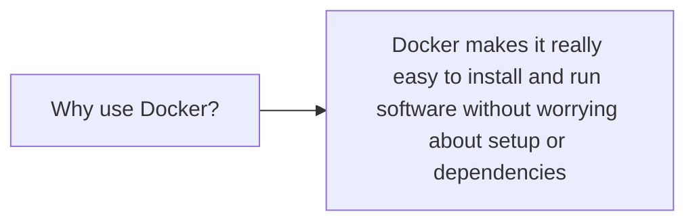

---

### What is Docker?

Docker is a platform and ecosystem built around **creating and running containers**.

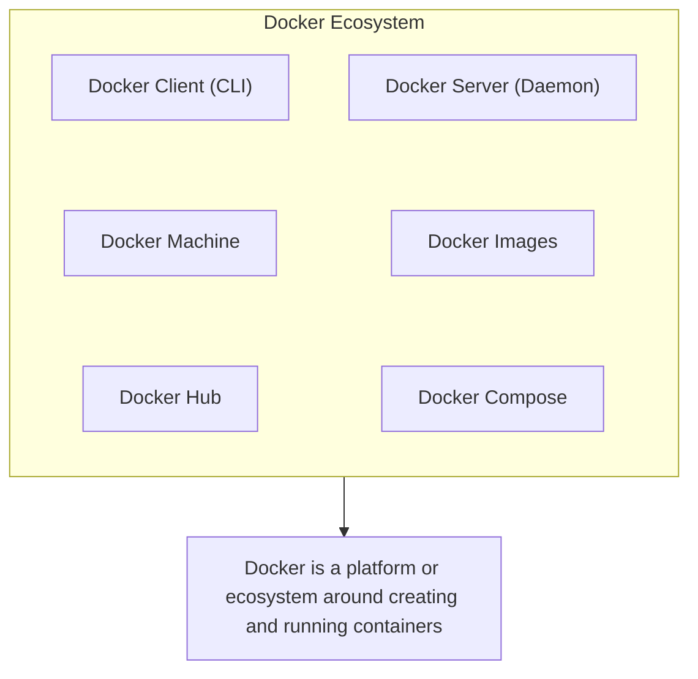

* **Docker Client (CLI):** The command-line interface tool you type `docker` commands into, which sends requests to the Docker Server.
* **Docker Server (Daemon):** The background service (`dockerd`) responsible for building images, running containers, and managing local Docker objects.
* **Docker Machine:** A tool that provisions and manages virtual hosts with the Docker Engine installed (historically used to run Docker on non-Linux hosts or remote cloud VMs).
* **Docker Images:** Read-only blueprint files containing the filesystem snapshot, dependencies, and startup command needed to create a container.
* **Docker Hub:** The default public cloud registry for finding, pulling, and sharing container images.
* **Docker Compose:** A tool for defining and running multi-container applications declaratively using a single YAML configuration file.

---

### What is a Container?

A **Docker container** is a lightweight, standalone, executable package of software that includes everything needed to run an application: code, runtime, system tools, system libraries, and settings. It packages an application and its dependencies together, making it easier to create, deploy, and run applications consistently anywhere.

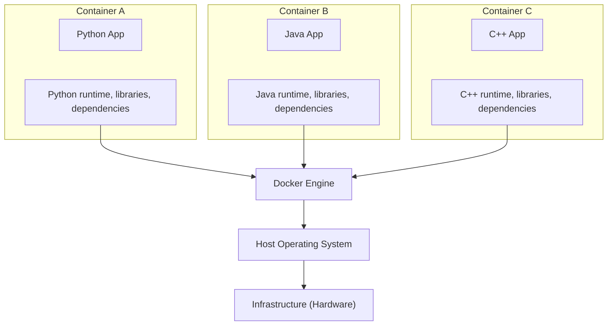

---

### What is an Image?

* An **Image** is a single file (template/snapshot) containing a **File System snapshot** plus a **Startup Command** — everything required to run an application.
* A **Container** is a running instance of an Image. *(How an image becomes a container is covered in [Section 3](#what-happens-behind-the-scenes-when-creating-a-container-from-an-image).)*

---

### What is Docker Desktop?

Docker relies on Linux kernel features, so it runs natively only on **Linux**. **Docker Desktop** makes it work on Windows and macOS by:
1. Creating a lightweight **Linux VM** on your host OS. *(Why a VM is needed is explained in [How Docker Runs on macOS and Windows](#how-docker-runs-on-macos-and-windows).)*
2. Forwarding `docker` CLI commands from the host OS to the Docker Daemon running inside that VM — so it *appears* Docker runs natively.

Docker Desktop also bundles the **Docker Client (CLI)** and **Docker Server (Daemon)** in a single application — we interact with the CLI, and the CLI communicates with the Daemon:

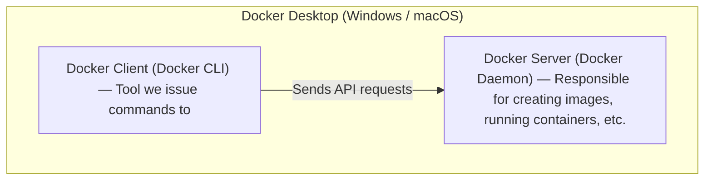

---

## 2. What Happens When You Run a Docker Command

When you run your first command in the Docker CLI:

```bash
docker run hello-world
```

The flow behind the scenes is:

1. **Docker CLI (Client)** sends the request to the **Docker Daemon (Server)**.
2. **Docker Daemon** checks whether the **Local Image Cache** already contains the `hello-world` image.
3. If not found locally, the Daemon pulls the `hello-world` image from **Docker Hub** and stores it in the Local Image Cache.
4. The Daemon creates a new **Container** from the cached image and executes its startup command.

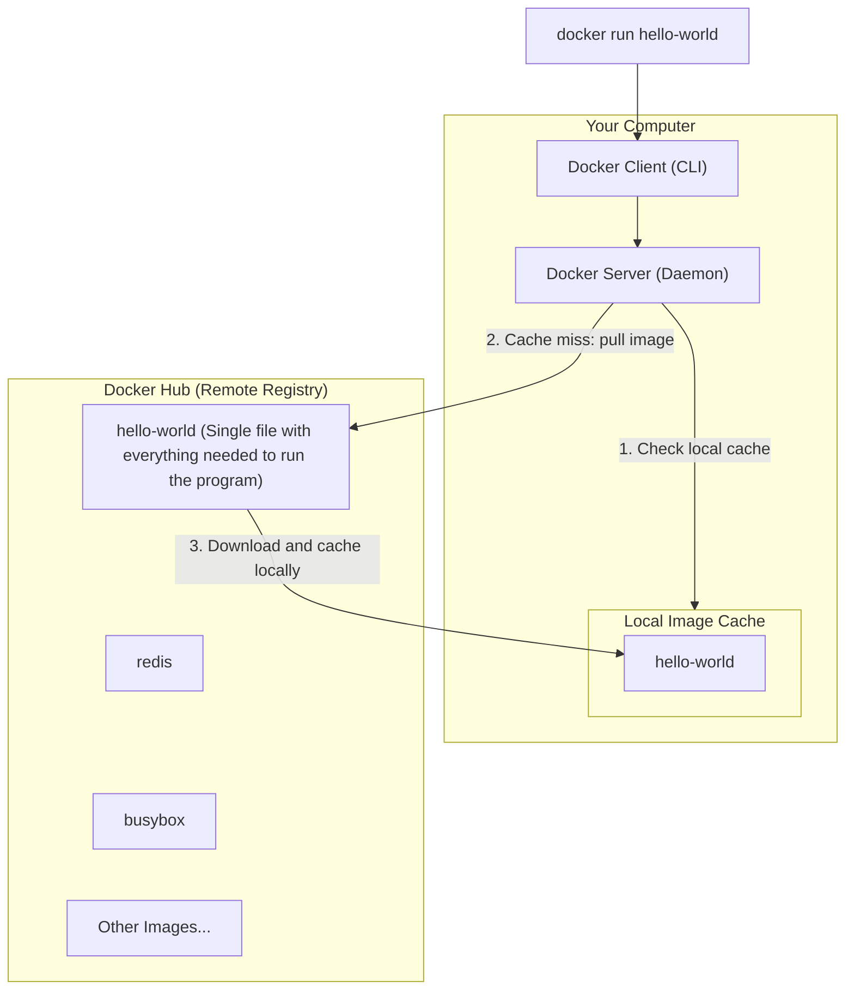

---

## 3. Container Internals

### How Your OS Works

* The **OS Kernel** is a core software process that governs access between all running processes on your computer and the physical hardware.
* **System Calls** are the kernel's exposed endpoints that running applications invoke whenever they need to interact with hardware (CPU, memory, disk, network).

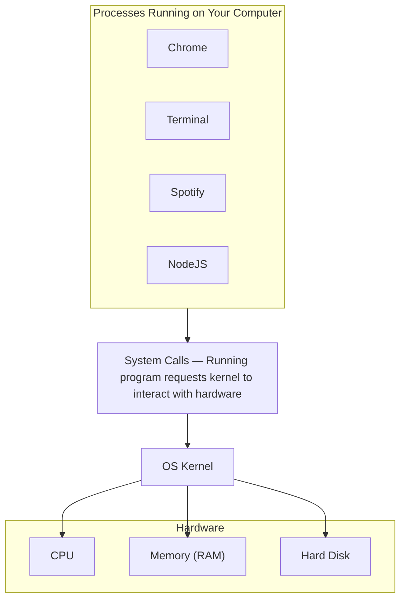

---

### Why Containers Are Better for Development

Suppose a hypothetical situation where **Chrome (App A)** needs **Python v2** and **NodeJS (App B)** needs **Python v3**, with the limitation that a standard OS filesystem normally expects one system installation at a time.

Linux solves this using two kernel primitives:

1. **Namespacing:** Isolates resources per process (or group of processes) so each process sees its own dedicated slice of the system (e.g., Chrome's process sees a hard disk segment containing Python v2, while NodeJS sees a segment containing Python v3).
2. **Control Groups (cgroups):** Limits the *amount* of hardware resources (memory, CPU, disk I/O, network bandwidth) a process can consume.

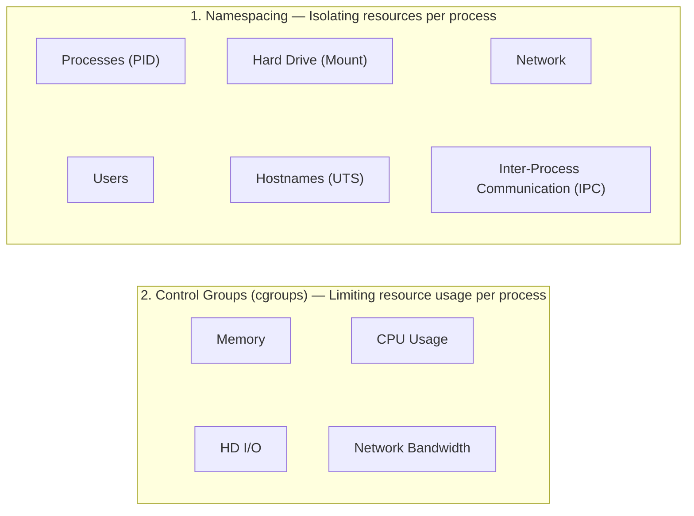

#### How Docker Runs on macOS and Windows

Because **Namespaces** and **cgroups** are **Linux-specific** kernel features, the Linux VM that [Docker Desktop](#what-is-docker-desktop) installs is what provides a real Linux Kernel for your containers:

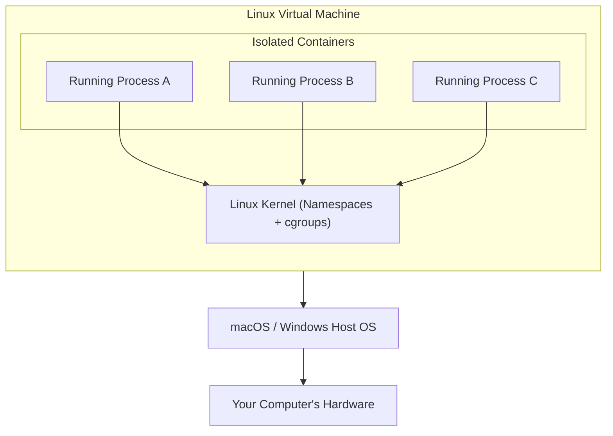

---

### Container Analogy & Mental Model

A **Container** is **not** a physical box—it is simply a running process (or group of processes) paired with an isolated, resource-limited slice of the host's hardware managed by the kernel.

#### Hard Disk Segmentation Analogy (Python v2 vs. Python v3)

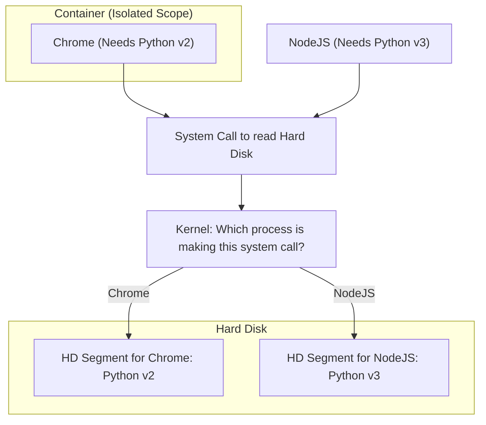

#### Simplified General Representation of a Container

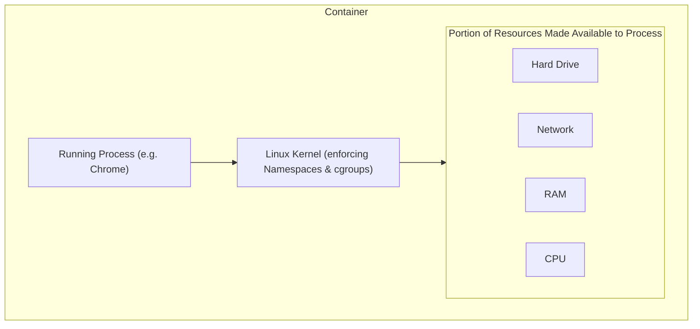

---

### What Happens Behind the Scenes When Creating a Container from an Image?

Recall the two parts of an [Image](#what-is-an-image):
* **FS Snapshot** — the required directories, binaries, and tools (e.g., Chrome, Python).
* **Startup Command** — the default command executed when the container starts (e.g., `Run Chrome`).

When you run the image:
1. The **Kernel** carves out an isolated set of resources (Namespaces + cgroups) for the container.
2. The **FS Snapshot** is mounted/placed into that container's isolated hard drive segment.
3. The **Startup Command** executes, launching the target process inside the container.

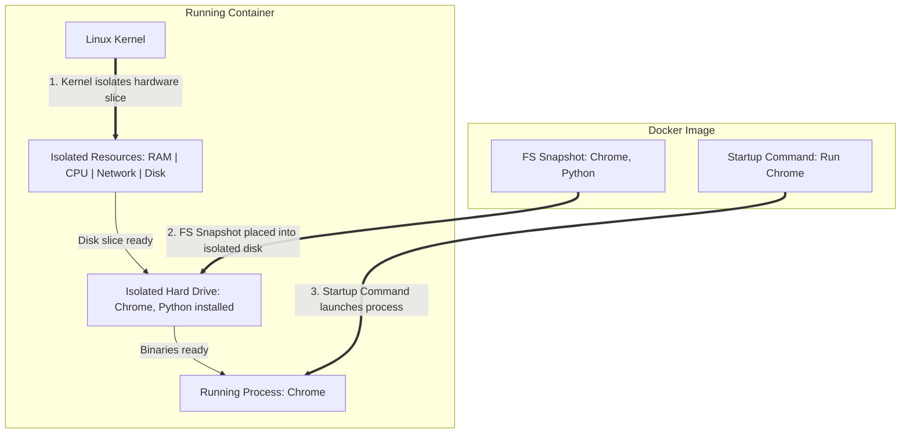

---

**Next:** [Part 2: Manipulating Containers with the Docker CLI →](./02-docker-cli-commands.md)
