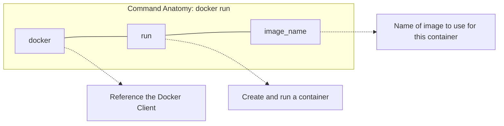
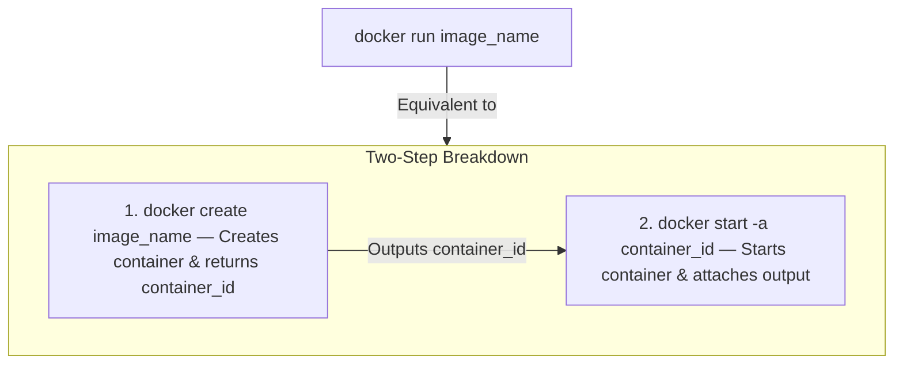
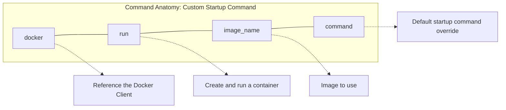
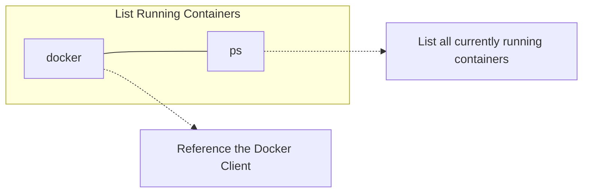
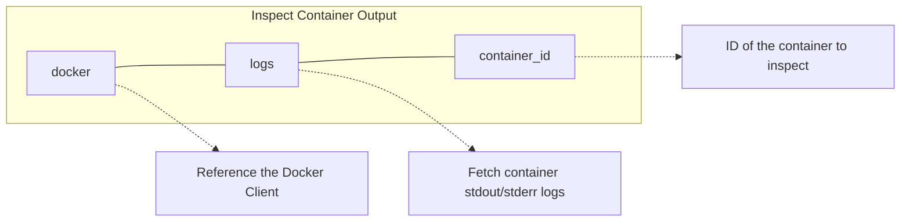
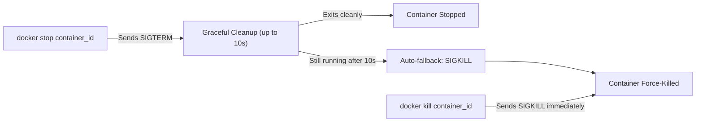
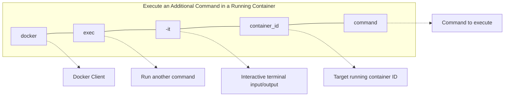
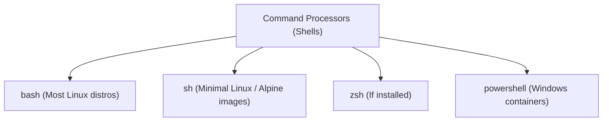

[back to Docker index](./dockercontent.md)
---

# Part 2: Manipulating Containers with the Docker CLI

## Table of Contents
1. [Creating and Running a Container from an Image](#1-creating-and-running-a-container-from-an-image)
2. [Overriding the Default Startup Command in an Image](#2-overriding-the-default-startup-command-in-an-image)
3. [Listing Containers](#3-listing-containers)
4. [Clearing Unused Local Resources](#4-clearing-unused-local-resources)
5. [Getting Logs from a Container](#5-getting-logs-from-a-container)
6. [Stopping Containers (`stop` vs. `kill`)](#6-stopping-containers-stop-vs-kill)
7. [Executing Commands Inside a Running Container](#7-executing-commands-inside-a-running-container)
8. [Getting Shell Access Inside a Running Container](#8-getting-shell-access-inside-a-running-container)

---

## 1. Creating and Running a Container from an Image

```bash
docker run <image_name>
```



Under the hood, `docker run` is a combination of **two separate commands**:
* `docker create <image_name>`: Creates a container from the image and outputs its `<container_id>`.
* `docker start -a <container_id>`: Starts the already-created container. **The `-a` flag attaches your terminal to the container's output stream (`stdout`/`stderr`).**



---

## 2. Overriding the Default Startup Command in an Image

```bash
docker run <image_name> <override_command>
```



* For this to succeed, the override command's executable (e.g., `ls`, `echo`) must exist inside the image's **File System (FS) snapshot**.
* You can also pass an override command to `docker create <image_name> <command>`.
* Once a container has been created (with or without a custom command), **its startup command cannot be modified later**.

---

## 3. Listing Containers

```bash
docker ps
```



* `docker ps --all` (or `docker ps -a`): Lists **all** containers ever created on this machine (including stopped/exited ones), not just the currently running ones.

---

## 4. Clearing Unused Local Resources

```bash
docker system prune
```

Running `docker system prune` prompts for confirmation before removing unused local resources:

```text
$ docker system prune
WARNING! This will remove:
  - all stopped containers
  - all networks not used by at least one container
  - all dangling images
  - all build cache

Are you sure you want to continue? [y/N]
```

What this clears:
1. **Stopped containers** — they will no longer appear in `docker ps --all`.
2. **Unused networks** — all networks not currently used by at least one container.
3. **Dangling images** — untagged/unused local image layers.
4. **Build cache** — you will need to re-download/rebuild layers next time.

---

## 5. Getting Logs from a Container

```bash
docker logs <container_id>
```



* Retrieves all output logs emitted by the container up to the current timestamp (add `-f` to follow/stream logs live).
* Very useful if a long-running process was started in the background (detached / without the `-a` flag).

---

## 6. Stopping Containers (`stop` vs. `kill`)

```bash
docker stop <container_id>
docker kill <container_id>
```

* **`docker stop`** sends a **`SIGTERM`** (terminate signal) to the container's primary process (PID 1), giving it time to clean up resources and shut down gracefully.
  * **Fallback behavior:** If the container does not stop within **10 seconds**, Docker automatically sends **`SIGKILL`** behind the scenes.
* **`docker kill`** immediately sends a **`SIGKILL`** (kill signal) to the primary process—stopping it instantly with **no cleanup allowed**.



---

## 7. Executing Commands Inside a Running Container

**Scenario:** You run a database server inside a container (e.g., Redis) and need to run its CLI inside that same container while the server keeps running.

```bash
docker exec -it <container_id> <command>
```



### What Does the `-it` Flag Do?
`-it` combines two flags that are almost always used together:
* **`-i` (interactive):** Attaches your terminal's `STDIN` to the executed process so you can type input into it.
* **`-t` (pseudo-TTY):** Allocates a pseudo-terminal for clean text formatting, prompts, and interactive control.

---

## 8. Getting Shell Access Inside a Running Container

Instead of running `docker exec` repeatedly for every single command, you can launch a **command processor (shell)** inside the running container:

```bash
docker exec -it <container_id> <command_processor>
```



* Because most Docker images are Linux-based, **`sh`** (always available on lightweight `alpine` images) and **`bash`** are your best bets (`powershell` is used for Windows containers).
* Once executed, you get full interactive shell access inside that running container until you type `exit`.
* **Shortcut on startup:** You can also launch directly into a shell when creating a container:
  ```bash
  docker run -it <image_name> sh
  ```

---

### How to Execute Commands Once Inside the Container Shell

Once `docker exec -it <container_id> sh` (or `bash`) runs, your terminal prompt changes (for example, from your host prompt `ankit@pc:~$` to `/ #` or `root@a1b2c3d4:/usr/app#`).

At this point, your terminal is wired directly into the shell running **inside the container's isolated Linux environment**:
* **Do NOT prefix commands with `docker` anymore**—just type normal Linux or application commands directly at the `/ #` prompt and press `Enter`, exactly as if you had SSH'd into a Linux server.
* You can only run binaries/commands that exist inside that container's **File System (FS) snapshot** (e.g., `ls`, `cd`, `cat`, `env`, `redis-cli`, `node`, `python`).

#### Step-by-Step Interactive Terminal Walkthrough

```bash
# 1. From your HOST terminal, open a shell inside a running Redis container:
ankit@pc:~$ docker exec -it a1b2c3d4 sh

# 2. Notice the prompt changed to '/ #' -> you are now INSIDE the container!
#    Run standard Linux commands directly:
/ # pwd
/ # ls -la
/ # any more commonly used linux commands 

# finally when done -> Exit the container shell to return to your host machine:
/ # exit
ankit@pc:~$
```

#### Crucial Difference When Exiting the Shell (`exec -it` vs. `run -it`)

* **If you entered via `docker exec -it <container_id> sh`:**
  * Your shell (`sh`) is a **secondary process** (e.g., PID 18), while your app/server is PID 1.
  * Typing `exit` (or `Ctrl + D`) **only closes your shell session**—the container itself **keeps running** in the background!
* **If you started the container via `docker run -it <image_name> sh`:**
  * The shell (`sh`) **is the primary process (PID 1)** of that container.
  * Typing `exit` (or `Ctrl + D`) terminates PID 1 and **stops the container completely**. *(Tip: To detach from a `docker run -it` shell without stopping the container, press **`Ctrl + P` followed by `Ctrl + Q`**.)*

---

**Next:** [Part 3: Dockerfiles & Building Custom Images →](./03-dockerfiles-and-custom-images.md)
