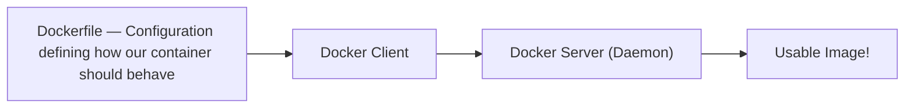
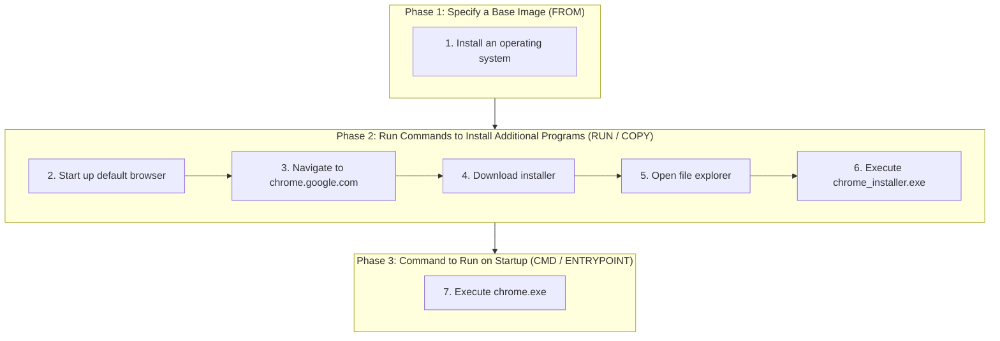
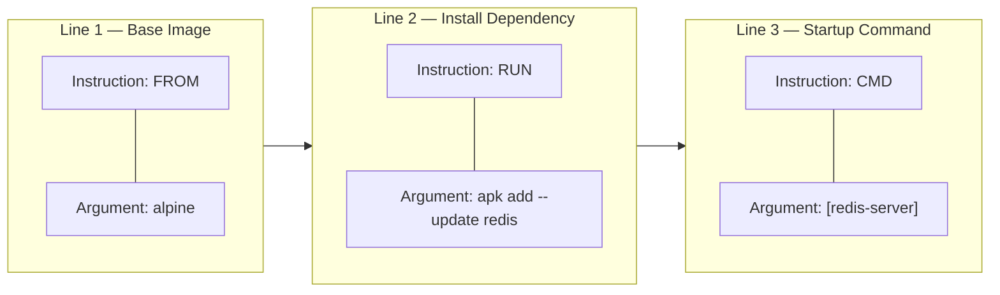
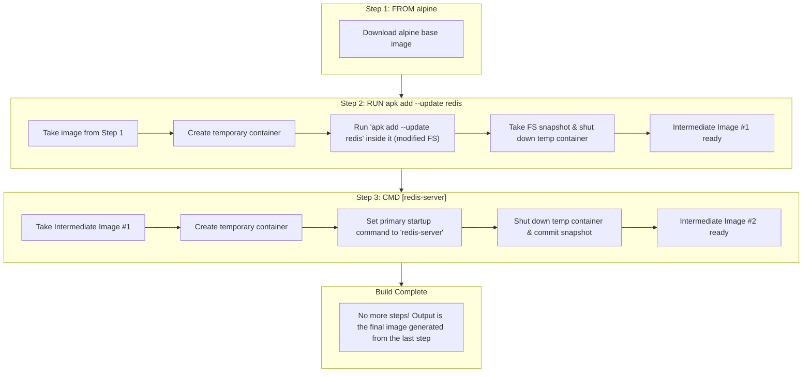
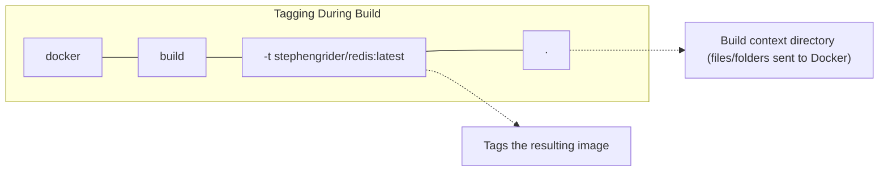
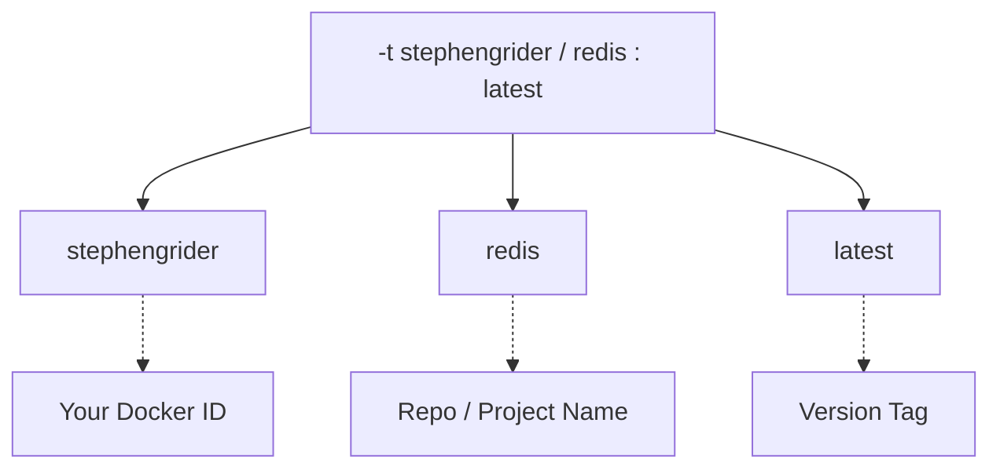
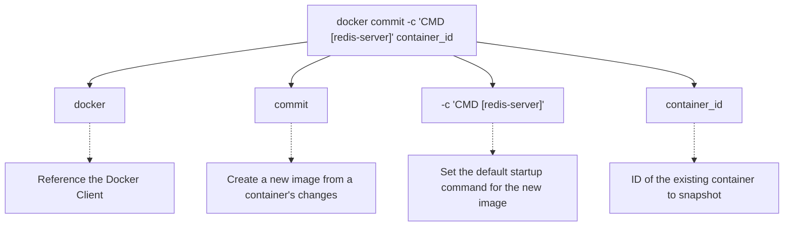
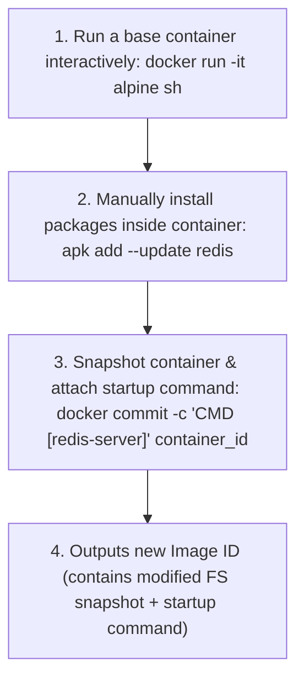

[back to Docker index](./dockercontent.md)
---

# Part 3: Dockerfiles & Building Custom Images

## Table of Contents
1. [What is a Dockerfile?](#1-what-is-a-dockerfile)
2. [Writing a Dockerfile (The Analogy)](#2-writing-a-dockerfile-the-analogy)
3. [Anatomy of a Dockerfile & Common Instructions](#3-anatomy-of-a-dockerfile--common-instructions)
4. [What Happens Inside `docker build .`?](#4-what-happens-inside-docker-build-)
5. [Building, Running & Tagging an Image](#5-building-running--tagging-an-image)
6. [Creating an Image from a Running Container](#6-creating-an-image-from-a-running-container)

---

## 1. What is a Dockerfile?

A **Dockerfile** is a plain text file containing a series of instructions that the Docker Daemon (Server) follows step by step to build an image. Think of it as your blueprint for constructing a containerized application.



---

## 2. Writing a Dockerfile (The Analogy)


Think about every step you would have to perform to install Chrome on a brand-new computer with no operating system—each group of steps maps directly to one of the **three phases of every Dockerfile**, which Docker executes line by line, in order:



---

## 3. Anatomy of a Dockerfile & Common Instructions

The default filename is `Dockerfile`. Each line consists of an **instruction** (in ALL CAPS, telling the Docker Server what to do) followed by its **argument**:



```dockerfile
FROM alpine                  # Lightweight Alpine Linux base image
RUN apk add --update redis   # Runs while BUILDING the image (install packages)
CMD ["redis-server"]         # Default startup command for containers from this image
```

### Common Instructions

| Instruction | Purpose |
| :--- | :--- |
| **`FROM`** | The first instruction—specifies the base image you are building upon (e.g., `FROM ubuntu:20.04`). Every Dockerfile starts with this. |
| **`RUN`** | Executes commands during the **build process** (installing packages, compiling code, setting up dependencies). |
| **`COPY` / `ADD`** | Copies files from your local machine (build context) into the image. |
| **`WORKDIR`** | Sets the working directory inside the container for subsequent instructions. |
| **`ENV`** | Sets environment variables inside the image/container. |
| **`EXPOSE`** | Documents which network ports the application listens on. |
| **`CMD` / `ENTRYPOINT`** | Defines the default startup command executed when a container starts from this image. |

A slightly fuller example using more of these instructions:

```dockerfile
FROM python:3.9                     # Official Python base image
WORKDIR /app                        # Set the working directory
COPY . .                            # Copy build context into the image
RUN pip install -r requirements.txt # Install dependencies
CMD ["python", "app.py"]            # Startup command
```

---

## 4. What Happens Inside `docker build .`?

Each instruction runs against a **temporary container** built from the previous step's intermediate image, takes a snapshot, shuts down the temporary container, and passes the new intermediate image forward. Every instruction therefore produces a new read-only **layer**:



### Build Layer Caching
* Docker caches each intermediate image (layer) produced between steps to drastically speed up rebuilds.
* If an instruction (and everything above it) has not changed, Docker **reuses the cached layer** instead of re-downloading or re-installing packages.
* Modifying an instruction or changing the order invalidates the cache for that step **and every step below it**. *(See [Part 4](./04-real-world-node-project.md#4-optimizing-performance-with-build-caching) for how to order instructions to exploit this.)*
* Common base layers are also shared across different images, saving disk space.

---

## 5. Building, Running & Tagging an Image

```bash
docker build .              # Build -> outputs an image ID
docker run <image_id>       # Run a container from it
```

> Modern Docker Desktop has **BuildKit** enabled by default, which produces `sha256`-based image IDs (`sha256:<image_id>`).

Instead of referencing random hex `image_id` hashes, **tag** your image with a human-readable name using `-t`:

```bash
docker build -t <docker_user_id>/<project_name>:<version> .
# Example:
docker build -t stephengrider/redis:latest .
docker run stephengrider/redis
```



### Image Tag Naming Convention



---

## 6. Creating an Image from a Running Container

The image ↔ container relationship works in both directions: you can snapshot a modified container back into a new image using `docker commit`:

```bash
docker commit -c 'CMD ["redis-server"]' <container_id>
```

### Command Breakdown: `docker commit`



### How It Works Step-by-Step



This outputs a new `image_id` containing the container's current file system state and specified startup command, ready to be run via `docker run <new_image_id>`.

---

**Next:** [Part 4: Real-World Docker Project (Node.js Web Server) →](./04-real-world-node-project.md)
