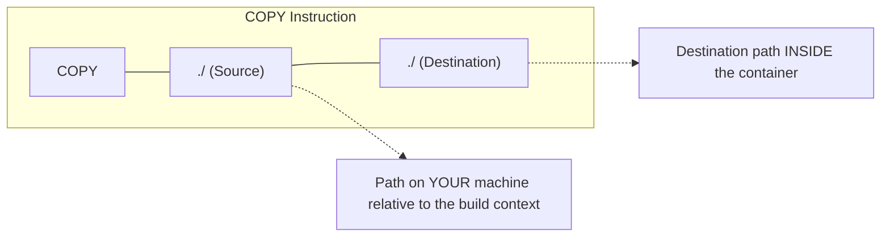
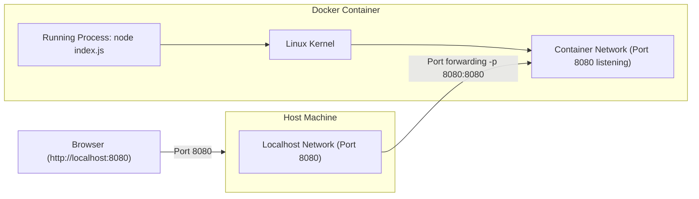
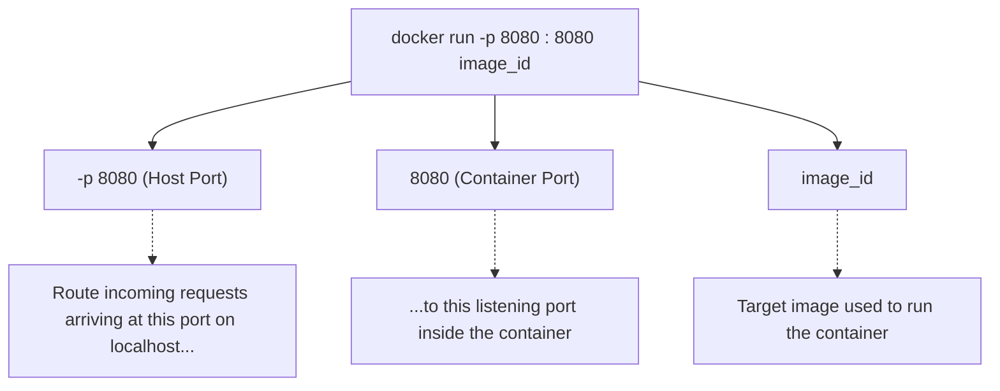
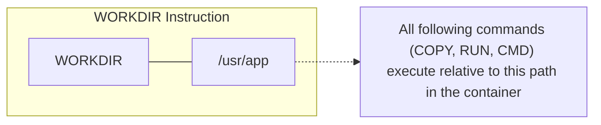
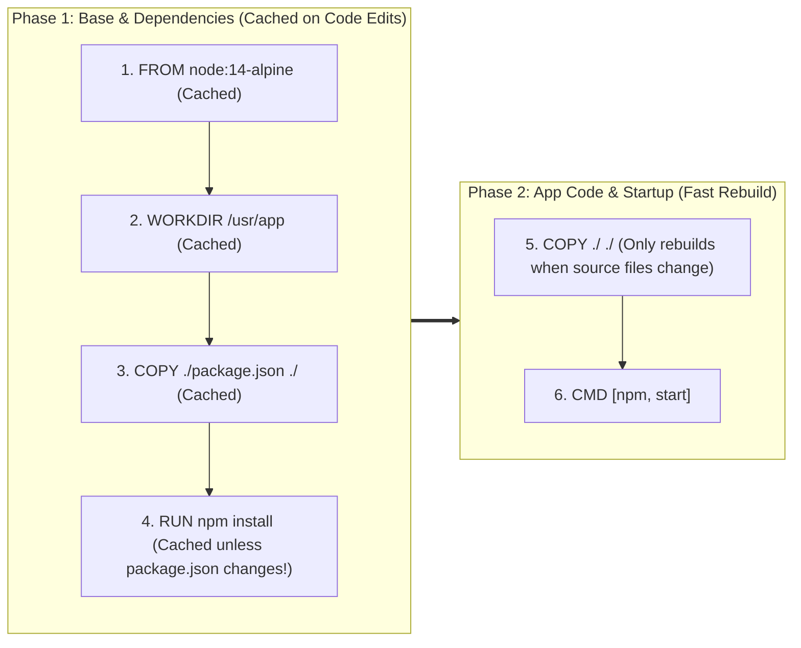

[back to Docker index](./dockercontent.md)
---

# Part 4: Real-World Docker Project (Node.js Web Server)

## Table of Contents
1. [Initial `Dockerfile` & The `COPY` Instruction](#1-initial-dockerfile--the-copy-instruction)
2. [Port Mapping for Incoming Traffic](#2-port-mapping-for-incoming-traffic)
3. [Setting the Working Directory (`WORKDIR`)](#3-setting-the-working-directory-workdir)
4. [Optimizing Performance with Build Caching](#4-optimizing-performance-with-build-caching)

---

## 1. Initial `Dockerfile` & The `COPY` Instruction

Goal: Containerize a simple Node.js web server that returns a `hi` message at the root URL (`/`).

```dockerfile
# Use a base image that comes with Node and npm pre-installed.
# Anything with 'alpine' in Docker means the lightest possible minimal Linux image.
FROM node:14-alpine

# Copy files from the local build context into the temporary build container
# so that 'npm install' has access to package.json.
COPY ./ ./

# Install required Node dependencies
RUN npm install

# Default startup command for the container
CMD ["npm", "start"]
```

### Anatomy of `COPY`



---

## 2. Port Mapping for Incoming Traffic

Container networking follows two key rules:
* **Outbound traffic:** A container can reach the outside world effortlessly by default.
* **Inbound traffic:** Incoming requests from the outside world arrive at your **host machine** first. You must explicitly configure **port mapping** so Docker forwards traffic from a host port to the container's listening port (e.g., `8080`).



### Port Mapping Command Syntax

```bash
docker run -p <port_on_host>:<port_in_container> <image_id>
# Example (host port and container port do not need to match):
docker run -p 8080:8080 <image_id>
```



---

## 3. Setting the Working Directory (`WORKDIR`)

Use the `WORKDIR` instruction right after `FROM` to isolate your application files in a dedicated folder (e.g., `/usr/app`) instead of dumping them into the container's root directory `/` where they could overwrite OS files.



Updated `Dockerfile`:

```dockerfile
FROM node:14-alpine

WORKDIR /usr/app

COPY ./ ./

RUN npm install

CMD ["npm", "start"]
```

---

## 4. Optimizing Performance with Build Caching

In the `Dockerfile` above, `COPY ./ ./` runs *before* `RUN npm install`. That means editing **any** single application source file invalidates the `COPY` layer cache—forcing `RUN npm install` to re-download all dependencies from scratch on every build!

**Solution:** Copy only `package.json` first, run `npm install`, and copy the rest of your source code *afterward*:



Optimized `Dockerfile`:

```dockerfile
FROM node:14-alpine

WORKDIR /usr/app

# Copy only dependency manifest first to maximize build cache hits
COPY ./package.json ./
RUN npm install

# Copy remaining source files after dependencies are installed
COPY ./ ./

CMD ["npm", "start"]
```

---

**Next:** [Part 5: Docker Compose & Multi-Container Applications →](./05-docker-compose-multi-container.md)
