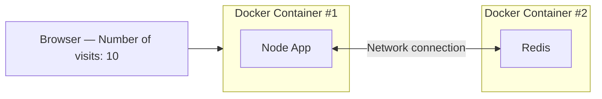
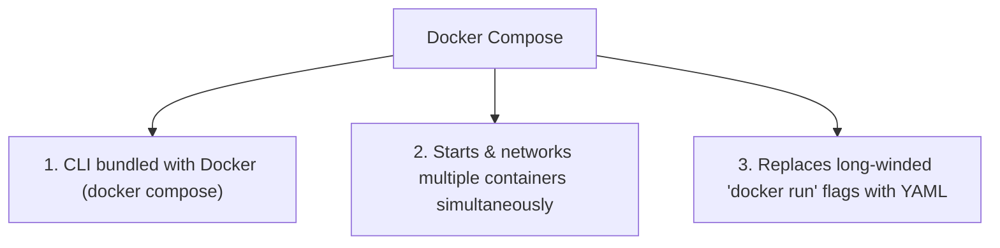
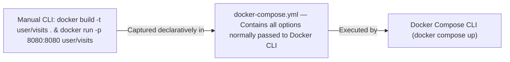
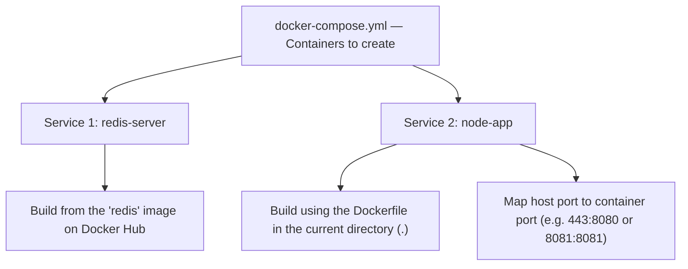
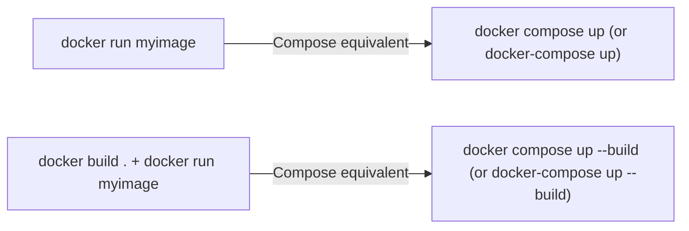

[back to Docker index](./dockercontent.md)
---

# Part 5: Docker Compose & Multi-Container Applications

## Table of Contents
1. [The Visit-Counter Application](#1-the-visit-counter-application)
2. [The Connectivity Challenge & Why Docker Compose](#2-the-connectivity-challenge--why-docker-compose)
3. [Structure of `docker-compose.yml`](#3-structure-of-docker-composeyml)
4. [`docker run` vs. Docker Compose Commands](#4-docker-run-vs-docker-compose-commands)

---

## 1. The Visit-Counter Application

Goal: Build a web application that displays the total number of visits the web page has received so far.


Instead of storing the visit count in memory inside the Node application (which breaks if you scale or restart Node), we isolate the Node web server and the Redis data store into **two separate containers**:



---

## 2. The Connectivity Challenge & Why Docker Compose

How do you start and connect multiple separate containers so they can talk to each other cleanly?

* **Using raw `docker` CLI commands:** Tedious, verbose, and error-prone (manually creating networks, starting each container with long flags, port mappings, and restart policies).
* **Using Docker Compose:** Works out of the box—you declare all services in one YAML file, and Compose automatically starts them together on a shared local network where they can reach each other **by service name**.



### How Compose Replaces Manual CLI Commands



---

## 3. Structure of `docker-compose.yml`

Think of `docker-compose.yml` as telling Docker: *"Here are the containers (services) I want created and wired together:"*



### Example `docker-compose.yml`

```yaml
version: '3'               # (Note: optional/deprecated in modern Compose V2)
services:                  # Each entry defines one containerized service
  redis-server:            # Service 1: stores the visitor count
    image: 'redis'         # Pull official redis image from Docker Hub
  node-app:                # Service 2: Node HTTP server
    build: .               # Build image using Dockerfile in current directory
    ports:
      - "443:8080"         # Map host port 443 -> container port 8080
```

Inside `node-app`, the Redis client simply connects to host **`redis-server`** — Compose's built-in DNS resolves the service name to the right container.

> **Modern Update:** See [Part 6: Modern Docker Compose (V2)](./06-production-docker-and-internals.md#5-modern-docker-compose-v2-for-multi-container-apps) for `compose.yaml` features like `healthcheck`, `depends_on`, named `volumes`, custom `networks`, and `.env` files.

---

## 4. `docker run` vs. Docker Compose Commands



| Single-Container Docker CLI | Docker Compose Equivalent | Purpose |
| :--- | :--- | :--- |
| `docker run myimage` | `docker compose up` | Start all services defined in `docker-compose.yml` |
| `docker build . && docker run myimage` | `docker compose up --build` | Rebuild local images and start all services |
| `docker stop ...` / `docker rm ...` | `docker compose down` | Stop and remove all containers & default network |

---

**Next:** [Part 6: Production Docker, Networking, Storage & The Bridge to Kubernetes →](./06-production-docker-and-internals.md)
