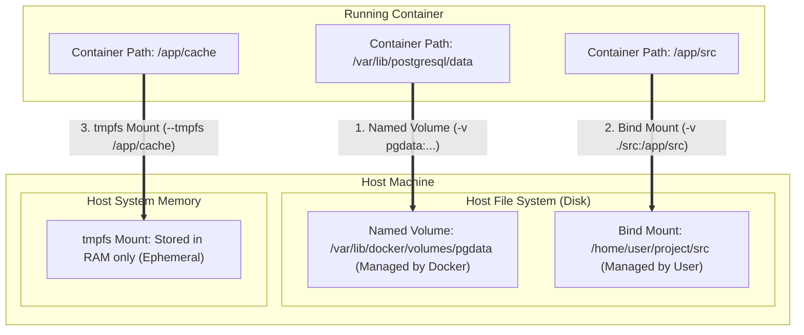
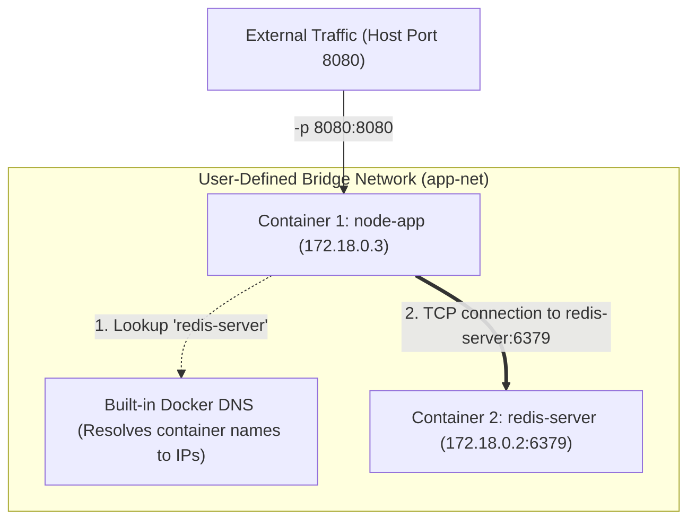
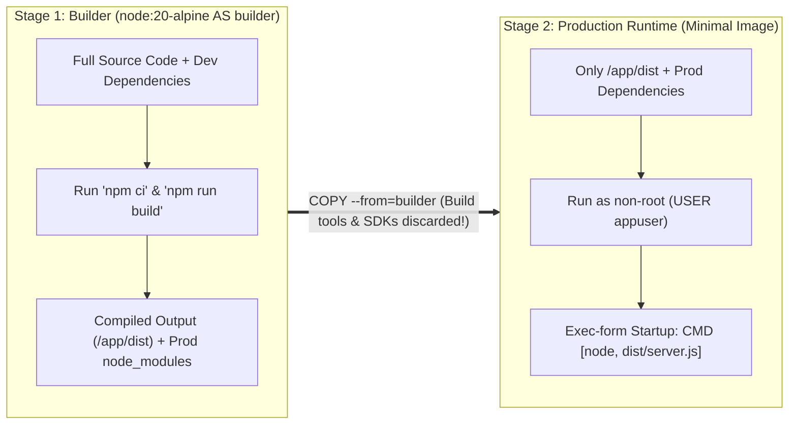
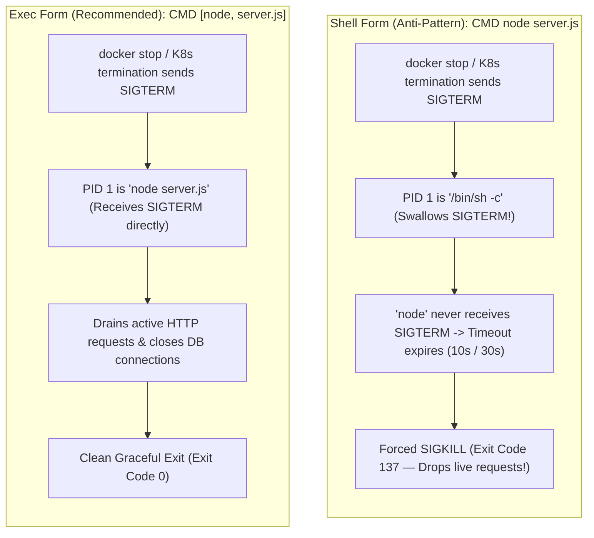
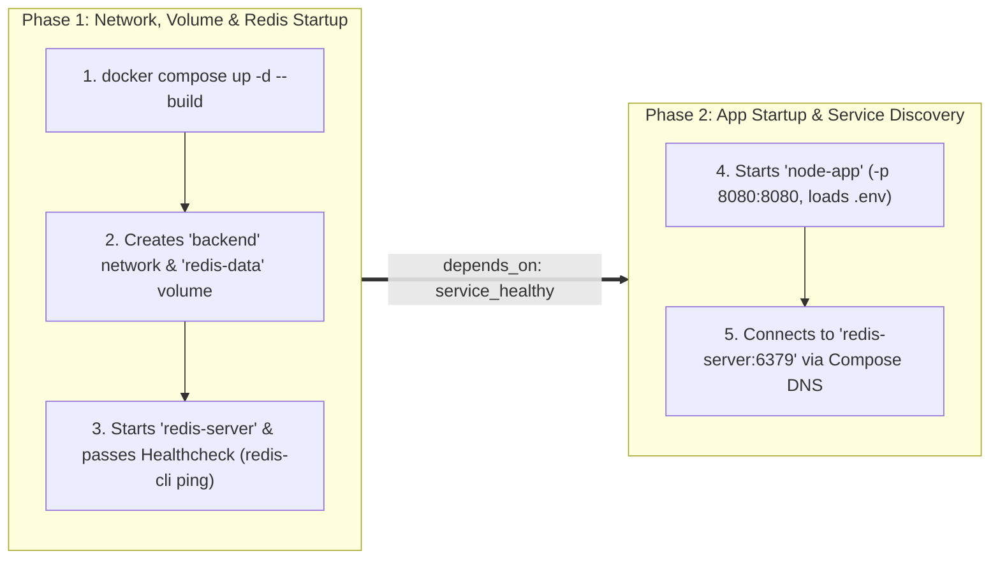
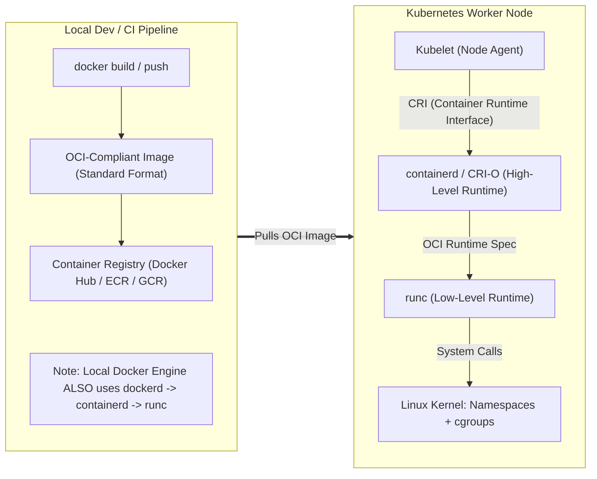

[back to Docker index](./dockercontent.md)
---

# Part 6: Production Docker, Networking, Storage & The Bridge to Kubernetes

> This section fills the critical production gaps between local Docker basics (`docker run` / basic `docker-compose`) and running containerized workloads in Kubernetes clusters.

## Table of Contents
1. [Docker Storage: Volumes, Bind Mounts & `tmpfs`](#1-docker-storage-volumes-bind-mounts--tmpfs)
2. [Docker Networking Deep Dive](#2-docker-networking-deep-dive)
3. [Production `Dockerfile` Best Practices](#3-production-dockerfile-best-practices)
4. [The PID 1 & `SIGTERM` Gotcha (`CMD` vs `ENTRYPOINT`)](#4-the-pid-1--sigterm-gotcha-cmd-vs-entrypoint)
5. [Modern Docker Compose (V2) for Multi-Container Apps](#5-modern-docker-compose-v2-for-multi-container-apps)
6. [Container Runtime Internals: OCI, `containerd`, `runc` & The Bridge to Kubernetes](#6-container-runtime-internals-oci-containerd-runc--the-bridge-to-kubernetes)

---

## 1. Docker Storage: Volumes, Bind Mounts & `tmpfs`

By default, every file created inside a container lives in a **writable container layer** (Copy-on-Write filesystem). **When the container is deleted, all data inside that layer is permanently lost.**

Docker provides three storage mechanisms to persist or share data outside the container's lifecycle:

| Storage Type | Where Data Lives | Managed By | Best Use Case |
| :--- | :--- | :--- | :--- |
| **Named Volume** (`-v pgdata:/var/lib/postgresql/data`) | Docker storage area (`/var/lib/docker/volumes/`) | Docker Daemon | **Production & local databases**, persistent app state, sharing data across containers. Independent of host folder structure. |
| **Bind Mount** (`-v $(pwd)/src:/app/src`) | Specific path on the host filesystem | User / Host OS | **Local development hot-reloading** (edit code on host, immediately reflected in container), injecting host config files. |
| **`tmpfs` Mount** (`--tmpfs /app/cache`) | Host system **RAM** (never written to disk) | Host Kernel | **Sensitive temporary secrets**, ephemeral high-speed caches, non-persistent scratch space. Linux only. |



### Essential Volume Commands

```bash
# Create and inspect a named volume
docker volume create app-data
docker volume ls
docker volume inspect app-data

# Run Postgres with a named volume (data survives container deletion)
docker run -d --name postgres \
  -e POSTGRES_PASSWORD=secret \
  -v app-data:/var/lib/postgresql/data \
  postgres:16-alpine

# Run a local dev container with a bind mount (read-only option with :ro)
docker run -it -v "$(pwd):/usr/app" -v /usr/app/node_modules node:20-alpine sh

# Clean up unused volumes (NOT removed by default `docker system prune`)
docker volume prune
```

> **Kubernetes Parallel:** Docker **Volumes** evolve into Kubernetes **Persistent Volumes (PV)** and **Persistent Volume Claims (PVC)**, while ephemeral shared scratch space (`tmpfs` / anonymous volumes) maps to Kubernetes **`emptyDir`** volumes.

---

## 2. Docker Networking Deep Dive

Earlier notes covered `-p host_port:container_port` (publishing a port to the host). Under the hood, Docker supports several **network drivers** that govern how containers communicate with each other and the outside world:

| Network Driver | How It Works | DNS Discovery? | When to Use |
| :--- | :--- | :--- | :--- |
| **Default `bridge`** | Containers attach to `docker0` virtual bridge and get private IPs (`172.17.0.x`). | **No** (must use IP addresses or deprecated `--link`) | Standalone one-off containers. |
| **User-Defined `bridge`** | Isolated virtual bridge network created via `docker network create`. | **Yes!** Built-in Docker DNS resolves containers by **container/service name**. | **Standard choice** for multi-container apps on a single host (automatically created by Docker Compose). |
| **`host`** | Container shares the host's network namespace directly (no NAT, no `-p` needed). | Uses host networking | Ultra-low-latency networking or network monitoring tools (Linux only). |
| **`none`** | Disables all networking inside the container (loopback `lo` only). | No | Batch jobs or security-isolated processing with zero network access. |
| **`overlay`** | Multi-host virtual network spanning multiple Docker daemons (Docker Swarm). | Yes | Multi-host Swarm clusters (largely superseded by Kubernetes CNI plugins like Calico/Cilium). |

### User-Defined Bridge Example



```bash
# 1. Create an isolated user-defined bridge network
docker network create app-net

# 2. Start Redis on that network
docker run -d --name redis-server --network app-net redis:7-alpine

# 3. Start your app on the SAME network -> can connect directly to `redis-server:6379`!
docker run -d --name node-app --network app-net -p 8080:8080 my-node-app
```

> **Kubernetes Parallel:** Every Kubernetes Pod gets its own routable IP across the entire cluster via a **CNI (Container Network Interface)** plugin, and **CoreDNS** + **Services** provide cluster-wide service discovery by name.

---

## 3. Production `Dockerfile` Best Practices

Writing a Dockerfile that *works locally* is easy; writing one that is **small, fast to build, secure, and Kubernetes-ready** requires specific practices:

### A. Multi-Stage Builds (Massive Size & Security Win)
Never ship compilers, SDKs (`maven`, `gcc`, `go`, `npm` devDependencies), or build tools into production images. Use **multi-stage builds** to compile in one stage and copy *only* the final artifact into a minimal runtime image (`alpine` or Google `distroless`).



```dockerfile
# ---------- Stage 1: Builder ----------
FROM node:20-alpine AS builder
WORKDIR /app

# Leverage layer caching: copy dependency manifests first
COPY package.json package-lock.json ./
RUN npm ci

# Copy source and build production bundle
COPY . .
RUN npm run build && npm prune --omit=dev

# ---------- Stage 2: Production Runtime ----------
FROM node:20-alpine AS runtime
WORKDIR /app

# Create and switch to a non-root user (NEVER run prod containers as root)
RUN addgroup -S appgroup && adduser -S appuser -G appgroup

# Copy ONLY compiled output and production dependencies from Stage 1
COPY --from=builder --chown=appuser:appgroup /app/dist ./dist
COPY --from=builder --chown=appuser:appgroup /app/node_modules ./node_modules
COPY --from=builder --chown=appuser:appgroup /app/package.json ./

USER appuser
EXPOSE 8080

# Use exec form (JSON array) so Node runs as PID 1 and receives SIGTERM cleanly
CMD ["node", "distroless-or-dist/server.js"]
```

### B. `.dockerignore` (Mandatory in Every Project)
Before building, the Docker CLI sends the entire **build context** (`.`) to the Docker daemon. Always include a `.dockerignore` file to prevent slow builds, cache invalidation, and accidental secret leaks:

```text
.git
.env
.env.*
node_modules
dist
build
*.log
Dockerfile
docker-compose*.yml
.vscode
```

### C. `COPY` vs `ADD`
* **`COPY`**: Transparently copies local files/directories into the image. **Prefer `COPY` 99% of the time.**
* **`ADD`**: Does everything `COPY` does, *plus* automatically extracts local `.tar` archives and can fetch remote URLs (which hurts caching and security). Only use `ADD` when you explicitly want automatic local tarball extraction.

### D. Pin Image Versions & Use Digests in Production
* **Avoid `:latest`** in production—it is mutable and can silently break deployments across nodes.
* Pin explicit semantic versions (`node:20.18-alpine`) or **immutable SHA-256 digests** (`booking:2.4.0@sha256:7b5c19d...`) so every Kubernetes node runs the exact same byte-for-byte image.

### E. Image Security Hygiene
* **Run as non-root (`USER`)**: If an attacker exploits your app, running as `root` inside the container drastically increases container-escape blast radius (and Kubernetes **Pod Security Standards: `Restricted`** will reject root containers).
* **Minimize attack surface**: Use `alpine`, `slim`, or `distroless` base images (distroless has no shell `sh`/`bash` or package manager `apt`/`apk`).
* **Never bake secrets into `ENV` or `ARG` layers**: Every layer is inspectable via `docker history`. Inject secrets at runtime (environment variables from a secret manager, or mounted Kubernetes Secrets).
* **Scan images in CI**: Use tools like **Trivy**, **Grype**, or **Docker Scout** to catch CVEs before pushing to a registry.

---

## 4. The PID 1 & `SIGTERM` Gotcha (`CMD` vs `ENTRYPOINT`)

Understanding `CMD`, `ENTRYPOINT`, and **exec form vs shell form** directly affects whether `docker stop` and **Kubernetes Graceful Shutdown** work properly!

### `ENTRYPOINT` vs `CMD`
* **`ENTRYPOINT`**: Defines the fixed executable the container always runs. Arguments passed to `docker run <image> <args>` are *appended* to `ENTRYPOINT`.
* **`CMD`**: Provides default arguments to `ENTRYPOINT`, *or* sets the default command if no `ENTRYPOINT` is defined. Easily overridden at runtime (`docker run <image> <override>`).

### Exec Form vs Shell Form (CRITICAL FOR GRACEFUL SHUTDOWN)

| Form | Syntax | What Runs as PID 1? | Receives `SIGTERM`? |
| :--- | :--- | :--- | :--- |
| **Exec Form (Recommended)** | `CMD ["node", "server.js"]` | `node server.js` | **Yes!** App receives `SIGTERM`, drains in-flight requests, and exits cleanly. |
| **Shell Form (Anti-pattern)** | `CMD node server.js` | `/bin/sh -c "node server.js"` | **No!** `/bin/sh` swallows `SIGTERM` and does NOT forward it to `node`. Docker waits 10s (Kubernetes waits 30s) and brutally sends `SIGKILL` (Exit Code 137), dropping live user traffic! |



---

## 5. Modern Docker Compose (V2) for Multi-Container Apps

Docker Compose evolved significantly since Compose V1:
* **CLI command**: Use `docker compose` (space, built into Docker CLI V2) instead of the legacy standalone `docker-compose` (hyphen).
* **Top-level `version:` key is deprecated**: Compose Specification no longer requires `version: '3'`.
* **Production-grade local setups** use `healthcheck`, `depends_on` with `condition: service_healthy`, named `volumes`, explicit `networks`, `restart` policies, and `.env` files.

### Modern `compose.yaml` Example



```yaml
services:
  redis-server:
    image: redis:7-alpine
    restart: unless-stopped
    volumes:
      - redis-data:/data
    networks:
      - backend
    healthcheck:
      test: ["CMD", "redis-cli", "ping"]
      interval: 5s
      timeout: 3s
      retries: 5

  node-app:
    build:
      context: .
      dockerfile: Dockerfile
    restart: on-failure
    ports:
      - "8080:8080"
    environment:
      - REDIS_HOST=redis-server
      - REDIS_PORT=6379
    env_file:
      - .env
    depends_on:
      redis-server:
        condition: service_healthy   # Waits until Redis actually responds to PING!
    networks:
      - backend

volumes:
  redis-data:

networks:
  backend:
    driver: bridge
```

### Essential Compose Commands

| Command | Purpose |
| :--- | :--- |
| `docker compose up -d --build` | Build images and start all services in detached (background) mode |
| `docker compose ps` | List containers managed by this Compose project |
| `docker compose logs -f node-app` | Stream live logs for a specific service |
| `docker compose exec node-app sh` | Open a shell inside a running service container |
| `docker compose down` | Stop and remove containers + default network (preserves named volumes) |
| `docker compose down -v` | Stop and remove containers, networks, **AND named volumes** (wipes DB data!) |

### Where Docker Compose Stops (Why Kubernetes Exists)
Docker Compose is phenomenal for **local development and single-host setups**, but it runs on **one machine**. It cannot:
* Schedule containers across a fleet of servers.
* Self-heal when an entire physical/virtual host dies.
* Perform zero-downtime rolling updates across multiple Availability Zones.
* Autoscale pods and cluster nodes dynamically under a 500,000-user traffic surge.

That is where **Kubernetes** takes over.

---

## 6. Container Runtime Internals: OCI, `containerd`, `runc` & The Bridge to Kubernetes

A common point of confusion is: *"If I build images with Docker, why does Kubernetes say it uses `containerd` instead of Docker?"*

The answer lies in **open standards (OCI & CRI)** that decouple building images from running them:



* **OCI (Open Container Initiative)**: Standardizes the **image format** and **runtime spec**. Any image built by `docker build`, `podman`, or `kaniko` is an OCI image and runs identically on `containerd` or `CRI-O`.
* **CRI (Container Runtime Interface)**: The gRPC API Kubernetes' `kubelet` uses to talk to container runtimes.
* **Why Kubernetes removed `dockershim` (v1.24)**: Docker (`dockerd`) was a full developer platform sitting *on top of* `containerd`. Kubernetes didn't need Docker's CLI, Compose, or BuildKit on worker nodes—so `kubelet` now speaks directly to **`containerd`** (or **`CRI-O`**), which calls **`runc`** to create the Linux **Namespaces** and **cgroups** you learned about in [Section 1: Container Internals](./01-docker-basics-and-container-internals.md#3-container-internals).

---

**Next Topic:** Ready to scale containers across production clusters? → [The Complete Kubernetes Study Notes](../Kubernetes/kubernetes-content.md)

[← Back to Docker Index](./dockercontent.md) | [← Back to Main Notes README](../README.md)
