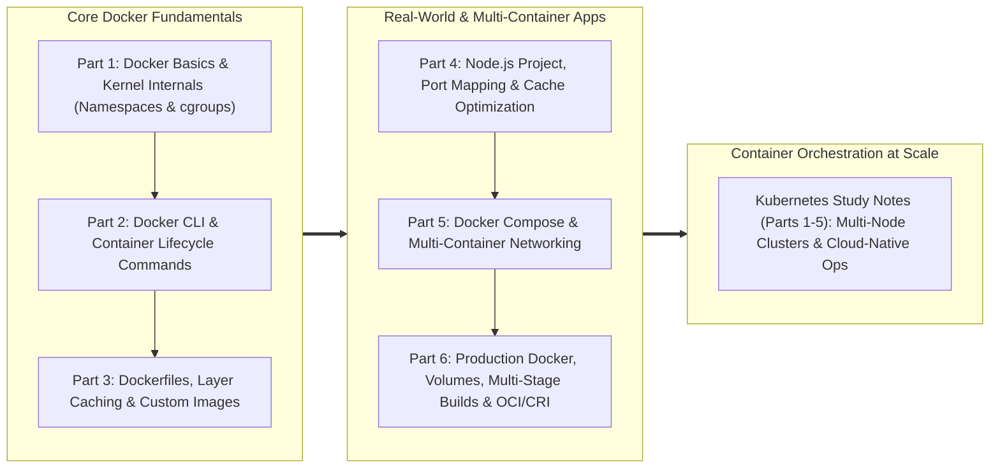

[back to previous file](../README.md)
---

# The Complete Docker Ecosystem Explained (Comprehensive Study Notes)

> A complete, end-to-end visual guide to **Docker & Containerization**—from Linux kernel primitives (**Namespaces** & **cgroups**), Docker CLI mechanics, and **Dockerfile** layer caching to multi-container **Docker Compose**, production multi-stage builds, volumes, networking, and the **OCI / `containerd` / CRI bridge to Kubernetes**.

---

## Navigation & Study Roadmap

| Part | File | Topics Covered |
| :--- | :--- | :--- |
| **Part 1** | [01: Docker Basics, Command Flow & Container Internals](./01-docker-basics-and-container-internals.md) | Why/What is Docker, Docker Ecosystem (`CLI`, `Daemon`, `Machine`, `Images`, `Hub`, `Compose`), Images vs. Containers, Docker Desktop (Linux VM on macOS/Windows), `docker run` command flow, OS Kernel & System Calls, Linux **Namespaces** & **Control Groups (`cgroups`)**, behind-the-scenes Image → Container instantiation |
| **Part 2** | [02: Manipulating Containers with the Docker CLI](./02-docker-cli-commands.md) | `docker run` (`docker create` + `docker start -a`), overriding default startup commands, `docker ps` / `docker ps --all`, `docker system prune`, `docker logs`, `docker stop` (`SIGTERM` → 10s → `SIGKILL`) vs. `docker kill` (`SIGKILL`), `docker exec -it`, interactive container shell access (`sh`/`bash`) & command execution walkthrough |
| **Part 3** | [03: Dockerfiles & Building Custom Images](./03-dockerfiles-and-custom-images.md) | What is a `Dockerfile`, OS + Chrome analogy, instruction anatomy (`FROM`, `RUN`, `COPY`, `ADD`, `WORKDIR`, `ENV`, `EXPOSE`, `CMD`, `ENTRYPOINT`), what happens inside `docker build .` (temporary intermediate containers & layer caching), image tagging (`-t user/repo:version`), `docker commit` |
| **Part 4** | [04: Real-World Docker Project (Node.js Web Server)](./04-real-world-node-project.md) | Containerizing a Node.js web server (`node:14-alpine`), `COPY` build context rules, host-to-container port forwarding (`-p 8080:8080`), isolating project files with `WORKDIR /usr/app`, optimizing rebuild speed by caching `package.json` + `npm install` before copying source code |
| **Part 5** | [05: Docker Compose & Multi-Container Applications](./05-docker-compose-multi-container.md) | Multi-container visit-counter architecture (Node.js + Redis), why raw CLI networking doesn't scale, declarative `docker-compose.yml` structure (`services`, `image`, `build`, `ports`), built-in service DNS discovery, `docker run` vs. `docker compose` commands |
| **Part 6** | [06: Production Docker, Networking, Storage & Bridge to Kubernetes](./06-production-docker-and-internals.md) | Docker Storage (`Named Volumes`, `Bind Mounts`, `tmpfs`), Docker Networking drivers (`bridge`, user-defined bridge DNS, `host`, `none`, `overlay`), Production `Dockerfile` practices (Multi-stage builds, `.dockerignore`, `COPY` vs. `ADD`, non-root `USER`, `@sha256` digests), PID 1 & `SIGTERM` (`CMD` vs. `ENTRYPOINT`, Exec Form vs. Shell Form), Modern Docker Compose V2 (`healthcheck`, `depends_on: service_healthy`), OCI / `containerd` / `runc` / CRI bridge to Kubernetes |
| **Next Step** | [The Complete Kubernetes Ecosystem (Parts 1–5)](../Kubernetes/kubernetes-content.md) | Multi-node container orchestration, Desired State & Control Loops, Pods, Deployments, Services, Gateway API, PV/PVC, Probes, HPA/Karpenter Autoscaling, RBAC & Security, Helm, GitOps, Observability & Troubleshooting |

---

## Essential Docker CLI Quick-Reference Cheatsheet

| Category | Command | Purpose |
| :--- | :--- | :--- |
| **Run & Lifecycle** | `docker run -p 8080:8080 <image>` | Create and start a container with host-to-container port mapping |
| **Run & Lifecycle** | `docker create <image>` / `docker start -a <id>` | Create a container first, then start it with output attached |
| **Run & Lifecycle** | `docker stop <id>` / `docker kill <id>` | Gracefully stop (`SIGTERM` → 10s → `SIGKILL`) or force-kill (`SIGKILL`) |
| **Inspect & Debug** | `docker ps` / `docker ps --all` | List running containers, or all containers ever created |
| **Inspect & Debug** | `docker logs -f <id>` | View or stream (`-f`) a container's `stdout`/`stderr` logs |
| **Inspect & Debug** | `docker exec -it <id> sh` | Open an interactive shell inside a running container |
| **Build & Images** | `docker build -t <user>/<repo>:<tag> .` | Build and tag a custom image from a `Dockerfile` in `.` |
| **Build & Images** | `docker commit -c 'CMD ["..."]' <id>` | Snapshot a modified container into a new image |
| **Storage & Network** | `docker volume create <name>` / `docker volume prune` | Create a persistent named volume or clean unused volumes |
| **Storage & Network** | `docker network create <name>` | Create an isolated user-defined bridge network with built-in DNS |
| **Compose (V2)** | `docker compose up -d --build` / `docker compose down` | Build & start multi-container services in background, or tear them down |
| **Cleanup** | `docker system prune` | Remove all stopped containers, unused networks, dangling images & build cache |
