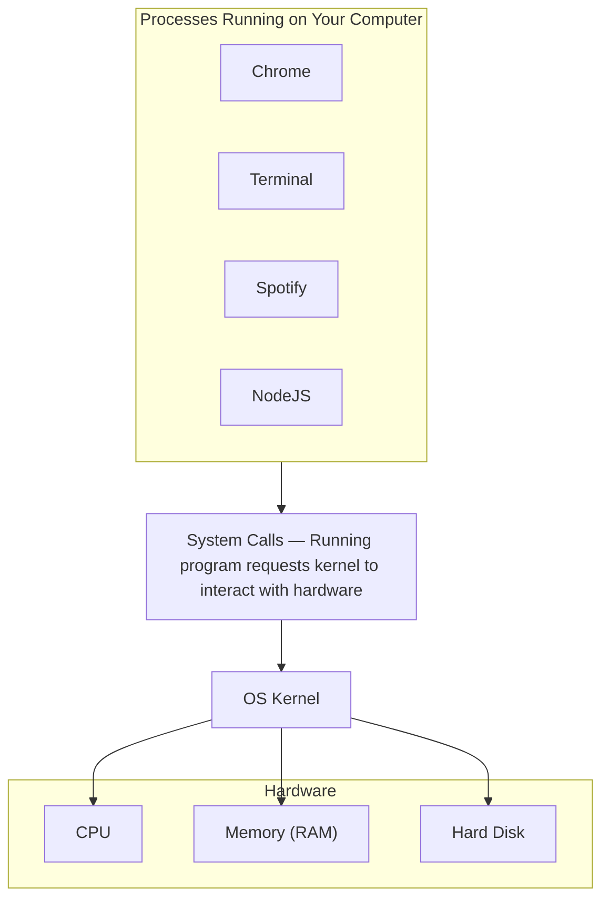
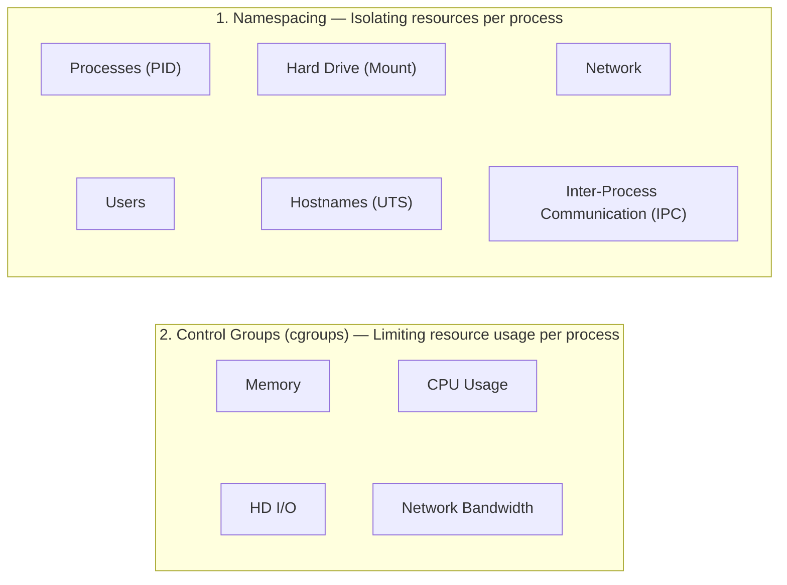
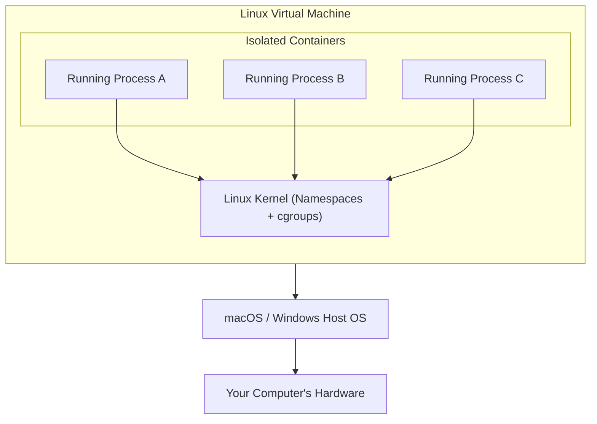
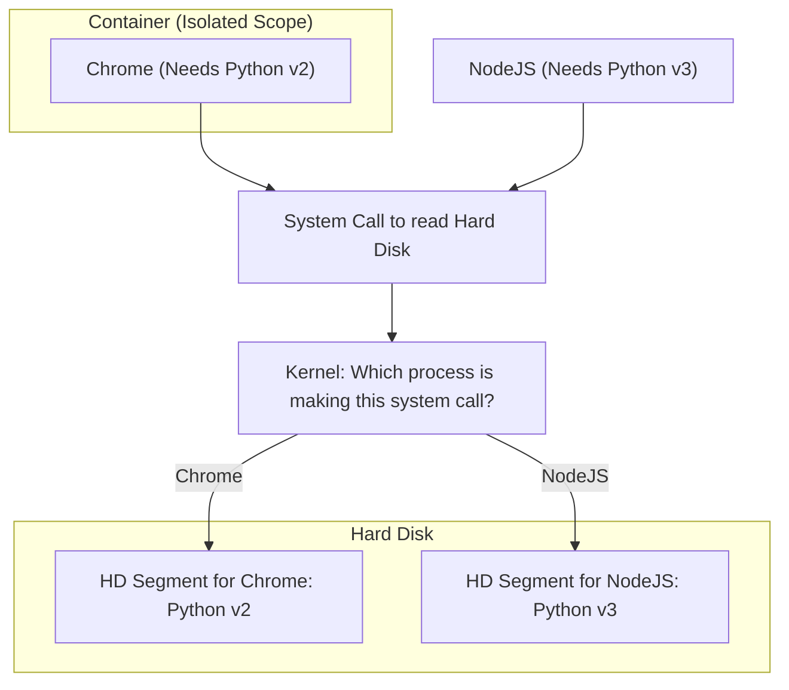
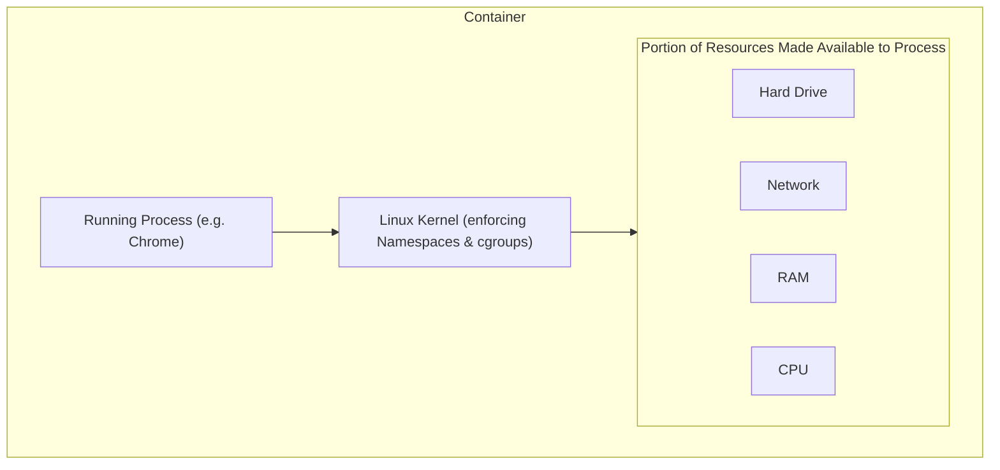
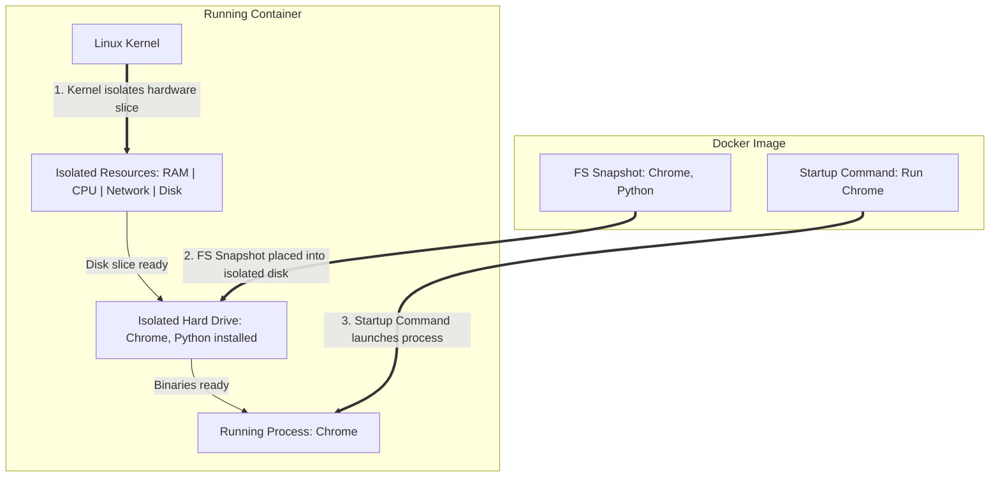

[back to previous file](../dockercontent.md)
---

# Container Internals

## How Your OS Works

* The **OS Kernel** is a core software process that governs access between all running processes on your computer and the physical hardware.
* **System Calls** are the kernel's exposed endpoints that running applications invoke whenever they need to interact with hardware (CPU, memory, disk, network).

---

## Why Containers Are Better for Development

Suppose a hypothetical situation where **Chrome (App A)** needs **Python v2** and **NodeJS (App B)** needs **Python v3**, with the limitation that a standard OS filesystem normally expects one system installation at a time.

Linux solves this using two kernel primitives:

1. **Namespacing:** Isolates resources per process (or group of processes) so each process sees its own dedicated slice of the system (e.g., Chrome's process sees a hard disk segment containing Python v2, while NodeJS sees a segment containing Python v3).
2. **Control Groups (cgroups):** Limits the *amount* of hardware resources (memory, CPU, disk I/O, network bandwidth) a process can consume.

### How Docker Runs on macOS and Windows

Because **Namespaces** and **cgroups** are **Linux-specific** kernel features, installing Docker Desktop on macOS or Windows installs a lightweight **Linux Virtual Machine** on top of your host OS to provide a real Linux Kernel for your containers:

---

## Container Analogy & Mental Model

A **Container** is **not** a physical box—it is simply a running process (or group of processes) paired with an isolated, resource-limited slice of the host's hardware managed by the kernel.

### Hard Disk Segmentation Analogy (Python v2 vs. Python v3)

### Simplified General Representation of a Container

---

## What Happens Behind the Scenes When Creating a Container from an Image?

An **Image** contains two core things:
1. **File System (FS) Snapshot:** A packaged set of required directories, binaries, and tools (e.g., Chrome, Python).
2. **Startup Command:** The default command to execute when the container starts (e.g., `> Run Chrome`).

When you run the image:
1. The **Kernel** carves out an isolated set of resources (Namespaces + cgroups) for the container.
2. The **FS Snapshot** is mounted/placed into that container's isolated hard drive segment.
3. The **Startup Command** executes, launching the target process inside the container.

