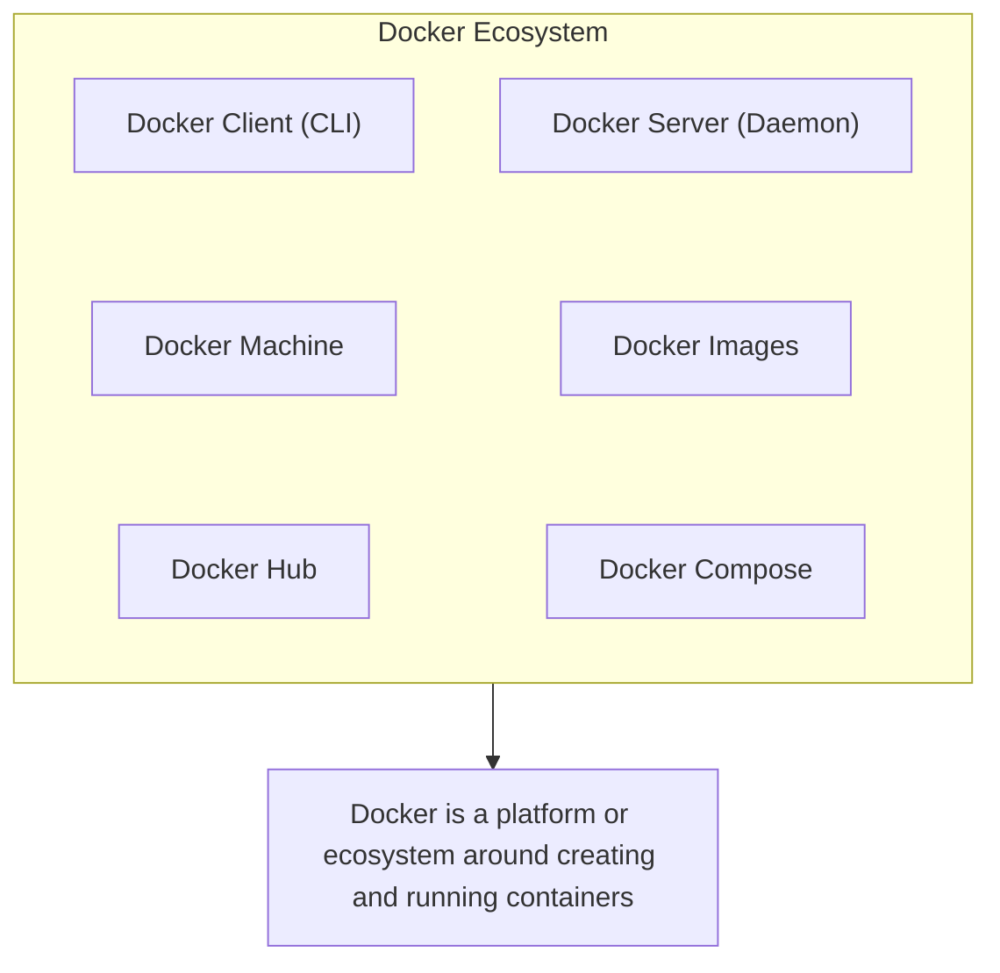
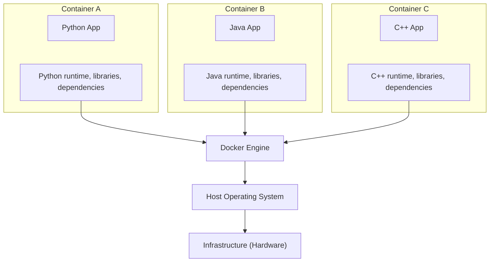
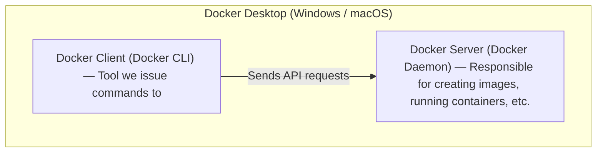

[back to previous file](../dockercontent.md)
---

# Docker Basics

## Why Use Docker?

One of the primary reasons to use Docker is to make installing and running software packages effortless, without worrying about setup or dependency conflicts.

---

## What is Docker?

Docker is a platform and ecosystem built around **creating and running containers**.

* **Docker Client (CLI):** The command-line interface tool you type `docker` commands into, which sends requests to the Docker Server.
* **Docker Server (Daemon):** The background service (`dockerd`) responsible for building images, running containers, and managing local Docker objects.
* **Docker Machine:** A tool that provisions and manages virtual hosts with the Docker Engine installed (historically used to run Docker on non-Linux hosts or remote cloud VMs).
* **Docker Images:** Read-only blueprint files containing the filesystem snapshot, dependencies, and startup command needed to create a container.
* **Docker Hub:** The default public cloud registry for finding, pulling, and sharing container images.
* **Docker Compose:** A tool for defining and running multi-container applications declaratively using a single YAML configuration file.

---

## What is a Container?

A **Docker container** is a lightweight, standalone, executable package of software that includes everything needed to run an application: code, runtime, system tools, system libraries, and settings. It packages an application and its dependencies together, making it easier to create, deploy, and run applications consistently anywhere.

---

## What is an Image?

* An **Image** is a single file (template/snapshot) containing all the dependencies, file system snapshot, and startup configuration required to run an application.
* A **Container** is a running instance of an Image.

---

## What is Docker Desktop?

Docker as a containerization technology relies on Linux kernel features and runs natively only on **Linux OS**.

**Docker Desktop** bridges this gap on Windows and macOS by doing two things:
1. Creates a lightweight **Linux VM** on your host OS (Windows / macOS).
2. Forwards `docker` CLI commands from the host OS to the Docker Daemon running inside that Linux VM.

Because containers run inside the Linux VM seamlessly behind the scenes, it appears as if Docker is running natively on Windows or macOS.

Docker Desktop bundles the **Docker Client (CLI)** and **Docker Server (Daemon)** in a single application — we interact with the CLI, and the CLI communicates with the Daemon:

