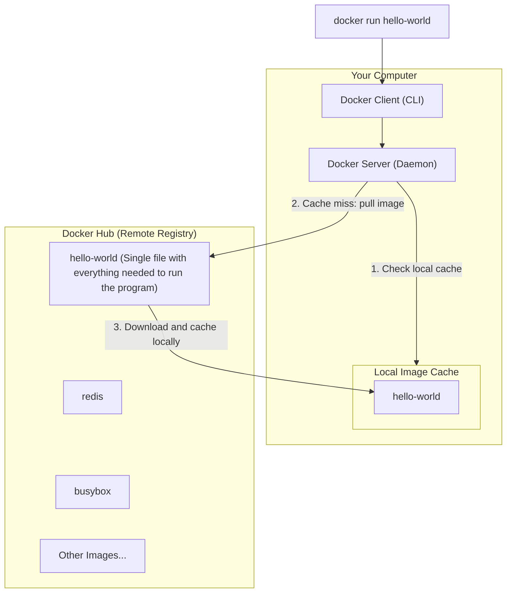

[back to previous file](../dockercontent.md)
---

# What Happens When You Run a Docker Command: Flow

When you run your first command in the Docker CLI:

```bash
docker run hello-world
```

The flow behind the scenes is:

1. **Docker CLI (Client)** sends the request to the **Docker Daemon (Server)**.
2. **Docker Daemon** checks whether the **Local Image Cache** already contains the `hello-world` image.
3. If not found locally, the Daemon pulls the `hello-world` image from **Docker Hub** and stores it in the Local Image Cache.
4. The Daemon creates a new **Container** from the cached image and executes its startup command.


