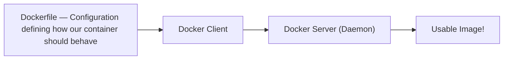
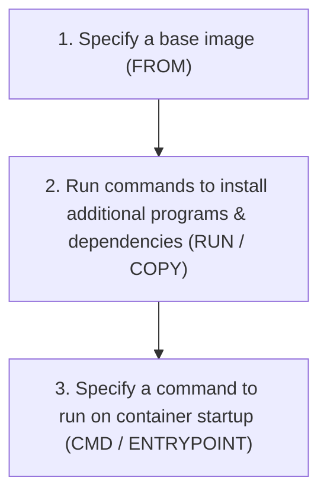

[back to previous file](../dockercontent.md)
---

# What is a Dockerfile?

## Dockerfile Overview

A **Dockerfile** is a plain text file containing a series of instructions that the Docker Daemon (Server) follows step by step to build an image. Think of it as your blueprint for constructing a containerized application.



---

## How It Works: Instructions in Sequence

When you execute `docker build`, Docker reads the Dockerfile line by line, executing each instruction in order to assemble your application environment inside the image:



---

## Common Instructions

| Instruction | Purpose |
| :--- | :--- |
| **`FROM`** | The first instruction—specifies the base image you are building upon (e.g., `FROM ubuntu:20.04`). Every Dockerfile starts with this. |
| **`RUN`** | Executes commands during the **build process** (installing packages, compiling code, setting up dependencies). |
| **`COPY` / `ADD`** | Copies files from your local machine (build context) into the image. |
| **`WORKDIR`** | Sets the working directory inside the container for subsequent instructions. |
| **`ENV`** | Sets environment variables inside the image/container. |
| **`EXPOSE`** | Documents which network ports the application listens on. |
| **`CMD` / `ENTRYPOINT`** | Defines the default startup command executed when a container starts from this image. |

---

## Layered Approach & Caching

Docker builds images in **layers**—each instruction in the Dockerfile creates a new read-only layer. Layers are cached so that if you change one instruction, only that instruction and subsequent layers need rebuilding. This makes builds fast and allows common base layers to be shared across multiple images.

### Example Dockerfile

```dockerfile
# Use an official Python base image
FROM python:3.9

# Set the working directory
WORKDIR /app

# Copy the current directory contents into the container
COPY . .

# Install any needed dependencies
RUN pip install -r requirements.txt

# Specify the command to run when the container starts
CMD ["python", "app.py"]
```

---

## Building and Running the Image

* **Build the image:**
  ```bash
  docker build -t myapp .
  ```
  Docker executes the instructions in order, creates layers, and produces an image tagged `myapp`.
  * *Note:* Modern versions of Docker Desktop have **BuildKit** enabled by default, which generates `sha256`-based image digests (`sha256:<image_id>`).
* **Run a container from the image:**
  ```bash
  docker run myapp
  ```
  The container inherits the image's file system snapshot, environment variables, and default startup command.
