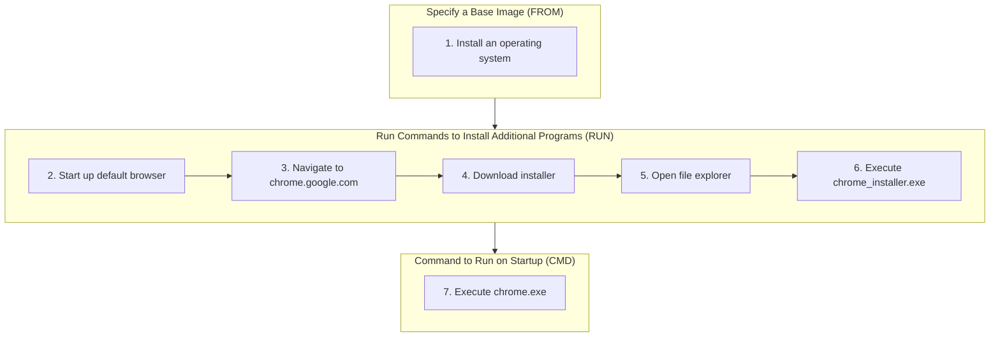
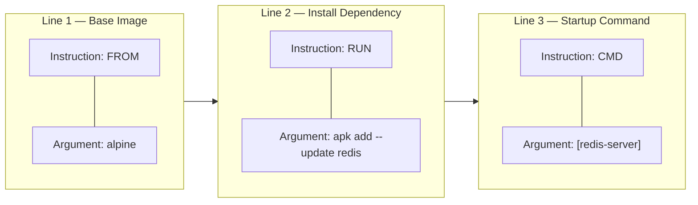
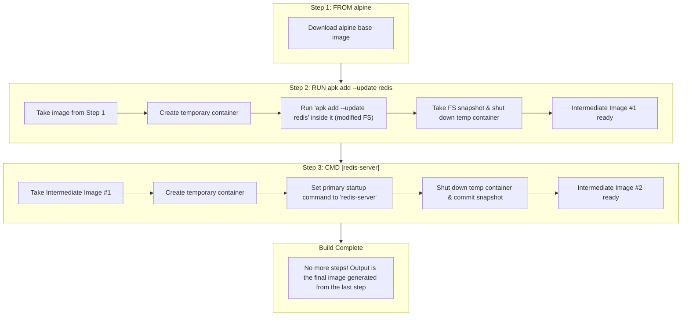
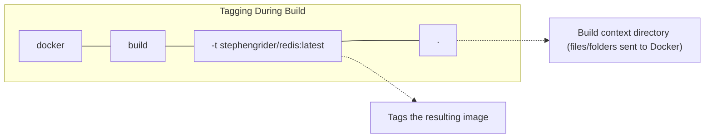
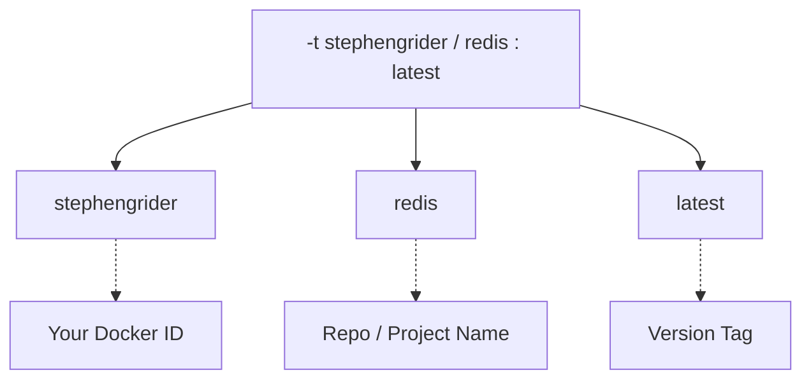
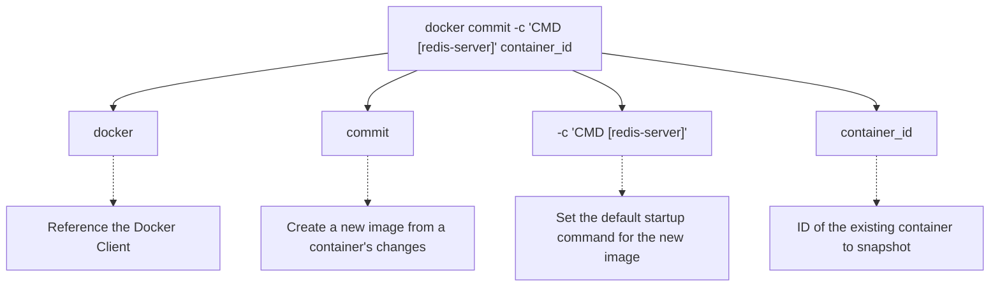
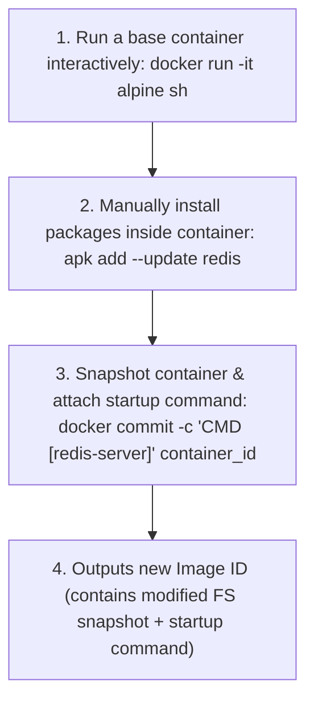

[back to previous file](../dockercontent.md)
---

# Building Custom Images & Dockerfile Flow

## Creating a Dockerfile (The Analogy)


Think about every step you would have to perform to install Chrome on a brand-new computer with no operating system—each group of steps maps directly to a Dockerfile phase:



---

## Anatomy of a Dockerfile

The default filename is `Dockerfile`. Each line consists of an **instruction** (in ALL CAPS, telling the Docker Server what to do) followed by its **argument**:



Example `Dockerfile`:

```dockerfile
FROM alpine
RUN apk add --update redis
CMD ["redis-server"]
```

* **`FROM alpine`**: Uses lightweight Alpine Linux as the base image.
* **`RUN <command>`**: Runs a command while building the image (e.g., installing packages).
* **`CMD ["command"]`**: Sets the default startup command when containers are launched from this image.

To build and run:
```bash
docker build .
docker run <image_id>
```

---

## What Happens Inside `docker build .`?

Each instruction runs against a temporary container built from the previous step's intermediate image, takes a snapshot, shuts down the temporary container, and passes the new intermediate image forward:



### Build Layer Caching
* Docker caches each intermediate image produced between steps to drastically speed up rebuilds.
* If an instruction (and everything above it) has not changed, Docker **reuses the cached intermediate image** instead of re-downloading or re-installing packages.
* Modifying an instruction or changing the order invalidates the cache for that step and every step below it.

---

## Tagging an Image

Instead of referencing random hex `image_id` hashes, tag your image with a human-readable name using `-t`:

```bash
docker build -t <docker_user_id>/<project_name>:<version> .
# Example:
docker build -t stephengrider/redis:latest .
docker run stephengrider/redis
```



### Image Tag Naming Convention



---

## Creating an Image from a Running Container

The image ↔ container relationship works in both directions: you can snapshot a modified container back into a new image using `docker commit`:

```bash
docker commit -c 'CMD ["redis-server"]' <container_id>
```

### Command Breakdown: `docker commit`



### How It Works Step-by-Step



This outputs a new `image_id` containing the container's current file system state and specified startup command, ready to be run via `docker run <new_image_id>`.
