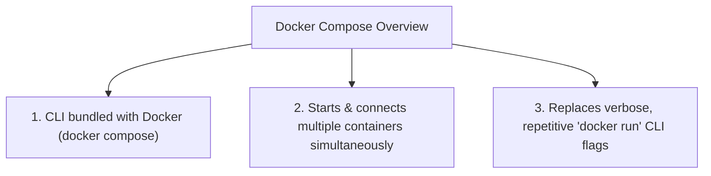
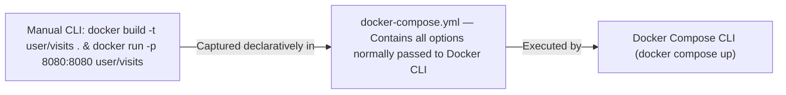
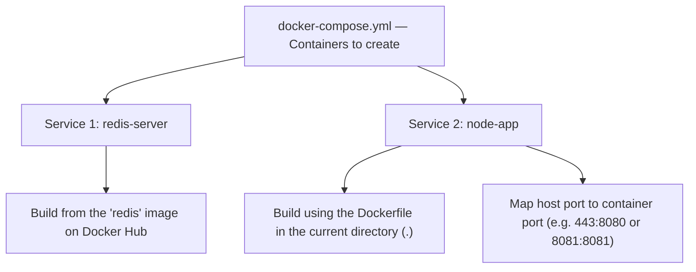
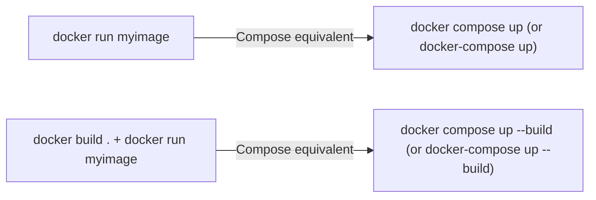

[back to previous file](../dockercontent.md)
---

# Docker Compose

## What / Why Docker Compose?

Instead of manually typing long, repetitive `docker build` and `docker run` commands with network and port flags to wire multiple containers together, **Docker Compose** lets you define your entire multi-container setup declaratively in a single YAML file.



### How Compose Replaces Manual CLI Commands



---

## Structure of `docker-compose.yml`

Think of `docker-compose.yml` as telling Docker: *"Here are the containers (services) I want created and wired together:"*



### Example `docker-compose.yml`

```yaml
version: '3'               # (Note: optional/deprecated in modern Compose V2)
services:                  # Each entry defines one containerized service
  redis-server:            # Service 1: stores the visitor count
    image: 'redis'         # Pull official redis image from Docker Hub
  node-app:                # Service 2: Node HTTP server
    build: .               # Build image using Dockerfile in current directory
    ports:
      - "443:8080"         # Map host port 443 -> container port 8080
```

> **Modern Update:** See [Section 6: Modern Docker Compose (V2)](../section-6/production-docker-and-internals.md#5-modern-docker-compose-v2-for-multi-container-apps) for modern `compose.yaml` features like `healthcheck`, `depends_on`, named `volumes`, custom `networks`, and `.env` files.

---

## `docker run` vs. Docker Compose Commands



| Single-Container Docker CLI | Docker Compose Equivalent | Purpose |
| :--- | :--- | :--- |
| `docker run myimage` | `docker compose up` | Start all services defined in `docker-compose.yml` |
| `docker build . && docker run myimage` | `docker compose up --build` | Rebuild local images and start all services |
| `docker stop ...` / `docker rm ...` | `docker compose down` | Stop and remove all containers & default network |
