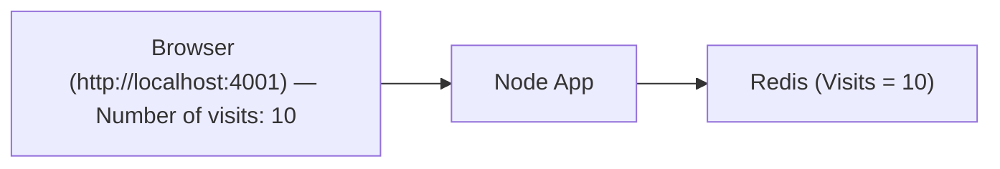
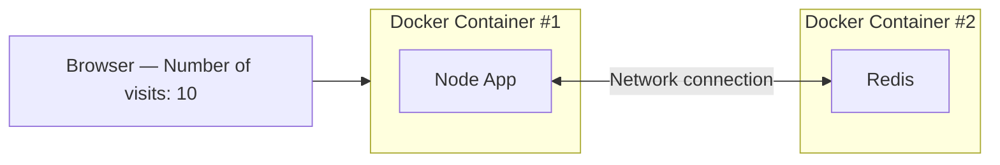
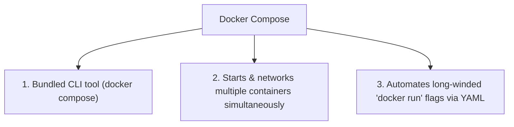

[back to previous file](../dockercontent.md)
---

# Multi-Container Application Example

## The Visit-Counter Architecture

Goal: Build a web application that displays the total number of visits the web page has received so far.

Instead of storing the visit count in memory inside the Node application (which breaks if you scale or restart Node), we isolate the Node web server and the Redis data store into **two separate containers**:

---

## The Multi-Container Connectivity Challenge

How do you start and connect multiple separate containers so they can talk to each other cleanly?

* **Using raw `docker` CLI commands:** Tedious, verbose, and error-prone (manually creating networks, starting each container with long flags, port mappings, and restart policies).
* **Using Docker Compose:** Works out of the box—you declare all services in one YAML file, and Compose automatically starts them together on a shared local network where they can reach each other by service name!

