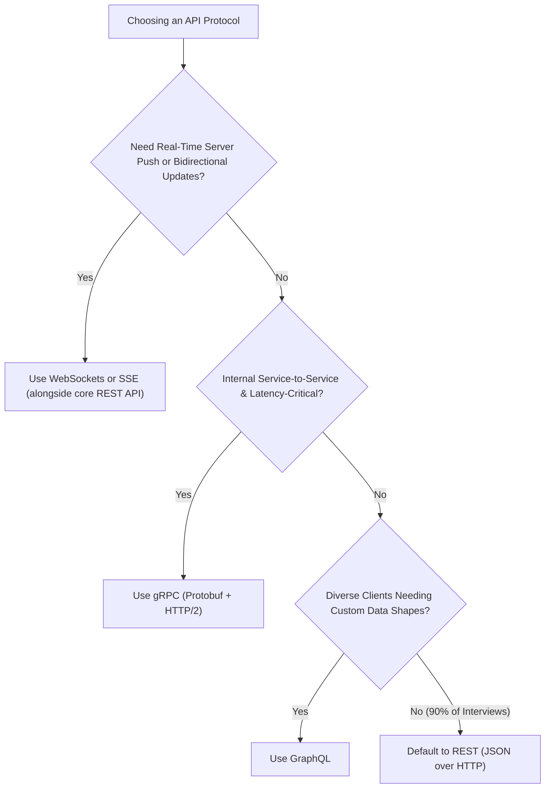
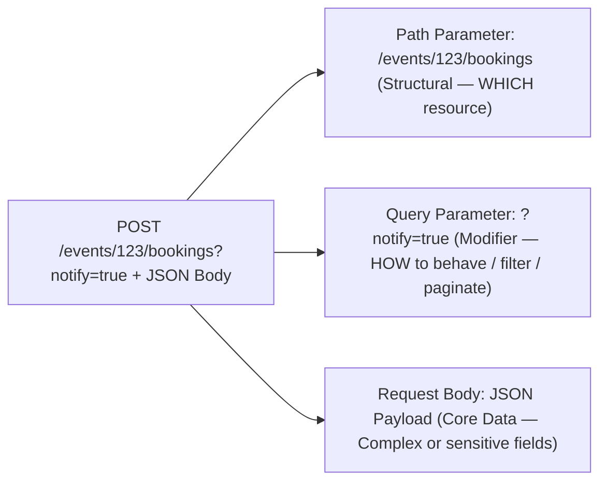
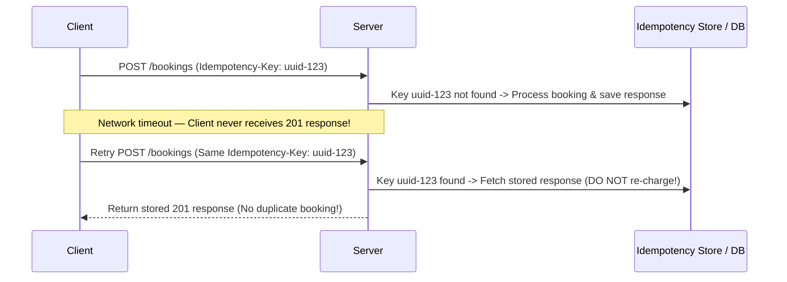
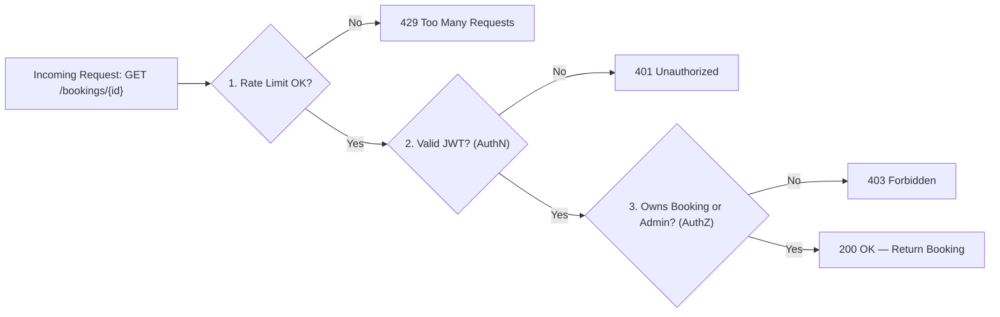

[back to HLD index](./HLD.md)
---

# API Design

> *Most interviewers don't expect your API design to be perfect—they want to see that you can design a clean, reasonable contract in ~5 minutes and move on to the deeper architectural challenges.*

## Table of Contents
1. [Choosing an API Protocol](#1-choosing-an-api-protocol)
2. [REST](#2-rest)
3. [GraphQL](#3-graphql)
4. [RPC & gRPC](#4-rpc--grpc)
5. [The 9 API Design Principles](#5-the-9-api-design-principles)
6. [Common API Patterns](#6-common-api-patterns)
7. [Security Considerations](#7-security-considerations)
8. [Interview Wrap-Up](#8-interview-wrap-up)

---

## 1. Choosing an API Protocol

There are three main request-response API paradigms (**REST**, **GraphQL**, and **RPC**), plus persistent-connection protocols (**WebSockets** / **SSE**) for real-time features like notifications, chat, or live updates.



> **Default Rule:** Default to **REST** unless you have a specific reason not to. It is universally understood, has great tooling, and fits 90% of interview problems. If unsure, simply say *"I'll use REST APIs"* and move on.

---

## 2. REST

### Resource Modeling
The foundation of good REST design is identifying **resources**—which map directly to the **Core Entities** from your requirements stage.

**Example (Ticketmaster):** Core entities are `events`, `venues`, `tickets`, and `bookings`:

```http
GET  /events                    # Get all events
GET  /events/{id}               # Get a specific event
GET  /venues/{id}               # Get a specific venue
GET  /events/{id}/tickets       # Get available tickets for an event
POST /events/{id}/bookings      # Create a new booking for an event
GET  /bookings/{id}             # Get a specific booking
```

* **Model things, not actions:** Represent nouns that exist in your system (`bookings`, `events`, `tickets`), not verbs (`book`, `purchase`).
* **Use plural nouns:** Always prefer `/events`, `/tickets`, `/bookings` over singular forms.
* **Nested paths vs. query parameters:**
  * **Nested path (`/events/{id}/tickets`)** → when the parent relationship is **required** for the query to make sense.
  * **Flat + query params (`/tickets?event_id=123&section=VIP`)** → when the filter is **optional** among multiple possible filters.

### HTTP Methods

| Method | Purpose | Safe? | Idempotent? | Notes |
| :--- | :--- | :--- | :--- | :--- |
| **`GET`** | Retrieve data without modifying state | Yes | Yes | Never mutate server state on `GET` |
| **`POST`** | Create a new resource | No | **No** | Repeated calls create duplicate resources (e.g., duplicate bookings) |
| **`PUT`** | Replace an entire resource (or create if missing) | No | Yes | Sends the full object; repeated calls yield the same final state |
| **`PATCH`** | Partially update specific fields of a resource | No | Depends | *"Set email = X"* is idempotent; *"append to list"* is not |
| **`DELETE`** | Remove a resource | No | Yes | Final state is the same (deleted), even if 1st call returns `204` and 2nd returns `404` |

### Passing Data to APIs



```http
POST /events/123/bookings?notify=true
Content-Type: application/json

{
  "tickets": [
    {"section": "VIP", "quantity": 2},
    {"section": "General", "quantity": 1}
  ],
  "payment_method": "credit_card"
}
```

* **Path parameters (`/events/123`):** Structural—identify the specific resource being targeted.
* **Query parameters (`?city=NYC&date=2024-01-01`):** Modifiers—filter, sort, paginate (`?page=2&limit=20`), or toggle optional behavior (`?notify=true`). Separated by `?` for the first parameter and `&` for subsequent ones.
* **Request body:** Payload—complex, large, or sensitive data structures.

---

## 3. GraphQL

**GraphQL** consolidates multiple resource endpoints into a **single endpoint** where the client declares the exact shape of the response it wants.

### Example Query (Ticketmaster)

```graphql
query {
  event(id: "123") {
    name
    date
    venue {
      name
      address
    }
    tickets {
      section
      price
      available
    }
  }
}
```

### Schema Design
Instead of endpoints, you define strongly typed entities and their relationships directly in a schema:

```graphql
type Event {
  id: ID!
  name: String!
  date: DateTime!
  venue: Venue!
  tickets: [Ticket!]!
}

type Venue {
  id: ID!
  name: String!
  address: String!
}

type Query {
  event(id: ID!): Event
  events(limit: Int, after: String): [Event!]!
}
```

### Trade-offs & Interview Guidance
* **When to mention it:** If the interviewer mentions *"mobile and web need completely different payloads"* or asks about *"avoiding over-fetching and under-fetching."*
* **The N+1 Problem (Biggest Gotcha):** Querying 100 events along with their venues can trigger **1 query for events + 100 separate queries for venues (101 DB queries)** instead of 2. Solving this requires batching patterns (e.g., **DataLoader**).
* **Field-level authorization:** Unlike REST's endpoint-level auth, GraphQL secures individual fields inside schema resolvers (e.g., exposing `event.name` while hiding `event.venue`).
* **Added complexity:** Requires query parsing, schema validation, and harder HTTP caching—stick to REST unless flexibility is an explicit requirement.

---

## 4. RPC & gRPC

**Remote Procedure Call (RPC)** is **action-oriented** rather than resource-oriented—clients invoke remote methods as if they were local functions:

```text
// Instead of GET /events/123
getEvent(eventId: "123")

// Instead of POST /events/123/bookings
createBooking(eventId: "123", userId: "456", tickets: [...])

// Instead of GET /events/123/tickets
getAvailableTickets(eventId: "123", section: "VIP")
```

The dominant modern RPC framework is **gRPC** (using **Protocol Buffers** + **HTTP/2**); **Apache Thrift** (originally from Facebook) is another notable multi-language alternative.

### Protocol Buffers & Compile-Time Type Safety
You define service contracts in a `.proto` file, and gRPC generates strongly typed client/server stubs across languages (e.g., a Go backend calling a Java payment service):

```protobuf
service TicketService {
  rpc GetEvent(GetEventRequest) returns (Event);
  rpc CreateBooking(CreateBookingRequest) returns (Booking);
  rpc GetAvailableTickets(GetTicketsRequest) returns (TicketList);
}

message GetEventRequest {
  string event_id = 1;
}

message Event {
  string id = 1;
  string name = 2;
  int64 date = 3;
  Venue venue = 4;
}
```

### When to Choose RPC in Interviews
* **Performance is critical:** Binary protobuf serialization over HTTP/2 is substantially faster than JSON over HTTP/1.1.
* **Type safety matters:** Generated contracts catch breaking mismatches at compile time.
* **Internal service-to-service APIs:** Microservices communicating internally don't need REST's public resource semantics.
* **Streaming:** gRPC natively supports client, server, and bidirectional streaming.

---

## 5. The 9 API Design Principles

| # | Principle | Practical Rule |
| :--- | :--- | :--- |
| **1** | **Design around resources, not actions** | Prefer `GET /users/{id}/bookings` and `POST /payments` over `/getUserBookings` or `/processPayment`. |
| **2** | **Be consistent everywhere** | Keep naming conventions, parameter names, and response envelopes uniform across all endpoints. |
| **3** | **Principle of least surprise** | Honor HTTP semantics: `GET` never mutates data, `DELETE` deletes, and `200 OK` means real success (never wrap errors in `200` with `{"success": false}`). |
| **4** | **Keep the API stateless** | Every request carries its own auth token, parameters, and payload so any backend instance can serve any request (enabling trivial horizontal scaling). |
| **5** | **Make retries safe** | Networks drop mid-request. `GET`/`PUT`/`DELETE` are naturally idempotent; protect `POST` mutations (bookings, payments) with **idempotency keys**. |
| **6** | **Paginate anything that can grow** | Paginate every collection endpoint from day one and enforce a **maximum page size cap** so clients can't send `?limit=100000` and take down your DB. |
| **7** | **Secure every endpoint by default** | Require valid authentication unless explicitly public, verify resource-level authorization, and back it with rate limiting. |
| **8** | **Evolve without breaking clients** | Old mobile clients live for years. Adding fields is safe; renaming, removing, or changing semantics requires versioning. |
| **9** | **Make errors actionable** | Return the right status class (`4xx` client fault, `5xx` server fault) plus a machine-readable error code and human-readable message. |

---

## 6. Common API Patterns

### Pagination

| Approach | Example | Pros | Cons / Gotchas |
| :--- | :--- | :--- | :--- |
| **Offset-Based** | `/events?offset=20&limit=10` | Simple, intuitive, allows jumping to arbitrary pages | Slow on large offsets; **duplicate or skipped records** if new items are inserted while paginating |
| **Cursor-Based** | `/events?cursor=cmd9atj3p...&limit=10` | Stable under live writes, fast indexed lookups at scale | Cannot jump directly to arbitrary page numbers |

**Cursor-Based Response Example:**
```json
{
  "events": [ ... ],
  "next_cursor": "cmd9atj3p000007ky19w1dpy2"
}
```

> **Interview Tip:** Offset pagination is fine unless you're dealing with real-time feeds or high-volume datasets. Most interviewers care more that you *remembered* pagination than which variant you pick.

### Filtering & Sorting
Use query parameters for filtering and sorting, with a leading `-` for descending order:
* **Filtering:** `GET /events?city=NYC&status=upcoming`
* **Sorting:** `GET /events?sort=-date` *(newest first)*

*(In an interview, demonstrate one filtered endpoint and state that the same convention applies across the API.)*

### Idempotency Keys
When a `POST` booking or payment request times out, the client doesn't know whether the server succeeded—so it retries. Without protection, retrying charges the user twice.

```http
POST /events/123/bookings
Idempotency-Key: 8e03978e-740c-4c2e-abd1-52f427d5c177
Content-Type: application/json

{
  "tickets": [{"section": "VIP", "quantity": 2}]
}
```



> **Strong Interview Signal:** Mentioning **Idempotency Keys** (as used in Stripe's API) whenever your design involves payments, bookings, or orders is a strong senior-level signal.

### Consistent Error Responses
Use one uniform error envelope across every endpoint:

```json
{
  "error": {
    "code": "SEAT_UNAVAILABLE",
    "message": "Section VIP has only 1 seat remaining"
  }
}
```

* **`code`:** Stable machine-readable string that client UIs can branch on (e.g., show seat picker).
* **`message`:** Human-readable explanation that can be improved without breaking clients.

### Versioning Strategies

| Strategy | Example | Pros | Cons |
| :--- | :--- | :--- | :--- |
| **URL Versioning** *(Interview Default)* | `/v1/events`, `/v2/events` | Explicit, easy to inspect/test in browsers, trivial to route | Pollutes URL path slightly |
| **Header Versioning** | `Accept-Version: v2` or `API-Version: 2` | Cleaner URLs, purer HTTP semantics | Less visible to developers, harder to test in browsers |

---

## 7. Security Considerations

### Authentication vs. Authorization
* **Authentication (AuthN):** Verifies *identity*—proving who the caller is.
* **Authorization (AuthZ):** Verifies *permissions*—checking whether the authenticated caller is allowed to perform this action on this specific resource.

### API Keys vs. JWT (JSON Web Tokens)

| Mechanism | How It Works | Best Fit | Avoid For |
| :--- | :--- | :--- | :--- |
| **API Keys** | Long random secret (`sk_live_abc123...`) sent in `Authorization` header and looked up in a DB with associated permissions/rate limits | Server-to-server communication & 3rd-party developer programmatic access | End-user sessions (no expiry/user context; users shouldn't manage raw keys) |
| **JWT** *(JSON Web Tokens)* | Server signs a self-contained token carrying `user_id`, roles/permissions, and expiration; any microservice verifies the signature **without a DB lookup** | User-facing web & mobile apps in **stateless distributed systems** | Cases requiring instant server-side revocation without a denylist |

### Role-Based Access Control (RBAC)
RBAC maps **Users → Roles → Permissions**:

| Role | Example Permissions (Ticketmaster) |
| :--- | :--- |
| **`customer`** | Book tickets, view/cancel own bookings |
| **`venue_manager`** | Create events, view sales for their own venues |
| **`admin`** | Full access across all resources |

**Request Security Pipeline (`GET /bookings/{id}`):**



### Rate Limiting & Throttling
Protect endpoints against abuse and traffic spikes by returning **`429 Too Many Requests`** when thresholds are exceeded:

| Strategy | Example Limit | Purpose |
| :--- | :--- | :--- |
| **Per-User Limits** | 1,000 requests/hour per authenticated user | Fair usage across logged-in accounts |
| **Per-IP Limits** | 100 requests/hour for unauthenticated traffic | Block anonymous scraping and DDoS |
| **Endpoint-Specific Limits** | 10 booking attempts/minute | Prevent automated ticket scalping or brute-force logins |

> **Interview Scope Tip:** Calling out rate limiting and auth demonstrates production awareness, but don't dive into token-bucket algorithms or OAuth flows unless the interviewer explicitly asks.

---

## 8. Interview Wrap-Up

Candidates fail far more often by **over-investing** in API design than by under-investing. Keep your API section crisp—spend **~5 minutes**, cover the core endpoints, call out pagination/idempotency/auth briefly, and move on to the High-Level Design.

---

**Previous:** [← Networking Essentials](./Networking-Essentials.md) | **Index:** [HLD Index](./HLD.md)
