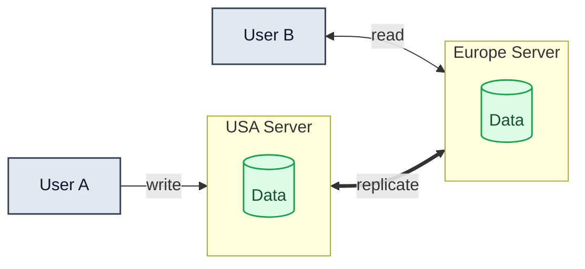
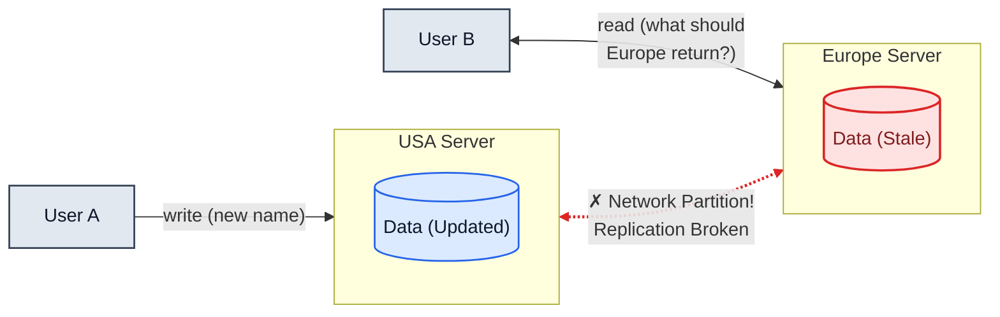
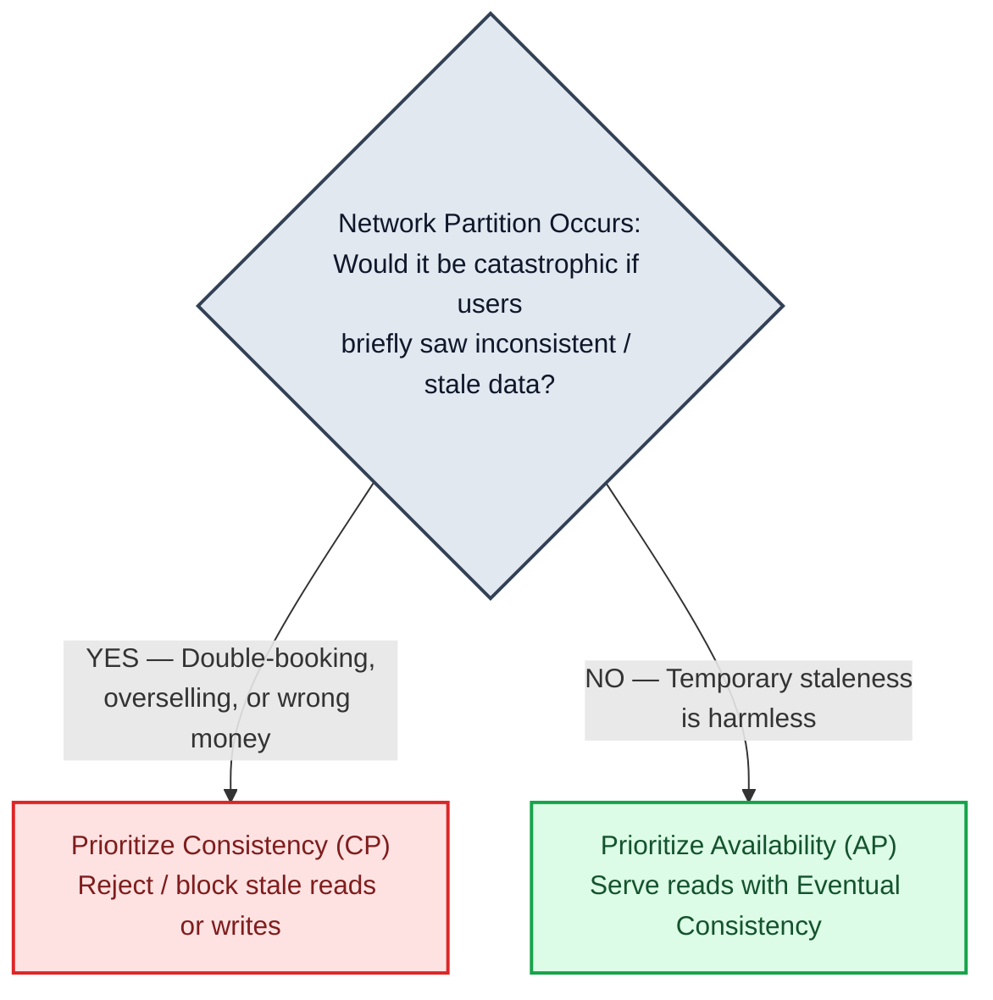
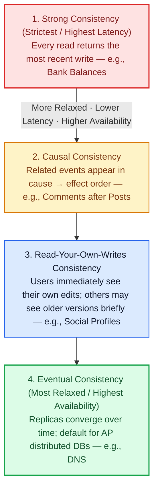

[back to HLD index](./HLD.md)
---

# CAP Theorem

> *In any distributed system, network partitions are inevitable—so in practice, CAP theorem boils down to a single design choice: when a network partition occurs, do you prioritize **Consistency (CP)** or **Availability (AP)**?*

## Table of Contents
1. [The Three Properties of CAP](#1-the-three-properties-of-cap)
2. [Understanding CAP Through an Example](#2-understanding-cap-through-an-example)
3. [Choosing Consistency (CP) vs. Availability (AP)](#3-choosing-consistency-cp-vs-availability-ap)
4. [Translating CAP into System Design Choices](#4-translating-cap-into-system-design-choices)
5. [Advanced CAP Considerations (Senior & Staff Level)](#5-advanced-cap-considerations-senior--staff-level)

---

## 1. The Three Properties of CAP

The **CAP Theorem** states that a distributed data store can simultaneously guarantee at most **two of three** properties:

| Property | Definition |
| :--- | :--- |
| **Consistency (`C`)** | All nodes see the exact same data at the same time. After a write completes on one node, every subsequent read from any node returns that updated value. |
| **Availability (`A`)** | Every request sent to a non-failing node receives a non-error response—without guaranteeing it contains the most recent write. |
| **Partition Tolerance (`P`)** | The system continues operating despite arbitrary message drops or network splits preventing nodes from communicating with one another. |

> **Important Distinction:** **Consistency** in CAP (linearizability / all replicas agreeing on the latest value) is completely different from **Consistency** in **ACID** databases (satisfying schema invariants, foreign keys, and constraints).

> **Practical Interview Insight:** In any real distributed system, **Partition Tolerance (`P`) is non-negotiable**—networks *will* fail. Therefore, CAP is never a 3-way choice; it is strictly choosing between **Consistency (`CP`)** and **Availability (`AP`)** when a network partition happens.

---

## 2. Understanding CAP Through an Example

Imagine running a global website with two servers—one in the **USA** and one in **Europe**—storing user public profiles (such as display names).

### Normal Operation (Basic Replication)
1. **User A** connects to the closest server (**USA**) and updates their display name.
2. The update replicates across the network to the **Europe** server.
3. **User B** in Europe reads User A's profile and sees the updated name.

### When a Network Partition Occurs
Now suppose the network link between the **USA** and **Europe** servers goes down. User A writes a new display name in the USA, but it **cannot replicate** to Europe.

When **User B** requests User A's profile from the Europe server, you face a forced choice:
* **Option A — Choose Consistency (`CP`):** Return an error because Europe cannot confirm its copy is up-to-date.
* **Option B — Choose Availability (`AP`):** Return Europe's potentially stale copy of User A's old name.

For a public display name, the answer is obvious: **seeing a slightly stale name is far better than seeing an error page** (`AP`).

---

## 3. Choosing Consistency (CP) vs. Availability (AP)

### When to Choose Consistency (`CP`)
Some systems *must* guarantee accuracy even if it means refusing requests during a partition:
* **Ticket Booking Systems:** If User A books seat `6A` on a flight, a partitioned server must never show `6A` as available to User B and double-book the seat.
* **E-Commerce Inventory:** If Amazon has 1 toothbrush left in stock, showing it as available to multiple buyers during a partition leads to overselling.
* **Financial Systems:** Stock trading platforms require exact, up-to-date order books—stale data leads to trades executing at incorrect prices.

### When to Choose Availability (`AP`)
The **majority of web systems** can tolerate brief inconsistency (seconds or minutes) via **eventual consistency** and should prioritize availability:
* **Social Media:** If User A changes their profile picture, User B seeing the old photo for a few minutes is completely fine.
* **Content Platforms (Netflix):** Serving a slightly outdated movie description temporarily is harmless.
* **Review Sites (Yelp):** Showing yesterday's restaurant hours for a few minutes is far better than returning an error.

---

## 4. Translating CAP into System Design Choices

When discussing **Non-Functional Requirements (NFRs)** in an interview, start with CAP: *"Does this system prioritize consistency or availability?"* Your answer directly shapes your architecture and technology stack:

| Choice | Architectural Patterns | Example Technologies |
| :--- | :--- | :--- |
| **Prioritize Consistency (`CP`)** | • **Distributed Transactions (2PC):** Keep multiple stores (e.g., cache + DB) strictly in sync *(higher latency & complexity)* • **Single-Node Source of Truth:** Avoid replication lag altogether *(limits horizontal scale)* | • Traditional RDBMSs (`PostgreSQL`, `MySQL`) • `Google Spanner` • `DynamoDB` *(strong consistency mode)* |
| **Prioritize Availability (`AP`)** | • **Multiple Read Replicas:** Asynchronous replication lets any replica serve reads even if slightly behind • **Change Data Capture (CDC):** Track primary DB mutations and propagate updates asynchronously to replicas, caches, and downstream stores | • `Cassandra` • `DynamoDB` *(multi-AZ eventual consistency)* • `Redis` clusters |

> **Configuration Reality:** Most modern distributed databases (like DynamoDB and Cassandra) offer tunable knobs for both strong and eventual consistency. The key interview skill is justifying *which guarantee your use case needs*.

---

## 5. Advanced CAP Considerations (Senior & Staff Level)

> **Interview Leveling:** For junior and mid-level interviews, Sections 1–4 cover what you need. For **senior and staff-level** interviews, be ready to discuss **per-feature trade-offs** and the **consistency spectrum**.

### Mixed Requirements Within the Same System
Real-world systems rarely choose pure `CP` or pure `AP` globally—they apply **different consistency models to different features**:

| System | Consistency-Critical Path (`CP`) | Availability-First Path (`AP`) | Example Interview Phrasing |
| :--- | :--- | :--- | :--- |
| **Ticketmaster** | **Booking a seat** *(prevent double-booking)* | **Viewing event details** *(briefly stale description is fine)* | *"I'll prioritize consistency for booking transactions, but optimize for availability when users are browsing events."* |
| **Tinder** | **Matching** *(simultaneous right swipes must both see the match immediately)* | **Viewing user profiles** *(slightly outdated profile photo is fine)* | *"I'll prioritize consistency for matching, while optimizing for availability when loading profiles."* |

### Levels of Consistency
Consistency is not binary—it sits on a **spectrum** trading performance and availability for stricter ordering guarantees:

| Consistency Level | Guarantee | Typical Use Case |
| :--- | :--- | :--- |
| **Strong Consistency** | Every read reflects the single most recent write *(highest latency cost)* | Bank account balances, seat reservations, inventory counts |
| **Causal Consistency** | Causally dependent operations appear in the same logical order to all users | Comments always appearing *after* the post they reply to |
| **Read-Your-Own-Writes** | A user always sees their own writes immediately, while other users may briefly see stale data | Updating your own social media profile or settings |
| **Eventual Consistency** | All replicas converge over time if no new writes occur *(default in most distributed DBs)* | DNS propagation, social feeds, view counts, analytics |

---

**Previous:** [← Consistent Hashing](./Consistent-Hashing.md) | **Index:** [HLD Index](./HLD.md)
