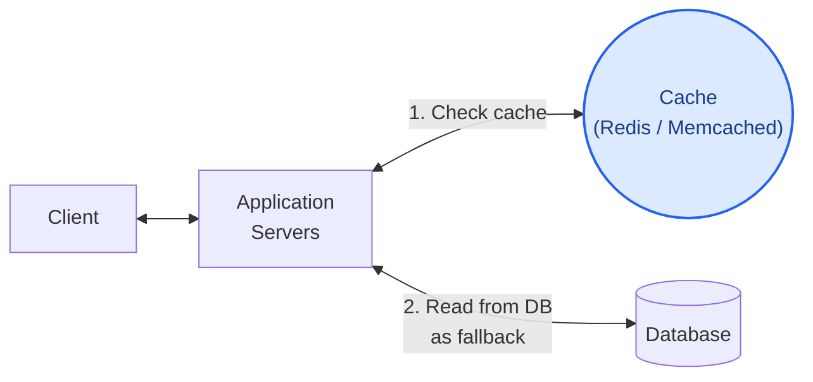
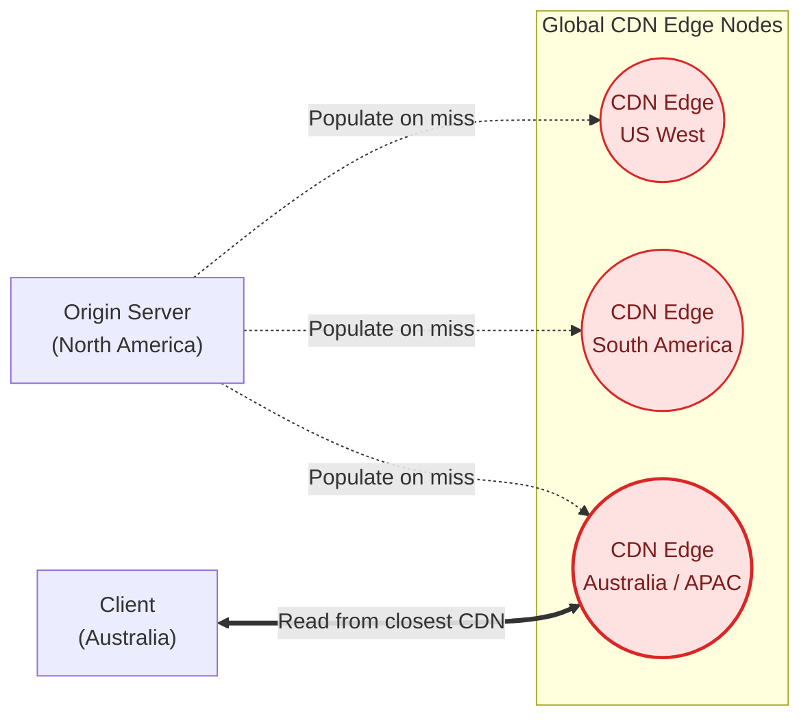
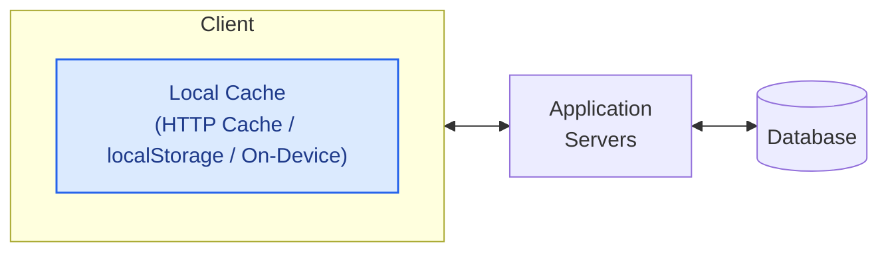
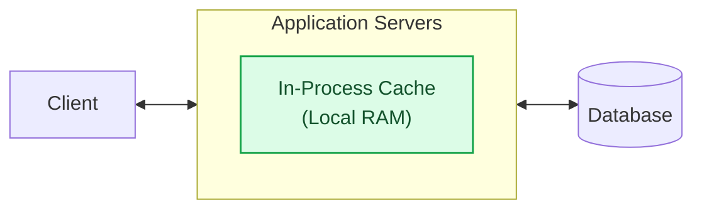
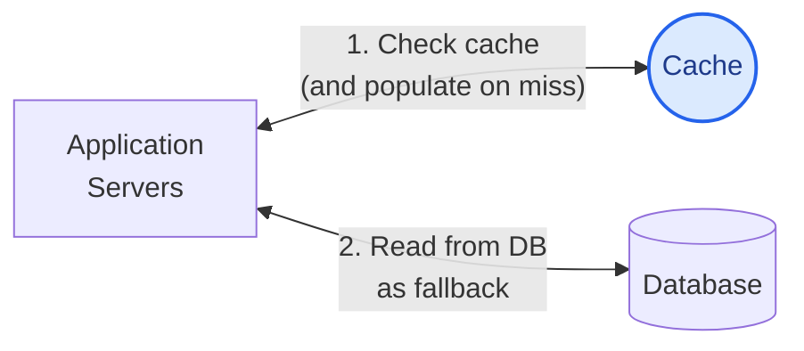
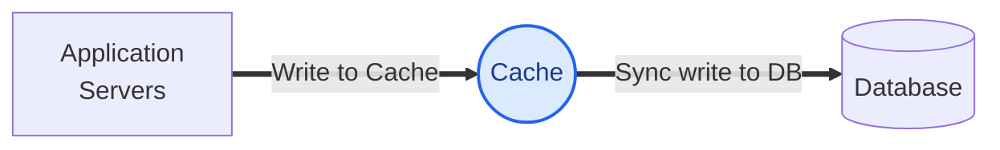
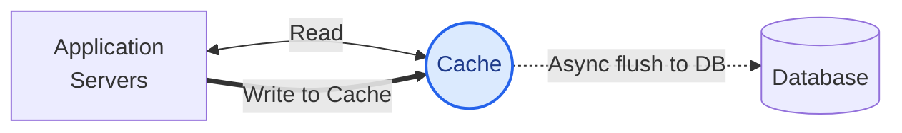
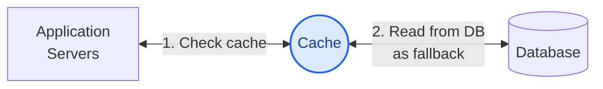
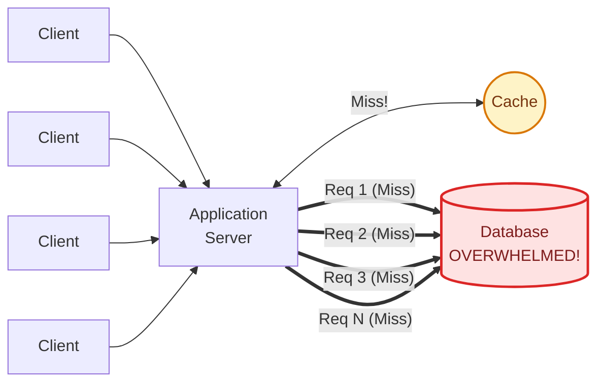

[back to HLD index](./HLD.md)
---

# Caching

> *Caching comes up almost every time a system faces high read traffic—relieving database load and dropping response latency from tens of milliseconds to single-digit milliseconds, at the trade-off of managing staleness and failure modes.*

## Table of Contents
1. [Where to Cache (Caching Layers)](#1-where-to-cache-caching-layers)
2. [Cache Architectures (Read & Write Patterns)](#2-cache-architectures-read--write-patterns)
3. [Cache Eviction Policies & TTL](#3-cache-eviction-policies--ttl)
4. [Common Caching Problems & Solutions](#4-common-caching-problems--solutions)
5. [Caching in System Design Interviews](#5-caching-in-system-design-interviews)

---

## 1. Where to Cache (Caching Layers)

Caching shows up across multiple layers of a distributed system: browsers cache, CDNs cache, application servers cache, standalone cache clusters cache, and even databases maintain internal buffer-pool caches. Knowing **where** to place each layer—and when to introduce it—is key.

### External Caching
An **external cache** is a standalone caching service (such as **Redis** or **Memcached**) that your application servers communicate with over the network to store frequently accessed data and avoid repeated database hits.

> **Interview Default:** External caching with **Redis** is the default answer whenever caching comes up for high-traffic systems. Start here, then layer on CDN, client-side, or in-process caching only when the problem specifically calls for them.

---

### CDN (Content Delivery Network)
A **CDN** (such as **Cloudflare**, **Fastly**, or **Akamai**) caches content on globally distributed edge nodes physically close to end users—dramatically cutting network latency and shielding origin servers from traffic spikes.

* Modern CDNs can cache public API responses, HTML pages, and even execute edge logic for personalization or security rules—but their highest-impact use case remains **media delivery** (images, videos, static bundles).
* **Interview Tip:** The cleanest time to introduce a CDN is when serving **static media at scale**. Lead with that justification, and expand into dynamic/API edge caching only if the prompt requires it.

---

### Client-Side Caching
**Client-side caching** stores data directly on the user's device—such as a browser's HTTP cache / `localStorage` or a mobile app's local memory / on-device storage—to eliminate unnecessary network round trips.

* **Trade-Off:** You have limited backend control over user devices, making cache invalidation harder and stale data more likely.

---

### In-Process Caching
Modern application servers ship with abundant RAM. **In-process caching** stores small, frequently read values directly inside the application server's local memory—eliminating even the network hop to Redis.

**Best fit for small, hot, rarely changing data:**
* Configuration values and **feature flags**
* Small reference datasets
* **Hot keys** (avoiding pounding a single Redis shard)
* Rate-limiting counters and precomputed values

> **Positioning in Interviews:** In-process caching is great for raw speed, **not** a replacement for Redis (each server holds its own isolated copy). Mention it strictly as an **optimization layer** *after* introducing an external cache.

### Caching Layers at a Glance

| Layer | Where It Lives | Typical Tools | Best For | Key Trade-Off |
| :--- | :--- | :--- | :--- | :--- |
| **External Cache** | Standalone cluster | Redis, Memcached | **Interview default**; shared hot DB queries & sessions | Extra network hop; cluster management |
| **CDN** | Global edge servers | Cloudflare, Fastly, Akamai | Static media (images, video, JS/CSS), public edge responses | Eventual purge/invalidation across edges |
| **Client-Side** | Browser / mobile device | HTTP `Cache-Control`, `localStorage` | Zero-latency UI assets & user-scoped static data | Little backend control; harder invalidation |
| **In-Process** | App server RAM | Local LRU map (Caffeine, Guava) | Tiny, hot, rarely changing values & hot-key shielding | Per-instance memory duplication & drift |

---

## 2. Cache Architectures (Read & Write Patterns)

These are the **four core caching patterns** to know for system design interviews:

### Cache-Aside (Lazy Loading)
The **most common caching pattern**—and the one you should **default to** in interviews.

**How it works:**
1. The application checks the cache first.
2. **Cache Hit:** Return the cached value immediately.
3. **Cache Miss:** Fetch the record from the database, write it into the cache, and return it to the caller.

---

### Write-Through Caching
The application writes **only to the cache**, and the cache **synchronously** writes to the database before acknowledging the write. The operation completes only after both the cache and database are updated.

* **Implementation note:** Requires a caching library or framework with a data-store plugin (Redis does **not** natively support write-through on its own).
* **Trade-offs:**
  * **Higher write latency:** Callers wait for both the cache update and the synchronous DB write.
  * **Cache pollution:** Every written item enters the cache—even data that may never be read again.
  * **Dual-write problem:** If the cache write succeeds and the DB write fails (or vice versa), the two stores diverge unless backed by retries, error handling, or reconciliation.
* **When to use:** When **reads must always return fresh data** and the system can tolerate slightly slower writes.

---

### Write-Behind (Write-Back) Caching
The application writes **only to the cache** (and serves reads directly from it). The cache batches and **asynchronously flushes** updates to the database in the background.

* **Trade-offs:** Delivers **extremely high write throughput**, but introduces **data-loss risk**—if the cache crashes before flushing pending writes to the database, those updates are lost.
* **When to use:** Workloads requiring **high write throughput** where **eventual consistency** and occasional minor data loss are acceptable (e.g., analytics counters, telemetry, metrics pipelines).

---

### Read-Through Caching
The cache sits inline as a **smart proxy**—the application never queries the database directly. On a cache miss, the **cache itself** fetches from the database, stores the entry, and returns it to the application.

* **Relationship to Write-Through:** Read-through is the read counterpart of write-through; both make the cache an intermediary over the DB and are often combined in specialized caching frameworks.
* **Real-world note:** **CDNs are a classic form of read-through cache** (fetching from the origin server on a miss). For application-level caching with Redis, however, **Cache-Aside** is far simpler and much more common—rarely propose read-through in interviews unless discussing CDNs or similar proxy infrastructure.

### Cache Architectures Comparison

| Pattern | Who Talks to DB? | Write Latency | Consistency / Risk | Interview Guidance |
| :--- | :--- | :--- | :--- | :--- |
| **Cache-Aside** | Application | Normal (direct DB write) | Possible stale window until TTL/invalidation | **Default choice** for Redis & app caching |
| **Write-Through** | Cache (sync) | Slower (cache + DB sync) | Fresh reads; dual-write & cache-pollution risks | Use when reads must stay fresh & slower writes are OK |
| **Write-Behind** | Cache (async) | **Fastest** (memory only) | Eventual consistency; **risk of data loss** on crash | Use for write-heavy metrics / analytics pipelines |
| **Read-Through** | Cache (sync on miss) | N/A (read path) | Centralizes logic; needs specialized cache/proxy | Mostly relevant for **CDNs** (origin pull) |

---

## 3. Cache Eviction Policies & TTL

Because memory is finite, every cache needs rules for deciding **what to remove** when it fills up and **when entries expire**:

| Policy | What It Removes | Implementation | Best Fit |
| :--- | :--- | :--- | :--- |
| **LRU** *(Least Recently Used)* | Item unaccessed for the longest time | Hash map + doubly linked list / ring buffer (`O(1)`) | **Default in most systems**—adapts well to typical temporal-locality workloads |
| **LFU** *(Least Frequently Used)* | Item accessed the fewest times | Per-key counter or approximate LFU | Workloads with long-lived popular items (trending videos, top playlists) |
| **FIFO** *(First In, First Out)* | Oldest inserted item (ignores access frequency) | Simple queue | Rarely used beyond toy/simple caches (risks evicting hot keys) |
| **TTL** *(Time To Live)* | Any entry older than its expiration window | Per-key expiration timestamp | **Not a standalone eviction policy**—pair with LRU/LFU whenever data must refresh (API responses, session tokens) |

---

## 4. Common Caching Problems & Solutions

Caching makes systems faster, but it introduces distributed failure modes. Whenever you add a cache in an interview, proactively show you can handle the edge cases that apply to your design.

### 1. Cache Stampede (Thundering Herd)
A **cache stampede** occurs when a popular cached entry expires and hundreds or thousands of concurrent requests miss the cache at the exact same moment—all slamming the database simultaneously to recompute the same key.

*Example:* A homepage feed cached with a `60s` TTL expires at `12:01:00`. Every incoming request during that brief rebuild window misses Redis and fires an expensive DB query, overwhelming the database and triggering cascading failures.

**How to handle it:**
* **Request Coalescing (Single Flight):** Allow only **one** in-flight request per key to query the database and repopulate the cache while all other concurrent requests wait for and share that result. *(Most effective solution.)*
* **Cache Warming:** Proactively refresh popular keys in the background *before* their TTL expires. *(Only works for TTL-based expiration—not for write-triggered invalidations.)*

---

### 2. Cache Consistency
Inconsistencies happen when the cache and database return different values—typically because systems write to the database first while reads continue hitting cached data during the gap. There is no silver bullet; pick the strategy that matches your freshness requirements:

* **Cache invalidation on writes:** Delete the cache entry right after updating the database so the next read repopulates fresh data.
* **Short TTLs:** Bound how long stale data can live when minor staleness is acceptable.
* **Accept eventual consistency:** For social feeds, metrics, and analytics, a few seconds of lag is completely acceptable.

---

### 3. Hot Keys
A **hot key** is a single cache entry receiving disproportionate traffic compared to all other keys. Even with a 99.9% cache hit rate, one hot key can saturate a single Redis node or shard.

*Example:* On Twitter, if millions of users view Taylor Swift's profile at once, `user:taylorswift` can overwhelm the single Redis shard holding that key—even while everything else works normally.

**How to handle it:**
* **Replicate hot keys:** Store copies of the key across multiple cache nodes (e.g., suffixed keys or read replicas) and load-balance reads across them.
* **Add an in-process local fallback cache:** Cache ultra-hot keys briefly in application server memory so requests never even hit Redis.
* **Apply rate limiting:** Throttle abusive traffic spikes targeting specific keys.

---

## 5. Caching in System Design Interviews

### When to Bring Up Caching
**Never jump straight to caching.** First identify the bottleneck, quantify it with rough numbers, and explain *how* caching solves it:

| Trigger Scenario | Example Interview Pitch |
| :--- | :--- |
| **Read-Heavy Workload** | *"10M DAU × 20 reads/day = 200M DB reads/day. Even indexed, DB queries take 20–50ms; Redis drops that under 2ms and removes most DB load."* |
| **Expensive Queries** | *"Building a personalized feed joins posts, followers, and likes (~200ms). Caching the computed feed for 60s lets us serve it in ~1ms from Redis."* |
| **High Database CPU** | *"Peak DB CPU hits 80% re-running the same read queries. Caching hot queries cuts DB load by 70–80%."* |
| **Strict Latency Target** | *"We need sub-10ms API responses, while DB reads take 30–50ms—we need a cache layer."* |

### 5-Step Playbook for Introducing Caching
Once you've justified the need, walk through your caching design systematically:

1. **Identify the bottleneck:** Name what is slow (DB CPU, query latency, heavy join/computation) and why.
2. **Decide what to cache & design keys:** Focus on data that is **read frequently, rarely updated, and expensive to fetch/compute**. Specify clear key patterns (e.g., `user:123:profile`, `trending:posts:global`).
3. **Choose your cache architecture:** Default to **Cache-Aside + Redis**; use Write-Through for strict read freshness or Write-Behind for extreme write volume. Layer **CDN** for static media and **in-process caching** for hot keys when needed.
4. **Set eviction & expiration:** Default to **LRU** for memory management and pair it with an appropriate **TTL** to bound staleness.
5. **Address 1–2 relevant downsides:** Proactively cover the failure modes that actually matter to your design—**cache invalidation**, **cache failures** (can the DB survive if Redis restarts?), or **thundering herd / hot keys**.

> **Staff-Level Signal:** Don't recite every caching failure mode like a checklist. Pick the **1–2 non-obvious risks** that genuinely threaten the system you are designing and explain concretely how you mitigate them.

---

**Previous:** [← DB Indexing](./DB-Indexing.md) | **Index:** [HLD Index](./HLD.md)
