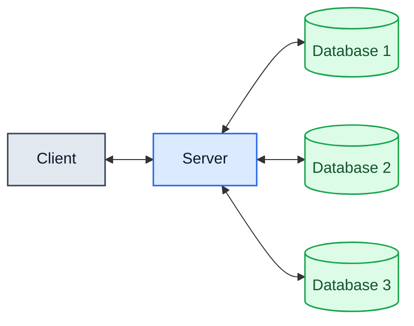
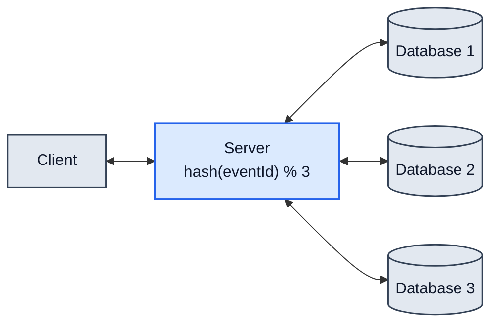
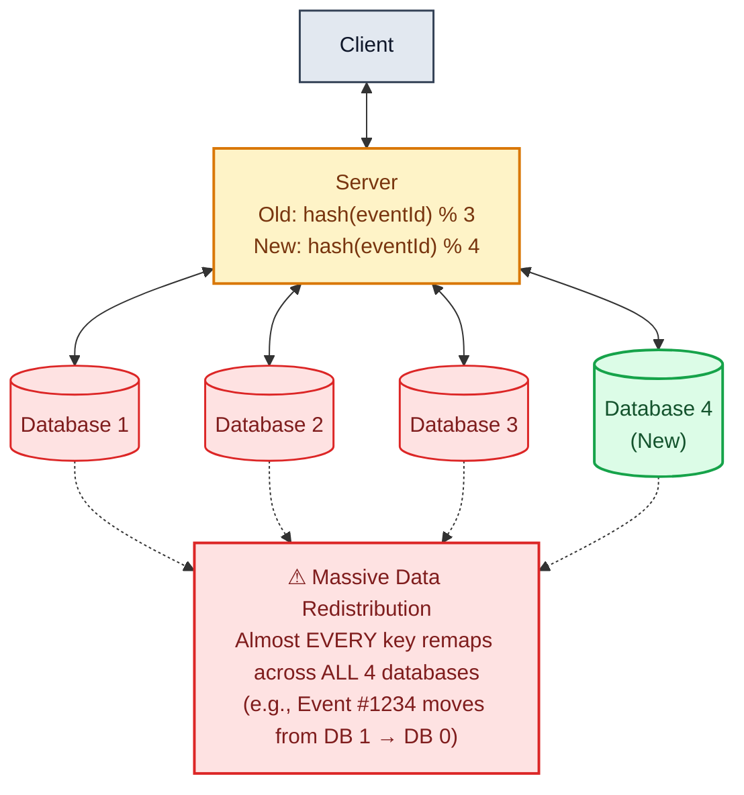
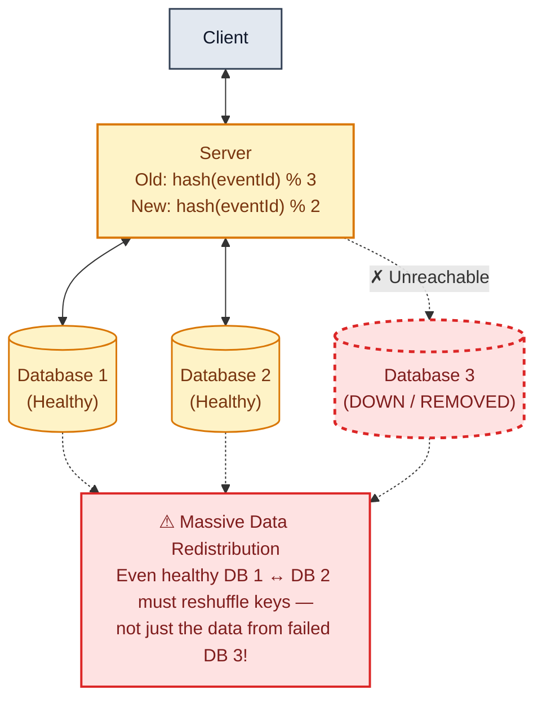
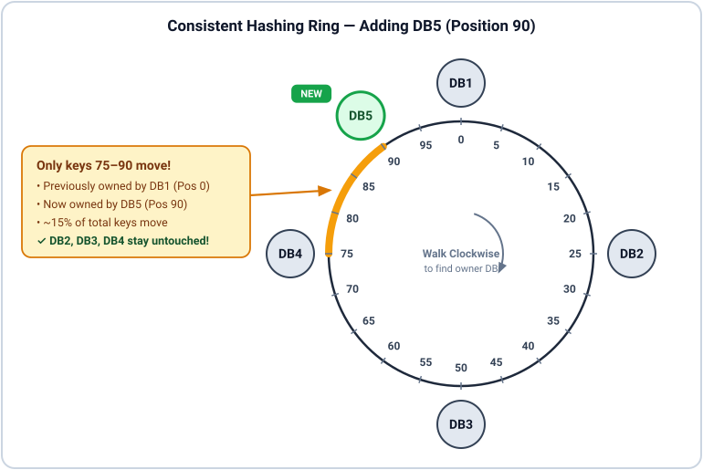
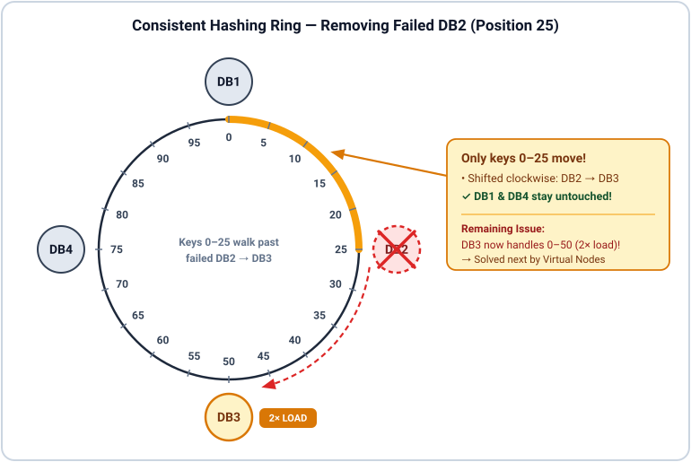
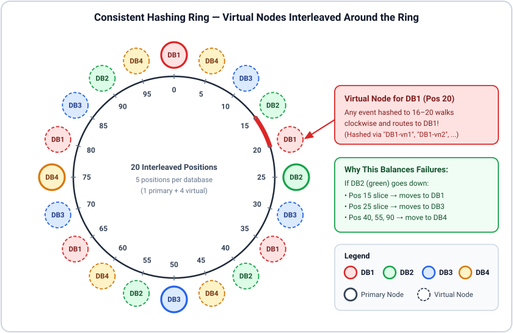

[back to HLD index](./HLD.md)
---

# Consistent Hashing

> *Consistent hashing arranges both keys and servers onto a circular hash ring so that adding or removing a node only moves a small fraction of keys—instead of reshuffling almost the entire dataset.*

## Table of Contents
1. [Motivating Example: Scaling TicketMaster](#1-motivating-example-scaling-ticketmaster)
2. [First Attempt: Simple Modulo Hashing](#2-first-attempt-simple-modulo-hashing)
3. [How Consistent Hashing Works (The Hash Ring)](#3-how-consistent-hashing-works-the-hash-ring)
4. [Virtual Nodes](#4-virtual-nodes)
5. [Addressing Hot Spots](#5-addressing-hot-spots)
6. [Data Movement & Replication in Practice](#6-data-movement--replication-in-practice)
7. [Real-World Usage & Interview Guidance](#7-real-world-usage--interview-guidance)

---

## 1. Motivating Example: Scaling TicketMaster

Imagine designing a ticketing platform like **TicketMaster**. Initially, the architecture is simple—one database stores all event records and serves every client request:


As traffic and event volume grow, a single database can no longer keep up—you must **shard** data across multiple databases:



That immediately raises the core routing question: **How do we know which event lives on which database instance?**

---

## 2. First Attempt: Simple Modulo Hashing

The simplest approach hashes the `event_id` into a number and takes the modulo (`%`) with the number of database instances:

```python
database_id = hash(event_id) % number_of_databases
```

With **3 databases**:
```text
Event #1234 → hash(1234) % 3 = 1 → Database 1
Event #5678 → hash(5678) % 3 = 0 → Database 0
Event #9012 → hash(9012) % 3 = 2 → Database 2
```



This works smoothly—until your cluster size changes.

### Problem 1: Adding a Node (`% 3` → `% 4`)
When you add a 4th database, changing the formula to `hash(event_id) % 4` remaps **almost every existing key**, not just the slice meant for Database 4:

* `Event #1234` previously mapped to `hash(1234) % 3 = 1` (**Database 1**), but now maps to `hash(1234) % 4 = 0` (**Database 0**).
* Massive cross-database data migration spikes load across every instance, causing timeouts, cache misses, and degraded latency.



### Problem 2: Removing a Failed Node (`% 3` → `% 2`)
If Database 3 crashes due to a hardware failure or bug, changing the formula to `hash(event_id) % 2` triggers the **exact same storm**—keys shuffle even between the healthy surviving nodes (`Database 1 ↔ Database 2`), not just from the failed Database 3:



Simple modulo hashing breaks down whenever nodes enter or leave the cluster. Enter **Consistent Hashing**.

---

## 3. How Consistent Hashing Works (The Hash Ring)

**Consistent hashing** maps both **database nodes** and **data keys** onto the same circular space called a **hash ring**.

1. **Create a circular hash space:** Imagine a ring with positions `0` through `99` wrapping back to `0` *(real systems use `0` to `2^32 - 1`, same concept)*.
2. **Place databases on the ring:** Hash each database identifier onto the ring—for 4 databases, imagine placing them at positions **`0` (DB1)**, **`25` (DB2)**, **`50` (DB3)**, and **`75` (DB4)**.
3. **Route keys clockwise:** Hash an `event_id` to find its position on the ring, then walk **clockwise** until you hit the first database node. That database owns the key.

### Adding a Database (`DB5` at Position 90)
Suppose we add **DB5** at position `90` on the ring:
* **Only events hashed to `75–90`** move (previously owned by `DB1` at `0`, now owned by `DB5` at `90`).
* **Every other event stays untouched** (`DB2`, `DB3`, `DB4`, and `90–0` on `DB1` don't move at all).
* That moves only `15 / 25` (60%) of `DB1`'s slice—or just **~15% of the entire dataset** instead of reshuffling nearly 100%.



### Removing a Database (`DB2` at Position 25 Fails)
If **DB2** goes down:
* **Only keys `0–25`** (previously owned by `DB2`) walk clockwise past the missing node and move to **DB3** (at position `50`).
* Keys on `DB1` (`76–0`) and `DB4` (`51–75`) remain completely untouched!



---

## 4. Virtual Nodes

Look closely at the failure diagram above: when `DB2` failed, **all** of `DB2`'s keys landed on `DB3`, giving `DB3` **2× the load** of `DB1` and `DB4`—risking a cascading overload!

**Virtual nodes (vnodes)** solve this by placing **each physical database at multiple interleaved positions** around the ring by hashing different name variants (`"DB1-vn1"`, `"DB1-vn2"`, `"DB1-vn3"`, etc.):



### Why Virtual Nodes Matter Twice
1. **Balanced failure recovery:** When `DB2` crashes, its virtual slices (`DB2-vn1`, `DB2-vn2`, `DB2-vn3`, …) sit next to different neighbors—so its load spreads evenly across `DB1`, `DB3`, and `DB4` instead of doubling `DB3`'s traffic.
2. **Balanced scaling out:** When a new database joins, its virtual positions land all around the ring, absorbing small slices from *multiple* existing nodes instead of relieving only a single clockwise neighbor.
3. **Smoother uniformity:** The more virtual nodes per physical server, the more evenly keys distribute across the cluster.

---

## 5. Addressing Hot Spots

Even with virtual nodes distributing keys uniformly, a **hot spot** can still overload a single server if one specific key is vastly more popular than all others (e.g., a **Taylor Swift concert** generating `100×` the reads of any other event).

> **Key Interview Distinction:** **Virtual nodes** prevent **structural imbalance** (uneven key distribution across nodes), while **replication and key salting** prevent **workload imbalance** (uneven traffic on hot keys).

| Strategy | How It Works | Notes |
| :--- | :--- | :--- |
| **Read Replicas** *(Most Common)* | Replicate popular keys across multiple nodes and load-balance reads among them | Cleanest default solution for read-heavy hot keys |
| **Key-Space Salting** | Append a random suffix (e.g., `taylor-swift-{0..9}`) so one logical key hashes to multiple nodes | Distributes write/read load; reads scatter across salted keys and aggregate |
| **Adaptive Rebalancing** | Monitor traffic in real time and migrate hot key ranges off overloaded nodes | Operationally complex, though managed systems (e.g., DynamoDB) automate it |

---

## 6. Data Movement & Replication in Practice

Consistent hashing determines **where data should live**, but it does not magically teleport terabytes across the network the instant a machine dies. In production, distributed databases combine consistent hashing with **replication** so node failures require **zero immediate data movement**:

* **Amazon DynamoDB:** Replicates each partition across **3 Availability Zones**. When a primary fails, a surviving replica is promoted via a consensus protocol like **Raft**—no data needs to move.
* **Apache Cassandra:** Replicates each key to **`N` consecutive clockwise nodes** around the ring so surviving replicas continue serving traffic immediately.
* **When data actually moves:** Primarily during **planned membership changes** (adding capacity) or permanently replacing a dead node to restore the target replication factor—and consistent hashing guarantees only a bounded fraction of keys need to be re-replicated.

---

## 7. Real-World Usage & Interview Guidance

Consistent hashing applies to any distributed cluster that maps keys to servers—**databases, caches, message brokers, CDNs, and stateful application tiers**:

| System | Distribution Approach |
| :--- | :--- |
| **Apache Cassandra** | Ring-based consistent hashing with virtual nodes |
| **Amazon DynamoDB** | Partition hashing & automated placement/splitting under the hood |
| **CDNs** | Consistent hashing to map cached objects to specific edge servers |
| **Redis Cluster** *(Alternative)* | **Fixed Hash Slots** — partitions the key space into **16,384 slots** via `CRC16(key) mod 16384` and assigns slot ranges to nodes *(simpler to reason about, requires more coordination during rebalancing)* |

### How Deep to Go in System Design Interviews
* **Standard product / app interviews:** Most modern databases (DynamoDB, Cassandra) handle consistent hashing for you—simply note that they use consistent hashing under the hood and keep moving.
* **Infrastructure-from-scratch interviews** *(design a distributed database, distributed cache, or distributed message broker)*: Be prepared to walk cleanly through:
  1. Why consistent hashing beats simple modulo hashing when resizing or handling failures.
  2. How **virtual nodes** balance load on both node failures and additions.
  3. How **hot spots** occur and how to mitigate them (read replicas, key salting).
  4. How **replication** pairs with consistent hashing for zero-downtime fault tolerance.
  5. Trade-offs vs. **fixed hash slots** (like Redis Cluster's 16,384 slots).

---

**Previous:** [← Sharding](./Sharding.md) | **Index:** [HLD Index](./HLD.md)
