[back to HLD index](./HLD.md)
---

# Database Indexing

> *By maintaining separate data structures optimized for searching, indexes let databases quickly locate exact records without examining every row—trading extra disk space and write overhead for dramatically faster reads.*

## Table of Contents
1. [How Database Indexes Work](#1-how-database-indexes-work)
2. [B-Tree Indexes](#2-b-tree-indexes)
3. [LSM Trees (Log-Structured Merge Trees)](#3-lsm-trees-log-structured-merge-trees)
4. [Hash Indexes](#4-hash-indexes)
5. [Geospatial Indexes](#5-geospatial-indexes)
6. [Inverted Indexes](#6-inverted-indexes)
7. [Index Optimization Patterns](#7-index-optimization-patterns)
8. [Interview Wrap-Up & Decision Guide](#8-interview-wrap-up--decision-guide)

---

## 1. How Database Indexes Work

> **Interview Scope:** For full-stack and product-focused roles, knowing *when* and *why* to use indexes is usually enough. Unless you are interviewing for a database internals role, storage-engine mechanics won't be quizzed directly—but understanding the fundamentals helps you make strong architectural trade-offs.

### Physical Storage & Access Patterns
Modern databases store vast amounts of data on **disk** (typically SSDs), yet can only process records once loaded into **RAM**. While databases use prefetching and buffer-pool caching to speed up disk access, sequentially scanning every page of a large table on disk is far too slow. Indexes provide compact, structured lookup paths so the database reads only the few disk pages it actually needs.

### The Cost of Indexes
Indexes are never free—every index introduces clear trade-offs:

| Trade-Off | Why It Happens | Practical Implication |
| :--- | :--- | :--- |
| **Extra Disk Space** | Each index stores its own sorted/structured copy of keys and pointers | Can consume nearly as much disk space as the original table |
| **Slower Writes** | Every `INSERT`, `UPDATE`, or `DELETE` must update both the main table **and** every index on it | A single write on a heavily indexed table can trigger multiple disk writes |
| **Memory Pressure** | Hot index pages compete for space in the buffer pool | Modern buffer pools mitigate this well, so memory impact is often overstated—still, avoid unused indexes |

**When Indexes Hurt More Than They Help:**
* **Write-heavy, rarely read tables:** E.g., an append-heavy logging table where new rows stream in constantly and old rows are seldom queried.
* **Tiny tables:** On tables with only a few hundred rows, traversing an index structure can cost more than a simple sequential table scan.

---

## 2. B-Tree Indexes

**B-tree indexes** are the most common database index type. A B-tree is a **self-balancing tree** that keeps keys in sorted order and supports fast searches, insertions, and deletions while minimizing disk reads.

Unlike binary trees (at most 2 children per node), B-tree nodes have a high branching factor—typically **hundreds of children** in practice. Each node holds an ordered array of keys and pointers sized to fit on a **single disk page** (typically `8 KB`), maximizing I/O efficiency.

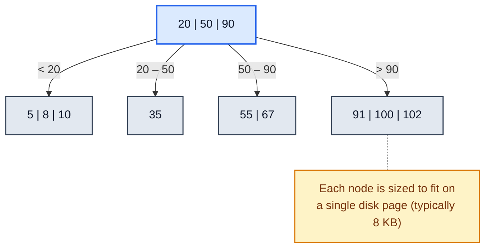

### Core B-Tree Invariants
Every node in a B-tree of order `m` enforces four strict rules:
1. All leaf nodes sit at the **exact same depth**.
2. Each non-root node contains between `m/2` and `m` keys.
3. An internal node with `k` keys has exactly `k + 1` children.
4. Keys within every node are stored in **sorted order**.

### B-Trees Across Modern Databases
* **PostgreSQL:** Uses B-trees for almost everything—primary keys, `UNIQUE` constraints, and default indexes:
  ```sql
  CREATE TABLE users (
      id    SERIAL PRIMARY KEY,
      email VARCHAR(255) UNIQUE
  );
  -- Automatically creates two B-tree indexes (id and email)
  ```
* **MongoDB:** Uses B-trees (specifically **B+ trees**, where record pointers live in the leaf nodes) for its indexes:
  ```javascript
  db.users.createIndex({ "email": 1 });
  ```
* **DynamoDB Note:** Organizes items within a partition in sort-key order for fast range queries, though its underlying storage engine is widely understood to use an **LSM-style** architecture rather than a B-tree.

### Why B-Trees Are the Default Choice
* **Sorted order:** Makes range queries (`BETWEEN`, `>`) and `ORDER BY` operations naturally fast.
* **Self-balancing:** Guarantees predictable `O(log n)` depth even as data grows or receives random inserts and deletes.
* **Disk-friendly I/O:** High fan-out + disk-page-aligned nodes minimize random disk reads.
* **Versatile:** Handles both equality lookups (`email = 'x'`) and range scans (`age > 25`) well.

> **Interview Default:** If you need to pick an index in an interview and aren't sure, **B-tree is almost always the right default**.

---

## 3. LSM Trees (Log-Structured Merge Trees)

B-trees shine on balanced and read-heavy workloads, but what if you're building a system like **Datadog** ingesting **100,000+ writes per second**? Updating a B-tree in place requires finding the target leaf page, reading it into memory, modifying it, and writing it back—turning heavy write traffic into a storm of random disk seeks (like constantly hunting down scattered folders in a filing cabinet).

**LSM trees** solve this with an **append-only** design that turns many small random writes into fewer large **sequential disk writes**.

> **Important Distinction vs. B-Trees:** With B-trees, each index is an independent structure you can attach to any column. An **LSM tree** is the **storage format for the entire table**, sorted by primary key. Primary-key lookups are fast, while secondary indexes require extra structures (such as Cassandra secondary indexes or DynamoDB GSIs/LSIs) with different performance characteristics.

### How LSM Trees Work

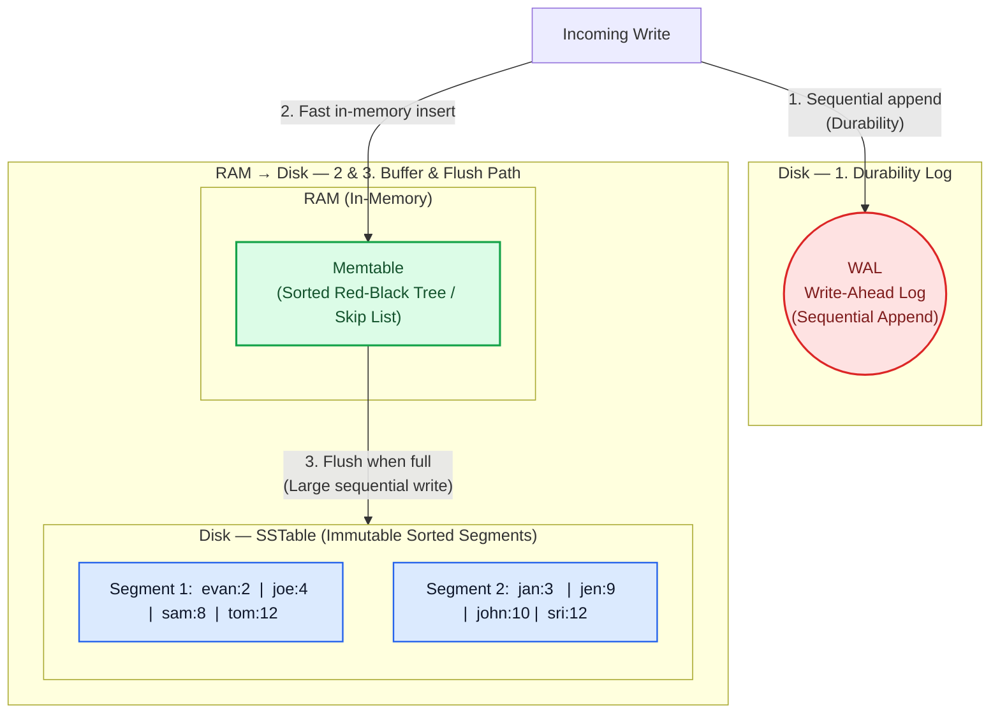

1. **Memtable (RAM):** Incoming writes go straight into an in-memory sorted structure (typically a red-black tree or skip list)—ultra-fast because it stays entirely in memory.
2. **Write-Ahead Log / WAL (Disk):** Simultaneously, every write is sequentially appended to an on-disk WAL for crash durability—far faster than random page updates.
3. **Flush to SSTable (Disk):** Once the memtable reaches a size threshold (e.g., a few MBs), it is frozen and flushed in one sequential write as an immutable **Sorted String Table (SSTable)**.
4. **Compaction (Background):** Over time, many SSTable segments accumulate. Background compaction periodically merges segments, discarding overwritten values and tombstoned deletes to keep file counts low and reads fast.

### Read Overhead & Optimizations
Because data may live in any layer, a point lookup must check in order:
1. Active **Memtable**
2. Any **immutable memtables** waiting to flush
3. On-disk **SSTables** from newest to oldest

To prevent point queries from reading dozens of files on disk, LSM engines rely on three key optimizations:
* **Bloom Filters:** A compact probabilistic structure attached to each SSTable that answers *"definitely NOT here"* (allowing instant skips) or *"maybe here"* (triggering a read).
* **Sparse Indexes:** Because SSTables are sorted, a sparse index tracks key ranges per block—so searching for `user_id = 500` completely skips an SSTable covering keys `1000–2000`.
* **Compaction Strategies:**
  * **Size-Tiered Compaction:** Minimizes write amplification, but leaves more overlapping SSTables to check on reads.
  * **Leveled Compaction:** Keeps fewer non-overlapping files (faster reads), at the cost of more frequent background rewrites.

### B-Tree vs. LSM Tree

| Dimension | B-Tree | LSM Tree |
| :--- | :--- | :--- |
| **Write Pattern** | In-place random page updates | Append-only sequential writes (WAL + Memtable flush) |
| **Write Throughput** | Moderate (random disk seeks at extreme scale) | **Very High** (sequential I/O) |
| **Read Latency** | **Predictable & Fast** (single tree traversal) | Slightly higher / variable (may check multiple SSTables) |
| **Best Use Cases** | User-facing OLTP apps, read-heavy or balanced workloads | Time-series, metrics (Datadog), IoT, audit logs, write-heavy ingestion |
| **Real-World Engines** | PostgreSQL, MySQL (InnoDB), MongoDB | **Cassandra** (Netflix viewing events), **RocksDB** (Facebook social interactions) |

---

## 4. Hash Indexes

**Hash indexes** are persistent hashmaps that map indexed keys directly to disk row locations, trading query flexibility for **`O(1)` exact-match lookups**.

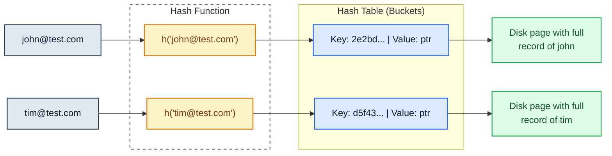

* **How it works:** Hash the indexed value to locate its bucket, then follow the pointer to the row's disk page. Hash collisions are typically handled via chaining or overflow buckets.
* **Major limitation:** Completely **useless for range queries or sorting**, because similar keys hash to scattered buckets.
* **Real-world usage:** Rare on disk—PostgreSQL supports hash indexes, yet defaults to B-trees because B-trees handle equality nearly as fast while also supporting ranges and ordering. Hash indexes shine in **in-memory** engines such as **Redis** and MySQL's `MEMORY` storage engine.
* **When to choose in interviews:** Only when you need ultra-fast **in-memory exact-match lookups**, will *never* need range queries or sorting, and have ample RAM.

---

## 5. Geospatial Indexes

### The Challenge With Location Data
Suppose you are building a restaurant discovery app like **Yelp** and need to answer: *"Find restaurants within 5 miles of me."*

A naive approach creates two separate B-tree indexes on `latitude` and `longitude`:

```sql
CREATE TABLE restaurants (
    id        SERIAL PRIMARY KEY,
    name      VARCHAR(255),
    latitude  DECIMAL(10, 8),
    longitude DECIMAL(11, 8)
);

CREATE INDEX idx_lat ON restaurants(latitude);
CREATE INDEX idx_lng ON restaurants(longitude);
```

This breaks down immediately in 2D space:

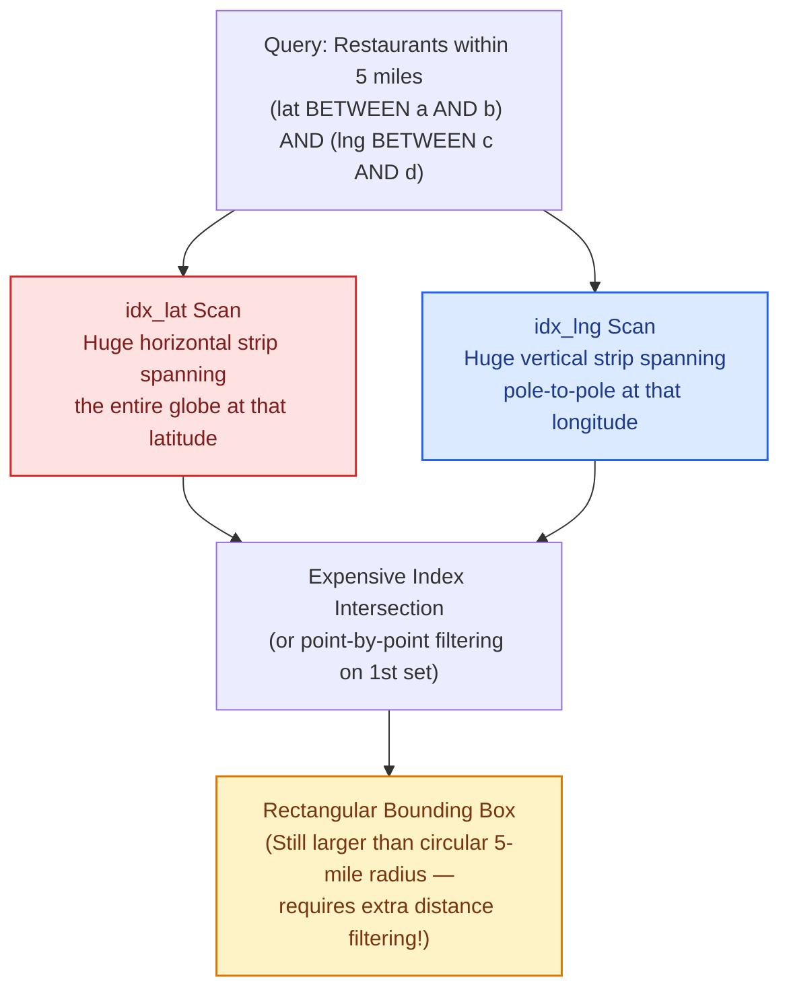

1. **Single-index scan:** Scanning `idx_lat` returns every restaurant across the entire globe in that latitude band; checking longitude for each row becomes expensive point filtering instead of a range scan.
2. **Index intersection:** Merging two massive sets (`idx_lat` ∩ `idx_lng`) is expensive, produces a rectangle larger than your circular radius, and still requires filtering out corner points outside 5 miles.

To query proximity efficiently, you need **2D spatial indexes**: **Geohash**, **Quadtree**, or **R-Tree**.

---

### Geohash
**Geohash** converts a 2D `(latitude, longitude)` point into a **1D Base32 string** that preserves spatial proximity. Recursively subdividing the map grid adds characters—longer strings mean higher precision:

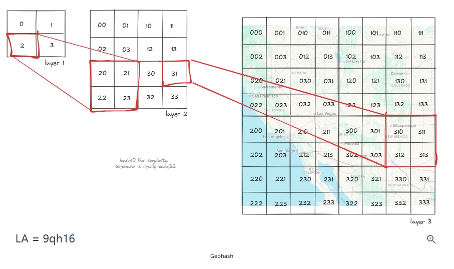

**Step-by-step mental model:**

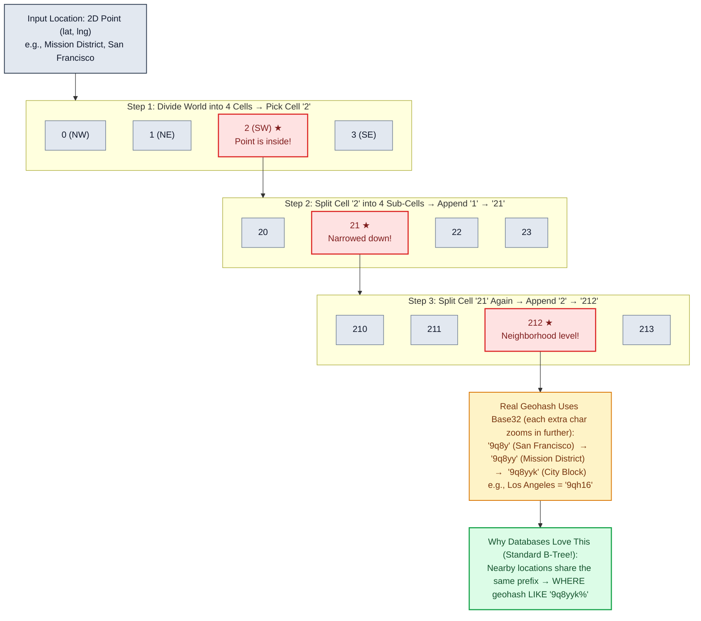

* **Why Geohash is so popular:** Nearby points usually share the same prefix (`9q8yyk...` vs `9q8yym...`). Once encoded as strings, you can index them with a **standard B-tree**—turning 2D proximity search into fast string prefix range scans (plus querying the 8 neighboring cells for radius searches spanning cell borders).
* **Boundary limitation:** Two places right across a street that falls on a major grid boundary can have completely different prefixes. Querying adjacent cells handles most cases, and for most applications this edge case is minor.

---

### Quadtree
Instead of encoding coordinates into strings, a **Quadtree** directly partitions 2D space by recursively splitting any region into **four equal quadrants** whenever it exceeds a point-count threshold `k` (typically `4–8`; `k = 5` below).

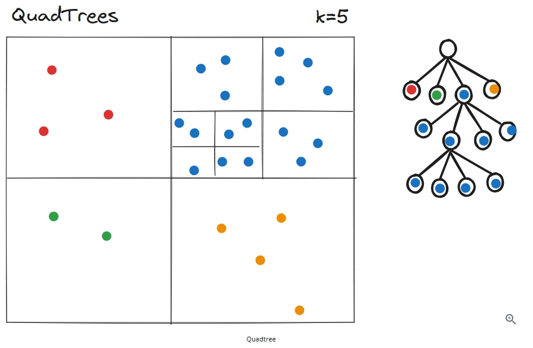

**How the 2D splits map to the tree (`k = 5`):**

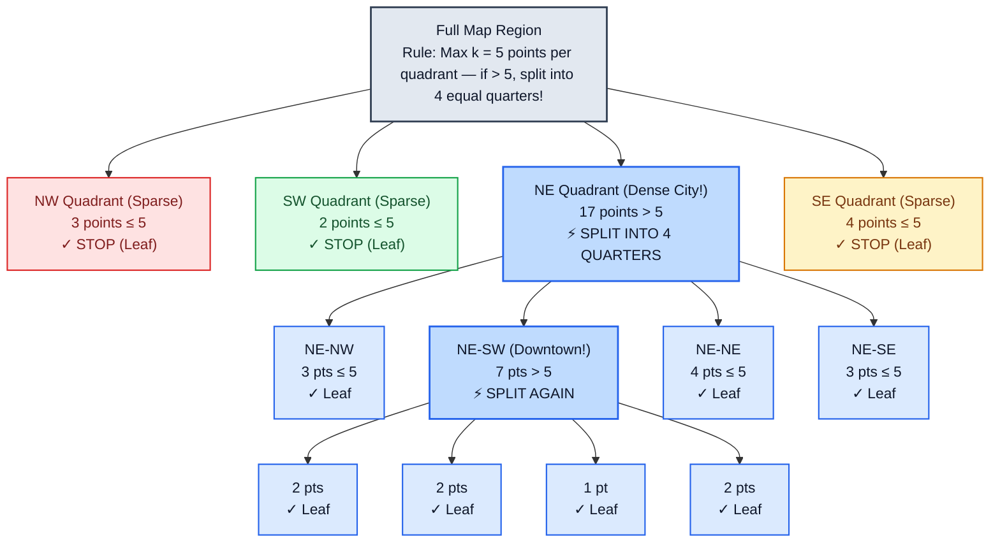

* **Adaptive resolution:** Dense urban areas subdivide finely while sparse rural regions remain large quadrants—similar to how **Google Maps** organizes map tiles across zoom levels.
* **Proximity search:** Traverse down to the target quadrant, inspect sibling/neighbor quadrants at the same depth, and walk up or down levels to adjust radius.
* **Trade-off:** Unlike Geohash, Quadtrees require a specialized tree structure rather than reusing standard database B-trees, making them less common inside general-purpose databases today.

---

### R-Tree
**R-Trees** are the **default spatial index in modern production databases** (including **PostgreSQL / PostGIS** and **MySQL**). Instead of splitting space into rigid equal quarters like a Quadtree, R-Trees group nearby objects into **flexible, overlapping Minimum Bounding Rectangles (MBRs)** that adapt to actual data clusters.

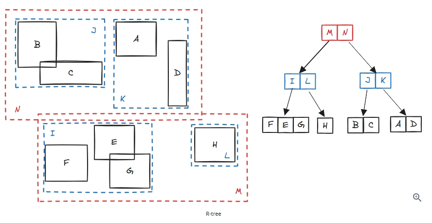

**How the overlapping bounding boxes map to the tree:**

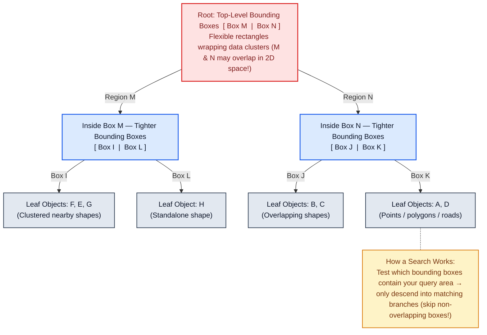

* **Supports points AND complex shapes:** A single R-Tree can index restaurant coordinates, delivery-zone polygons, and road networks together—each bounding rectangle expands to fit whatever shapes it holds.
* **Trade-off:** Because bounding rectangles can overlap (`M` and `N` may share spatial area), a query sometimes has to search multiple branches. Modern R-Tree variants optimize overlap vs. tree depth specifically for disk page reads.

### Geospatial Indexes Comparison

| Approach | How Space Is Divided | Works on Standard B-Tree? | Strengths | Weaknesses |
| :--- | :--- | :--- | :--- | :--- |
| **Geohash** | 1D Base32 prefix strings over recursive grid | **Yes** (prefix range scans) | Simple to implement & explain; leverages existing B-trees | Grid boundary edge cases; points only |
| **Quadtree** | Rigid recursive 4-way quadrant splits | No (custom tree) | Adaptive resolution for uneven density; great for map tiles | Specialized structure; less native DB support |
| **R-Tree** | Flexible, overlapping bounding rectangles | No (native in PostGIS/MySQL) | **Production default**; indexes points, polygons, and lines | Overlapping boxes can trigger multi-branch scans |

---

## 6. Inverted Indexes

B-trees fail when you need **full-text search** matching words anywhere inside a text column:

```sql
SELECT * FROM posts
WHERE content LIKE '%database%';
```

A B-tree can only help with prefix matches (`'database%'`) or suffix matches (on a reversed column). Searching for a substring anywhere in the text forces a full scan checking every character of every document.

An **inverted index** solves this by flipping the mapping from **Document → Words** to **Word → List of Documents** (just like the index at the back of a textbook).

**Example Documents:**
```text
doc1: "B-trees are fast and reliable"
doc2: "Hash tables are fast but limited"
doc3: "B-trees handle range queries well"
```

**Resulting Inverted Index:**
```text
b-trees  → [doc1, doc3]
fast     → [doc1, doc2]
reliable → [doc1]
hash     → [doc2]
tables   → [doc2]
limited  → [doc2]
handle   → [doc3]
range    → [doc3]
queries  → [doc3]
```

### Production Analysis Pipeline (Elasticsearch / Lucene), Full-Text-Search (FTS) index pipeline in Couchbase is similar

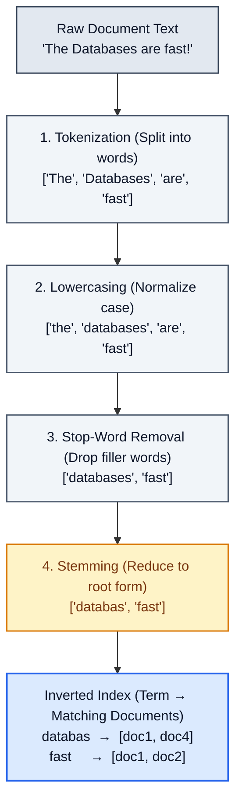

Because of this analysis pipeline, searching `"Databases"` seamlessly matches `"database"`, `"DATABASE"`, and `"database's"`. Production search engines (**Elasticsearch**, **Apache Lucene**) layer additional capabilities on top:
* **Term frequency analysis** (how often words appear)
* **Relevance scoring** (ranking the best matching documents, e.g., BM25)
* **Fuzzy matching** (handling typos like `"databas"`)
* **Phrase queries** (matching exact ordered word sequences)

**Real-world usage:** GitHub repository search, Slack message history search, documentation search.

> **Trade-Offs:** Inverted indexes carry substantial storage overhead and expensive write updates—whenever a document is edited, postings lists must be updated for **every term** inside that document.

---

## 7. Index Optimization Patterns

### Composite Indexes
The most common real-world optimization pattern: combining **multiple columns into a single ordered index** to match multi-condition queries.

Consider a classic social media feed query:
```sql
SELECT * FROM posts
WHERE user_id = 123
  AND created_at > '2024-01-01'
ORDER BY created_at DESC;
```

Two separate single-column indexes (`idx_user` and `idx_time`) force the database to scan both indexes, intersect the two result sets, and then sort by `created_at`. A single **composite index** handles filtering **and** sorting in one contiguous scan:

```sql
CREATE INDEX idx_user_time ON posts(user_id, created_at);
```

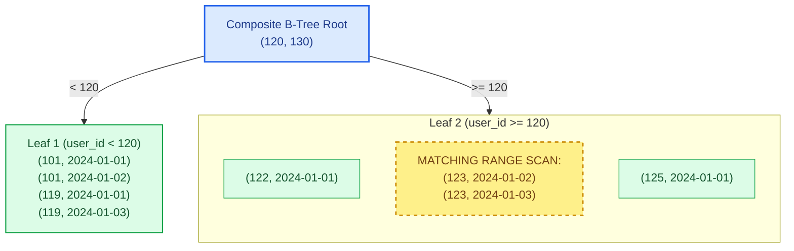

* Entries are sorted by `user_id` first, then by `created_at` within each `user_id`.
* For `user_id = 123`, the engine jumps directly to the highlighted slice and scans sequentially—**both filtering and sorting happen in a single index scan**.

> **Column Order Matters (Leftmost Prefix Rule):** An index on `(user_id, created_at)` accelerates queries filtering on `user_id` alone or `(user_id, created_at)`, **not** queries filtering on `created_at` alone. A common rule of thumb is to **order columns from most selective to least selective** (and equality columns before range columns).

---

### Covering Indexes
A **covering index** includes all columns required to satisfy a query—not just the filter/sort keys—so the database can answer the query purely from the index (**index-only scan**) without fetching full rows from the main table on disk.

```sql
CREATE TABLE posts (
    id         SERIAL PRIMARY KEY,
    user_id    INT,
    title      TEXT,
    content    TEXT,
    likes      INT,
    created_at TIMESTAMP
);

-- Regular composite index (must still fetch table pages to read 'likes')
CREATE INDEX idx_user_time ON posts(user_id, created_at);

-- Covering index: stores 'likes' in the index leaf so table lookups are skipped
CREATE INDEX idx_user_time_likes ON posts(user_id, created_at) INCLUDE (likes);
```

*(Shown in SQL here, though the exact same principle applies across NoSQL databases as well.)*

* **When it pays off:** High-traffic, read-heavy queries fetching a small subset of columns from wide tables (e.g., social feeds showing timestamps + like counts, or leaderboards).
* **Trade-off & interview reality:** Covering indexes are larger and add write/maintenance overhead, making them a **niche optimization** rather than a default choice. In interviews, prioritize clean primary and composite indexes first—reach for covering indexes only when you can clearly justify avoiding main-table lookups.

---

## 8. Interview Wrap-Up & Decision Guide

Use this decision flow whenever an interviewer asks how you would index a table or query pattern:

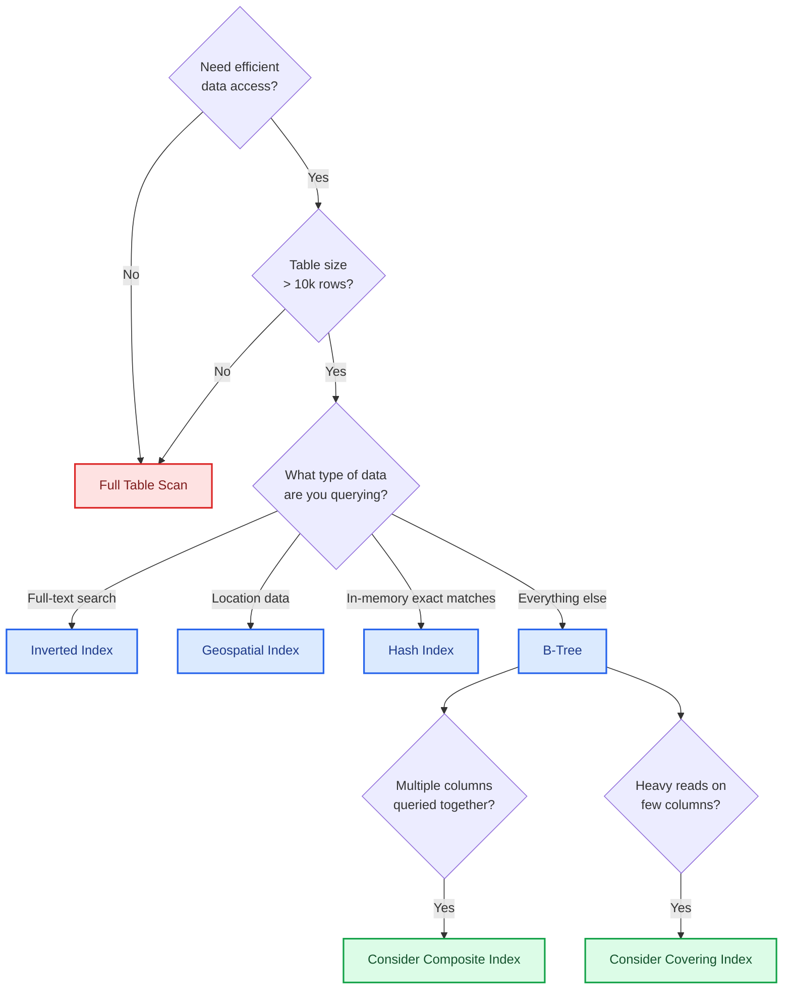

### Key Takeaways to Remember
* **When in doubt, pick B-Trees:** They are the Swiss Army knife of indexes, handling equality lookups, range scans, and sorting reliably.
* **Extreme write throughput:** Call out **LSM-tree** storage engines (Cassandra, RocksDB) when ingestion volume makes random B-tree page updates a bottleneck.
* **Location / proximity queries:** Reach for a **Geospatial Index**—at minimum know **Geohash** (and even better, contrast it with **Quadtrees** and **R-Trees**).
* **Full-text search:** Reach for an **Inverted Index** (e.g., Elasticsearch / Lucene).

---

**Previous:** [← Data Modeling](./Data-Modeling.md) | **Index:** [HLD Index](./HLD.md)
