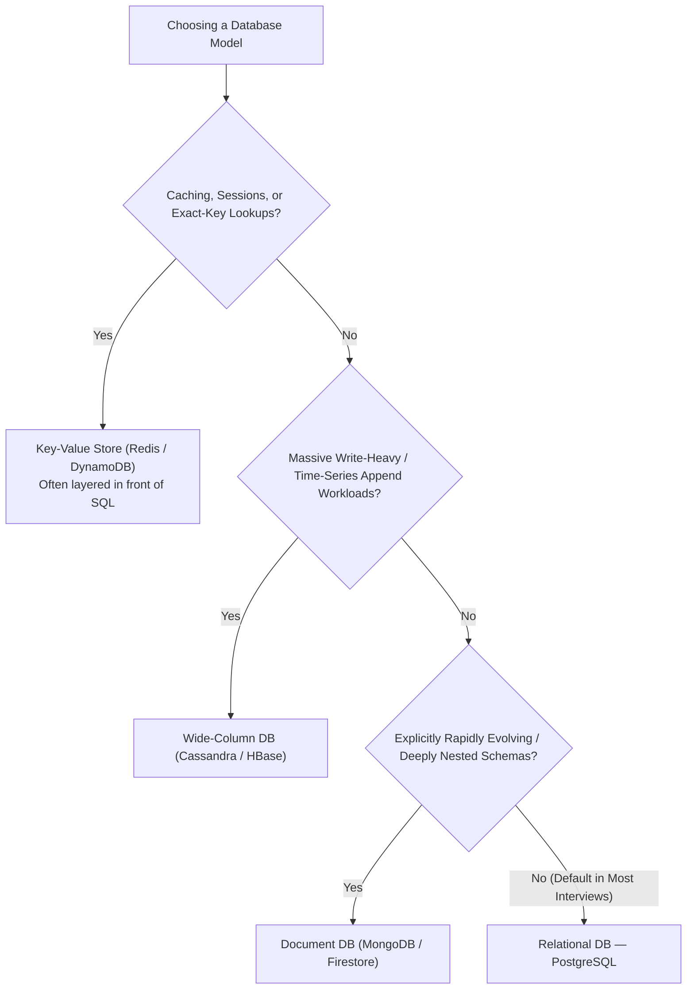
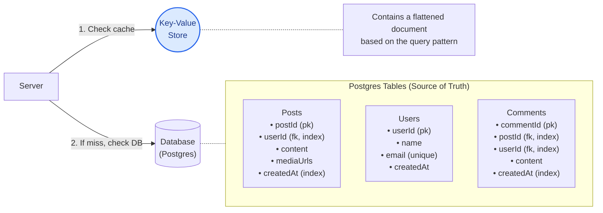
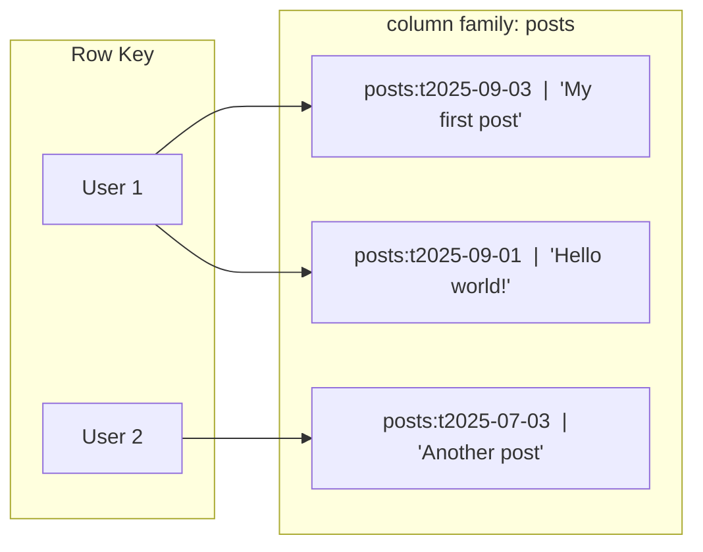
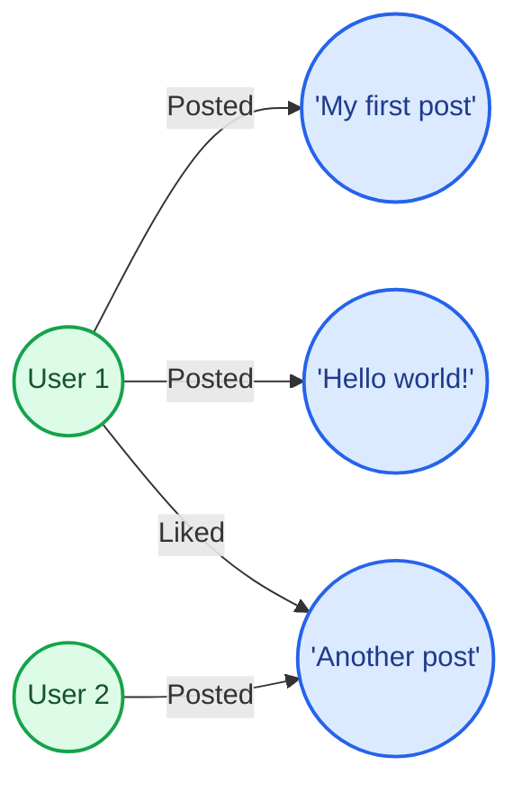
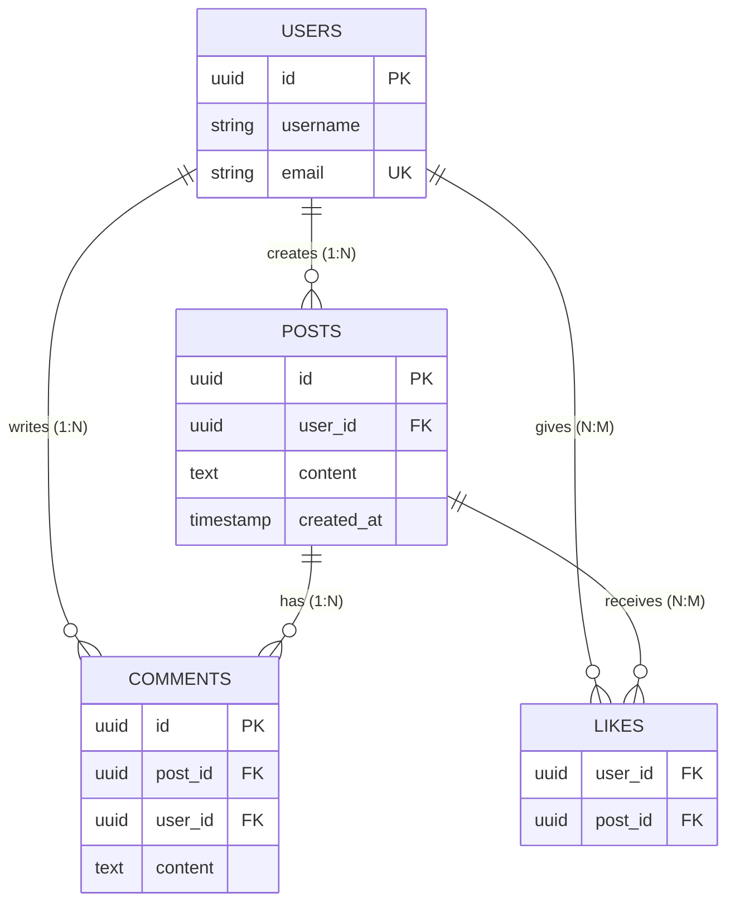
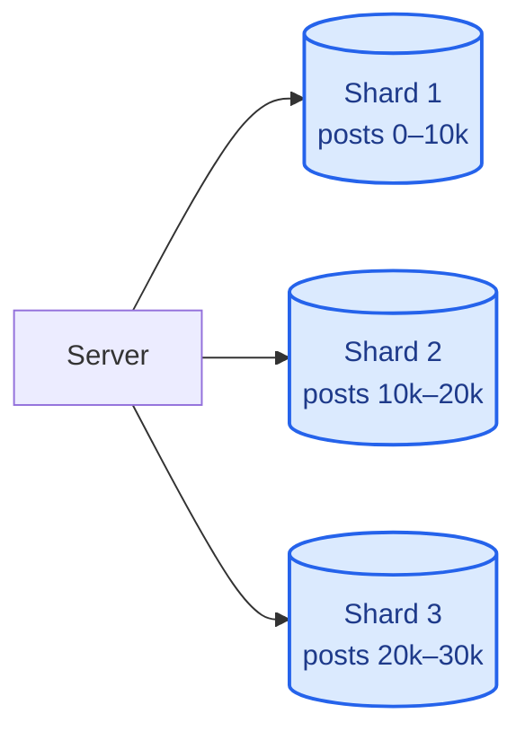
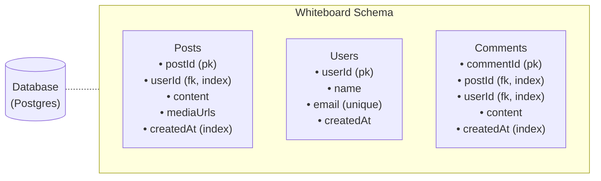

[back to HLD index](./HLD.md)
---

# Data Modeling

> *You're not expected to normalize everything or produce a complete schema diagram in a system design interview—your goal is a clear, functional data model aligned with your system's requirements that sets up scaling, consistency, and query performance.*

## Table of Contents
1. [Data Modeling in System Design Interviews](#1-data-modeling-in-system-design-interviews)
2. [Database Model Options](#2-database-model-options)
3. [Schema Design Fundamentals](#3-schema-design-fundamentals)
4. [Indexing for Access Patterns](#4-indexing-for-access-patterns)
5. [Normalization vs. Denormalization](#5-normalization-vs-denormalization)
6. [Scaling and Sharding](#6-scaling-and-sharding)
7. [Interview Wrap-Up & Final Whiteboard](#7-interview-wrap-up--final-whiteboard)

---

## 1. Data Modeling in System Design Interviews

**Data modeling** is the process of deciding what entities exist, how they are identified, and how they connect to one another. In an interview, it happens in two places:

1. **Requirements Gathering (Core Entities):** Identify your **core entities** early on. These usually map `1:1` with tables or collections and form the backbone of your schema.
2. **High-Level Design (Basic Schema):** Sketch a concise schema alongside your database component—including key fields, relationships, and a quick note on how you would index or partition to support the primary query patterns.

> **Why It Matters:** A reasonable schema is more than box-drawing. It directly sets up the rest of your design—scaling reads and writes, preserving consistency when it matters, and answering questions about growth or auditability without backtracking. A sloppy data model creates painful problems later in the interview.

---

## 2. Database Model Options

Different database models shape how you structure your data, so this choice affects everything that follows.



> **Default Rule:** Resist the temptation to show off by choosing exotic database types. Most of the time, the right answer is a **relational database**—specifically **PostgreSQL**—unless your requirements clearly signal a specialized model (or you have deep, opinionated experience with another database).

### Relational Databases (SQL)
Relational databases organize data into structured tables, enforce relationships through **foreign keys**, and provide **ACID** guarantees for transactions.

* **Natural fit for most interviews:** Most system design problems map cleanly onto tables and relationships (e.g., a social media app with `users`, `posts`, `comments`, and `likes`).
* **Strong consistency:** When strong consistency is a non-functional requirement—such as ensuring payments never double-charge or inventory never oversells—SQL's **ACID** guarantees are the right tool for the job.
* **Watch out for multi-table joins:** SQL excels at complex queries, but heavy multi-table joins can become performance traps at scale. Mentioning reporting-style queries raises yellow flags unless you address whether they are performant enough or require denormalized views, caching, or pre-computed results.
* **Scalability myth:** Concerns about SQL scalability are often exaggerated. Modern relational databases scale with **read replicas**, **sharding**, **connection pooling**, and **caching**. Some of the largest companies in the world (Facebook, Airbnb) rely on relational foundations—scaling depends on how you architect around the database, not just which engine you pick.
* **Examples:** `PostgreSQL`, `MySQL`, `SQLite`.

### Document Databases
Document databases store data as JSON-like documents with flexible schemas, making them well-suited for rapidly evolving applications where fields are not known upfront.

* **Interview reality:** System design interviews intentionally scope functional requirements to a clear, concise set—meaning you rarely have "evolving schemas" in the first place. Only consider a document store if the interviewer explicitly mentions rapidly changing data structures.
* **When to consider over SQL:** Frequently changing schemas, deeply nested data that would require many SQL joins, or records with vastly different structures.
* **Data modeling impact:** You denormalize more aggressively, embedding related data inside documents to avoid expensive lookups across collections.
* **Examples:** `MongoDB`, `Firestore`, `CouchDB`.

### Key-Value Stores
Key-value stores provide simple lookups by exact key match. They are extremely fast but offer limited query capabilities beyond single-key access.

* **When to consider:** Caching, session storage, feature flags, exact-ID lookups, or high-write scenarios requiring maximum performance without complex queries.
* **Used *with* SQL, not just *over* SQL:** Saying "over SQL" is often misleading. In practice, you frequently use **both together**—SQL as your durable source of truth, with a key-value cache (like Redis) in front for hot data. This delivers low-latency reads without sacrificing durability or complex query support.
* **Data modeling impact:** Your schema becomes very flat. You **denormalize** heavily and duplicate data across multiple keys to support different access patterns (since you cannot join across relationships)—great for reads, but hard to keep consistent when data changes.
* **Examples:** `Redis`, `DynamoDB`, `Memcached`.



### Wide-Column Databases
Wide-column databases organize data into **column families** where rows can hold different sets of columns. They are optimized for massive write-heavy workloads and time-series data.

* **How access patterns work:** When a user creates a post, you write an entry keyed by `(user_id, timestamp)`. Data sharing the same partition key (`user_id`) is stored together, making writes fast (append to the partition) and reads efficient (scan a contiguous range of a user's posts).
* **When to consider over SQL:** Enormous write volumes, time-series data, or analytics workloads where you primarily append data and run aggregations (e.g., telemetry, event logging, IoT sensor data).
* **Data modeling impact:** You design strictly around query patterns—even more than with SQL—often duplicating data across column families to serve different reads. **Time becomes a first-class citizen** in your schema.
* **Examples:** `Cassandra`, `HBase`.



### Graph Databases
Graph databases store data as **nodes** and **edges**, optimizing for traversing complex relationships between entities.



* **When to consider over SQL:** Honestly? **Almost never in interviews.** Classic textbook examples are social networks and recommendation engines, yet even Facebook models its social graph with MySQL.
* **Examples:** `Neo4j`, `Amazon Neptune`.

> **Common Interview Mistake:** Reaching for a graph database sounds sophisticated, but it adds unnecessary operational complexity. Standard databases can handle primary query patterns without introducing a specialized graph engine.

### Database Models at a Glance

| Model | Data Shape | Best Fit | Modeling Impact | Examples |
| :--- | :--- | :--- | :--- | :--- |
| **Relational (SQL)** | Tables, rows, foreign keys | **Default choice**; ACID transactions, clear entity relationships | Normalized tables + targeted indexes | PostgreSQL, MySQL, SQLite |
| **Document** | JSON-like documents | Rapidly changing or deeply nested/heterogeneous schemas | Aggressive denormalization & embedded sub-documents | MongoDB, Firestore, CouchDB |
| **Key-Value** | Flat key → value pairs | Caching, sessions, feature flags, exact-ID high-speed lookups | Flat, heavily denormalized, duplicated per access pattern | Redis, DynamoDB, Memcached |
| **Wide-Column** | Row keys + column families | Massive write volume, time-series, telemetry, event logs | Query-driven tables; time as a first-class key component | Cassandra, HBase |
| **Graph** | Nodes + directed edges | Deep multi-hop traversals *(rarely needed in interviews)* | Entities as nodes, relationships as typed edges | Neo4j, Amazon Neptune |

---

## 3. Schema Design Fundamentals

### Start with Requirements
Every schema design decision flows from **three core factors** established during requirements gathering and API design:

| Factor | What It Drives | Example |
| :--- | :--- | :--- |
| **Data Volume** | Where data physically lives (single DB vs. split across multiple data stores) | Millions of users may require separating user and post stores with distinct schemas and careful cross-store references |
| **Access Patterns** *(Most Important)* | Table structures, denormalization, and indexes—derived directly from your API endpoints | A news feed loading *"recent posts by followed users"* demands targeted indexes or denormalized views, whereas analytics dashboards need aggregated structures |
| **Consistency Requirements** | How tightly coupled related data must remain | Financial transactions require **strong consistency** (ACID in one DB); activity feeds/likes tolerate **eventual consistency**, allowing separate specialized data stores |

> **Core Insight:** Entities, keys, normalization, indexes, and sharding are not ends in themselves—they are simply tools to satisfy these three factors. Always ask: *"What queries will I need to support each API endpoint?"*

### Entities, Keys & Relationships
Start by listing your core entities and assigning each a **primary key (PK)**. Always use **system-generated IDs** (like `user_id` or `post_id`) rather than business data (like email addresses), because system-generated keys stay stable even when business rules change.

**Example (Social Media App):**
```text
users:    id (PK), username, email
posts:    id (PK), user_id (FK → users.id), content, created_at
comments: id (PK), post_id (FK → posts.id), user_id (FK → users.id), content
likes:    user_id (FK → users.id), post_id (FK → posts.id)
```



#### Relationship Cardinalities
| Relationship | Meaning | Example |
| :--- | :--- | :--- |
| **One-to-Many (`1:N`)** | One parent record maps to many child records | A user has many posts; a post has many comments |
| **Many-to-Many (`N:M`)** | Records on both sides link to many on the other (modeled via a join table) | Users like many posts; posts are liked by many users (`likes`) |
| **One-to-One (`1:1`)** | One record maps to exactly one other record | Rare in practice—often a sign the two tables should simply be merged |

#### Foreign Keys, Referential Integrity & Constraints
* **Foreign Keys (`FK`):** Enforced at the database level in SQL (e.g., `posts.user_id → users.id`) or via application logic in NoSQL. They guarantee **referential integrity**, preventing orphaned records (such as a post pointing to a nonexistent user or comments pointing to a deleted post).
* **Scale Trade-Off:** Foreign keys add write overhead because the database must validate every insert and update. At massive scale, some companies drop DB-level foreign keys to maximize write throughput and enforce integrity in application code instead. Calling out this trade-off in an interview is a strong signal.
* **Constraints (`NOT NULL`, `UNIQUE`, `CHECK`):** Enforce correctness directly in the database (e.g., unique emails, positive prices). They protect data quality at the cost of a small write overhead.

---

## 4. Indexing for Access Patterns

During an interview, explicitly call out **which columns are indexed and why**, tying each index directly back to your API endpoints.

**Example (Social Media App):**

| Target Column(s) | Query / Endpoint Supported | Why It Helps |
| :--- | :--- | :--- |
| `posts.user_id` | `GET /users/{id}/posts` | Quickly locate all posts authored by a specific user without a full table scan |
| `posts.created_at` | `GET /posts?sort=-created_at` | Efficiently fetch recent posts in chronological order |
| `(user_id, created_at)` *(Composite)* | `GET /users/{id}/posts?sort=-created_at` | Filter by user **and** return their most recent posts already sorted |

> **Interview Tip:** Always connect your indexes directly to your API contract—saying *"The `GET /users/{id}/posts` endpoint needs an index on `posts.user_id`"* shows you are thinking about real query performance rather than guessing.

---

## 5. Normalization vs. Denormalization

| Approach | How It Works | Pros | Cons |
| :--- | :--- | :--- | :--- |
| **Normalization** | Store each piece of information in **exactly one place** (e.g., user info lives only in `users`) | Prevents update anomalies; clean, consistent source of truth | Complex read queries may require multi-table joins |
| **Denormalization** | Duplicate related fields across tables/records (e.g., copying `username` onto every post) | Faster reads with fewer or zero joins | Expensive updates & inconsistency risk (changing a username requires updating every post; missing one corrupts state) |

> **Interview Strategy:** Always **start with a clean, normalized model** and denormalize only when a real bottleneck demands it. Duplicating data creates consistency problems that are much harder to solve than the performance problems you are trying to avoid.

### Best of Both Worlds: Normalized DB + Denormalized Cache
Even when you need fast, denormalized reads, you don't have to pollute your primary database schema. Keep your relational database **clean and normalized** as the source of truth, and place a **cache** (like Redis) in front storing pre-computed joins, aggregations, or flattened query-specific documents (as shown in the [Key-Value Stores](#key-value-stores) architecture above).

---

## 6. Scaling and Sharding

When your dataset grows too large for a single database instance, you **shard** (horizontally partition) it across multiple machines. The goal is to pick a **shard key** that keeps related data co-located.



### Core Sharding Principles
* **Shard by the primary access pattern:** If your dominant query is *"posts by user,"* shard by `user_id`. All of a user's posts live on the same shard, avoiding expensive cross-shard lookups.
* **Be careful with time-range sharding:** Partitioning by timestamp sounds tempting for *"recent posts"* queries, but **all current writes hit the single latest shard**, creating a **hot shard**. This is usually an anti-pattern for write-heavy systems; time-range partitioning fits better for archival or analytics workloads where recent reads dominate and writes are spread out.
* **Avoid cross-shard queries:** If a timeline feature needs posts from hundreds of followed users and your DB is sharded by `user_id`, the application must query many shards and merge the results (scatter-gather)—which is slow and complex.
* **Choose carefully—shard keys are hard to change:** Resharding a live production database is painful and often effectively permanent, so validate your shard key against every major access pattern upfront.

---

## 7. Interview Wrap-Up & Final Whiteboard

Data modeling is a foundational piece of system design interviews, but it is **not** the sole focus. Design a crisp, defensible schema that satisfies your requirements, then move on to the deeper architectural challenges.

### 6-Step Interview Checklist
Outline your core entities early during requirements gathering. Then, when you place a database component on the whiteboard during High-Level Design:

1. **Choose the database type** *(default to PostgreSQL unless requirements dictate otherwise)*.
2. **List the key columns** needed to fulfill your functional requirements for each entity.
3. **Specify primary keys (`pk`) and foreign keys (`fk`)** to define entity relationships.
4. **Call out indexed columns** and tie them directly to your API query patterns.
5. **Decide whether denormalization or caching** is needed for read performance.
6. **Evaluate sharding**—if required by data volume or throughput, choose a shard key aligned with your primary access pattern.

### Final Whiteboard Example
At the end of your data modeling pass, your whiteboard only needs to look as clean and concise as this:



---

**Previous:** [← API Design](./API-Design.md) | **Index:** [HLD Index](./HLD.md)
