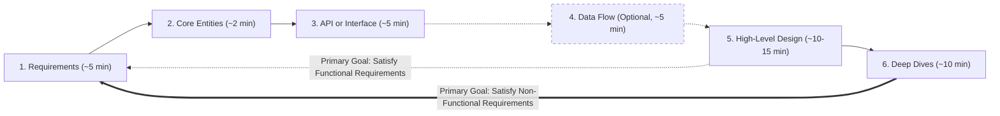
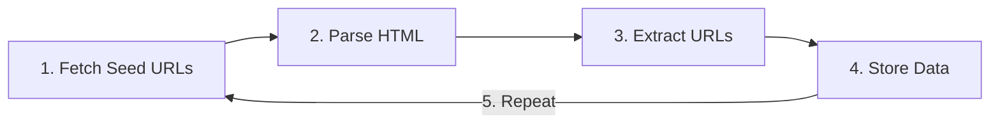
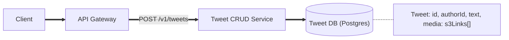
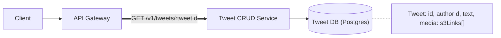
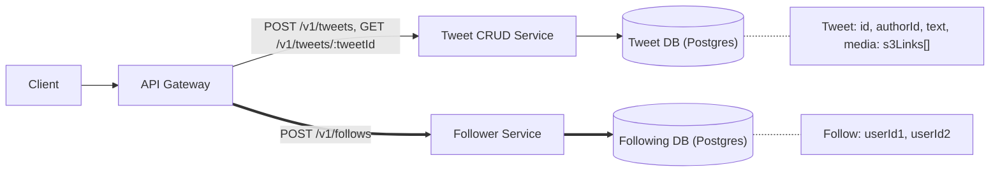
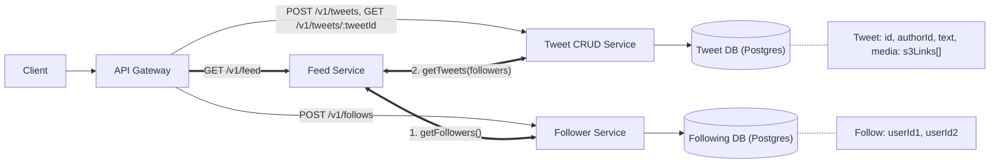

[back to HLD index](./HLD.md)
---

# HLD Interview Framework

> *In practice, candidates perform significantly better by following a repeatable structure—it keeps you from getting stuck and ensures you deliver a complete, working system within the interview window.*

## Table of Contents
1. [The Framework Overview](#1-the-framework-overview)
2. [Requirements (~5 minutes)](#2-requirements-5-minutes)
3. [Core Entities (~2 minutes)](#3-core-entities-2-minutes)
4. [API or System Interface (~5 minutes)](#4-api-or-system-interface-5-minutes)
5. [Data Flow (Optional, ~5 minutes)](#5-data-flow-optional-5-minutes)
6. [High-Level Design (~10-15 minutes)](#6-high-level-design-10-15-minutes)
7. [Deep Dives (~10 minutes)](#7-deep-dives-10-minutes)

---

## 1. The Framework Overview

A typical 45-minute High-Level Design (HLD) interview flows through **6 structured stages**, where the High-Level Design targets **Functional Requirements** and the Deep Dives harden the system for **Non-Functional Requirements**:



| Stage | Time Budget | Primary Focus |
| :--- | :--- | :--- |
| **1. Requirements** | ~5 min | Clarify scope via Functional & Non-Functional Requirements |
| **2. Core Entities** | ~2 min | Identify the main nouns/resources persisted and exchanged |
| **3. API / System Interface** | ~5 min | Define the contract between clients and the system |
| **4. Data Flow *(Optional)*** | ~5 min | Outline end-to-end processing steps (for data-processing pipelines) |
| **5. High-Level Design** | ~10–15 min | Build a simple end-to-end architecture satisfying functional requirements |
| **6. Deep Dives** | ~10 min | Harden the design for scale, bottlenecks, edge cases, and NFRs |

---

## 2. Requirements (~5 minutes)

The goal of this stage is to build a clear, shared understanding of the system you are being asked to design. Break requirements into **Functional** and **Non-Functional** sections.

### 1) Functional Requirements
Functional requirements are your **"Users/Clients should be able to..."** statements. They define the core features of the system and should be the first thing you discuss with your interviewer—usually as a back-and-forth conversation.

Ask targeted questions as if speaking to a client, customer, or product manager (*"Does the system need to do X?"*, *"What should happen if Y?"*) to arrive at a prioritized list of core features.

**Example (Twitter):**
* Users should be able to post tweets.
* Users should be able to follow other users.
* Users should be able to see tweets from users they follow.

### 2) Non-Functional Requirements
Non-functional requirements describe the system qualities that matter to users, phrased as **"The system should be able to..."** or **"The system should be..."** statements.

**Example (Twitter):**
* The system should be highly available, prioritizing availability over consistency.
* The system should scale to support **100M+ DAU** (Daily Active Users).
* The system should be low latency, rendering feeds in **under 200ms**.

> **Important — Quantify in Context:** Always tie non-functional requirements to a specific part of the system and quantify them where possible. Saying *"the system should be low latency"* is obvious and unhelpful—nearly all systems want low latency. Saying *"the system should have low-latency search (< 500ms)"* identifies the critical path and sets a concrete design target.

Aim to identify the **top 3–5** non-functional requirements most relevant to your problem using this checklist:

| Dimension | Key Questions to Consider |
| :--- | :--- |
| **CAP Theorem** | Should the system prioritize **Consistency** or **Availability**? *(Partition tolerance is a given in distributed systems.)* |
| **Environment Constraints** | Are there client/network constraints, such as mobile devices with limited battery life or streaming video over 3G? |
| **Scalability** | Are there unique scaling patterns (bursty traffic at specific times, holiday spikes)? What is the **read vs. write ratio**? |
| **Latency** | How fast must responses return—especially for compute-heavy paths (e.g., low-latency search in Yelp)? |
| **Durability** | Can the system tolerate any data loss? A social network might tolerate minor loss, whereas a banking system cannot. |
| **Security** | What level of data protection, access control, and encryption is required? |
| **Fault Tolerance** | How gracefully must the system handle failures? Consider redundancy, failover, and recovery mechanisms. |
| **Compliance** | Are there legal or regulatory constraints (e.g., GDPR, HIPAA, PCI-DSS) the design must satisfy? |

### 3) Capacity Estimation
Many guides recommend doing back-of-the-envelope calculations upfront, but this is **often unnecessary** and eats into valuable design time.

* **Recommended approach:** Tell the interviewer you would like to skip upfront estimations and calculate numbers on demand *when and if* they directly influence a design decision.
* **When estimation IS necessary:** Suppose you are designing a **Top-K trending topics** system for Facebook posts. Estimating the number of distinct topics directly determines whether a single-instance data structure (like a min-heap) fits in memory or whether you must shard across multiple instances—a major architectural decision.

---

## 3. Core Entities (~2 minutes)

Identify and list the **core entities** of your system. This establishes shared vocabulary, clarifies the central data in your design, and forms the foundation for both your API and persistence layer.

> **Why Not List the Entire Data Model Upfront?**
> Because you don't know what you don't know yet. As you design the system, you will discover additional entities and relationships. Starting with a concise list lets you iterate quickly—once you reach High-Level Design and see what state changes on each request, you can flesh out the relevant fields/columns next to each database.

**Questions to identify core entities:**
* Who are the actors in the system, and do any overlap?
* What are the core nouns or resources needed to satisfy the functional requirements?

---

## 4. API or System Interface (~5 minutes)

Define the contract between clients and your backend. First, make a quick protocol choice:

| Protocol | How It Works | When to Use |
| :--- | :--- | :--- |
| **REST** *(Representational State Transfer)* | Uses HTTP verbs (`GET`, `POST`, `PUT`, `DELETE`) for CRUD operations on resources | **Default choice** for most interviews and public client-server APIs |
| **GraphQL** | Clients specify the exact fields they need, preventing over-fetching and under-fetching | When diverse clients (mobile, web, TV) have very different data requirements |
| **RPC** *(Remote Procedure Call, e.g., gRPC)* | Invokes remote procedures directly with compact binary serialization | Internal service-to-service APIs where low latency and throughput are critical |

> **Key Tip:** Don't overthink the protocol choice—default to **REST** unless you have a concrete reason not to. For real-time features, you may also need **WebSockets** or **Server-Sent Events (SSE)**, but design your core API first.

### REST Naming & Example (Twitter)
* Use **plural nouns** for resource paths (e.g., `/v1/tweets`, not `/v1/tweet`).

```http
# Post a new tweet
POST /v1/tweets
Body: { "text": string }

# Fetch a specific tweet
GET /v1/tweets/{tweetId} -> Tweet

# Follow another user
POST /v1/follows
Body: { "followee_id": string }

# Fetch the authenticated user's home feed
GET /v1/feed -> Tweet[]
```

---

## 5. Data Flow (Optional, ~5 minutes)

For certain backend systems—especially **data-processing pipelines**—it helps to outline the high-level sequence of transformations applied to inputs to produce the desired outputs. **If your system does not involve a multi-stage processing pipeline, skip this step.**

**Example ([Web Crawler](https://www.hellointerview.com/learn/system-design/problem-breakdowns/web-crawler)):**



---

## 6. High-Level Design (~10-15 minutes)

Draw boxes and arrows representing the core components of your system (servers, databases, caches, queues) and how they interact—either on a physical whiteboard or virtual tools like [Excalidraw](https://excalidraw.com/).

> **Interview Prep Tip:** Ask your recruiter ahead of time which whiteboarding tool will be used and practice with it beforehand so you aren't fumbling with UI controls during the interview.

### Core Principles for High-Level Design
1. **Build sequentially, endpoint by endpoint:** Don't overthink it. Your primary goal is an architecture that satisfies the API and **functional requirements**. Walking through your API endpoints one by one is the cleanest way to evolve the diagram.
2. **Avoid premature complexity:** A common failure mode is layering on caches, message queues, and sharding too early and never finishing a working end-to-end system. Keep the HLD simple; note potential optimizations (caches, queues, read replicas) verbally and in writing, then tackle them in **Deep Dives**.
3. **Narrate data flow and state changes:** Talk through each request from API Gateway to database and back to the response, explicitly calling out what state changes at each persistence layer.
4. **Document only design-relevant schema fields:** When a request hits a database, jot down the key entity fields right next to the DB. Don't worry about exact types—your interviewer can infer them.

> **Skip Boilerplate Columns:** Don't waste time writing obvious fields (like `name`, `email`, or `password_hash` on a `User` table). Focus strictly on columns and relationships that matter to your design.

---

### Walkthrough: Building Twitter Endpoint by Endpoint

#### Iteration 1: `POST /v1/tweets`
Start with the first write path—creating a tweet and persisting it in a relational database with its key fields documented beside the store.



#### Iteration 2: `GET /v1/tweets/:tweetId`
No new services or databases needed—simply route read requests through the API Gateway to the existing `Tweet CRUD Service`.



#### Iteration 3: `POST /v1/follows`
Introduce a dedicated `Follower Service` and `Following DB` to store user follow relationships.



#### Iteration 4: `GET /v1/feed`
Add a `Feed Service` that orchestrates fetching the list of followed accounts from `Follower Service` and then pulling their tweets from `Tweet CRUD Service`.



> **Intentional Trade-off:** This simple high-level design for Twitter is **woefully inefficient** when fetching user feeds at scale (fan-out on read across millions of followers/tweets). That is completely expected—flag it now and solve it in the **Deep Dives** section.

---

## 7. Deep Dives (~10 minutes)

With a complete, working high-level design in place, use the final ~10 minutes to harden the architecture:

* **Verify Non-Functional Requirements:** Ensure the system actually meets your latency, availability, scalability, and durability targets.
* **Address Edge Cases:** Handle hot keys (e.g., celebrity accounts with millions of followers), failure modes, and partial outages.
* **Resolve Bottlenecks:** Introduce caching, fan-out strategies, message queues, sharding, or read replicas where the HLD breaks down.
* **Respond to Interviewer Probes:** Adapt and refine the design based on follow-up questions.

> **Seniority Signal:** The degree to which you proactively lead deep dives scales with seniority. More senior candidates are expected to spot bottlenecks themselves and drive the discussion without waiting for interviewer prompts.

---

**Next:** [Networking Essentials →](./Networking-Essentials.md)
