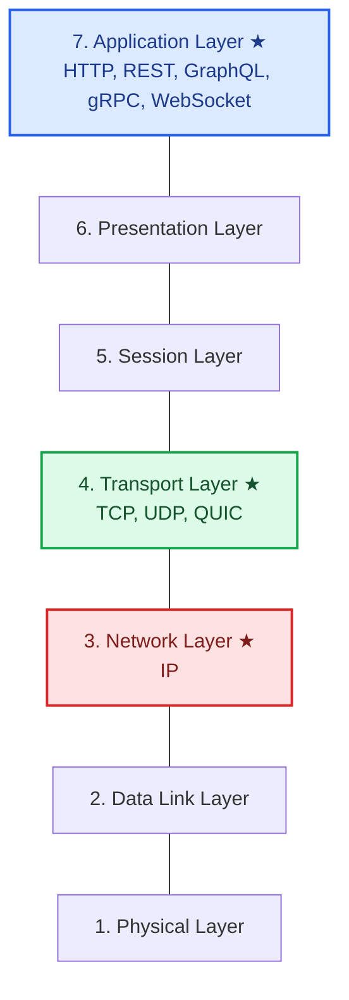
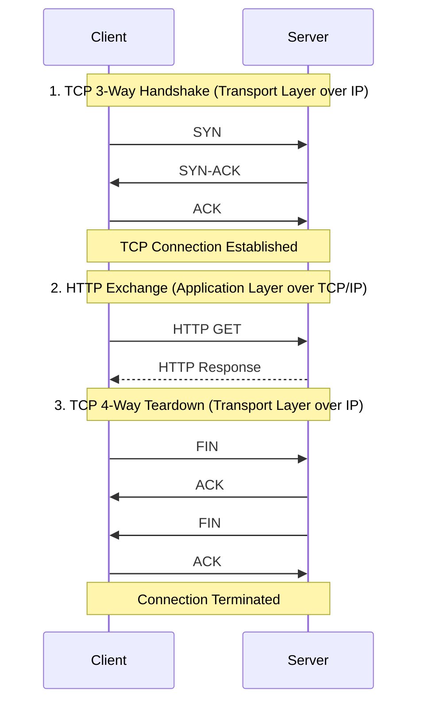
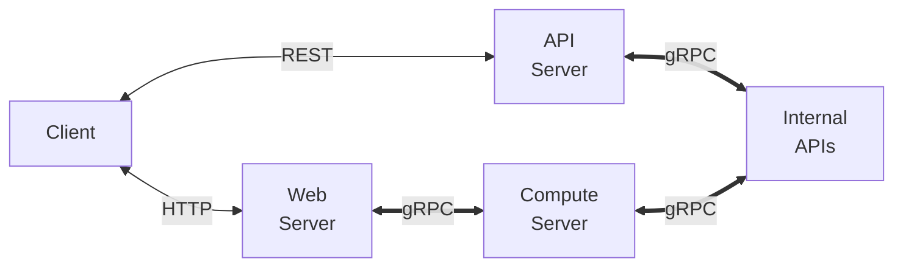
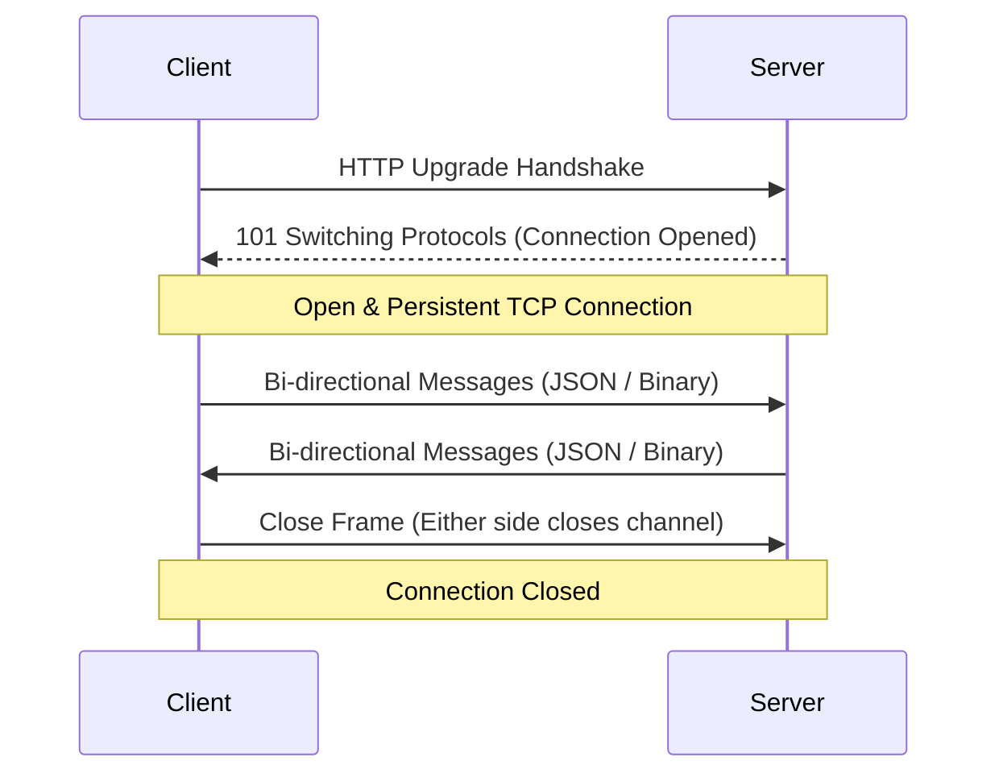
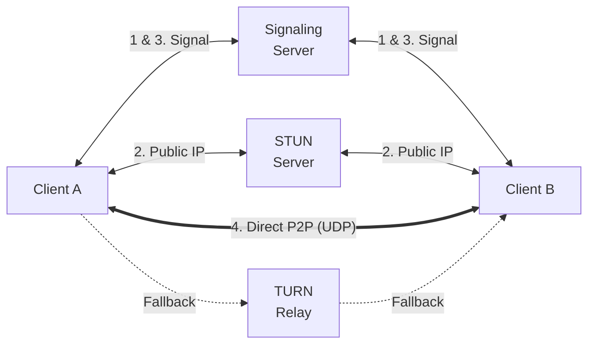
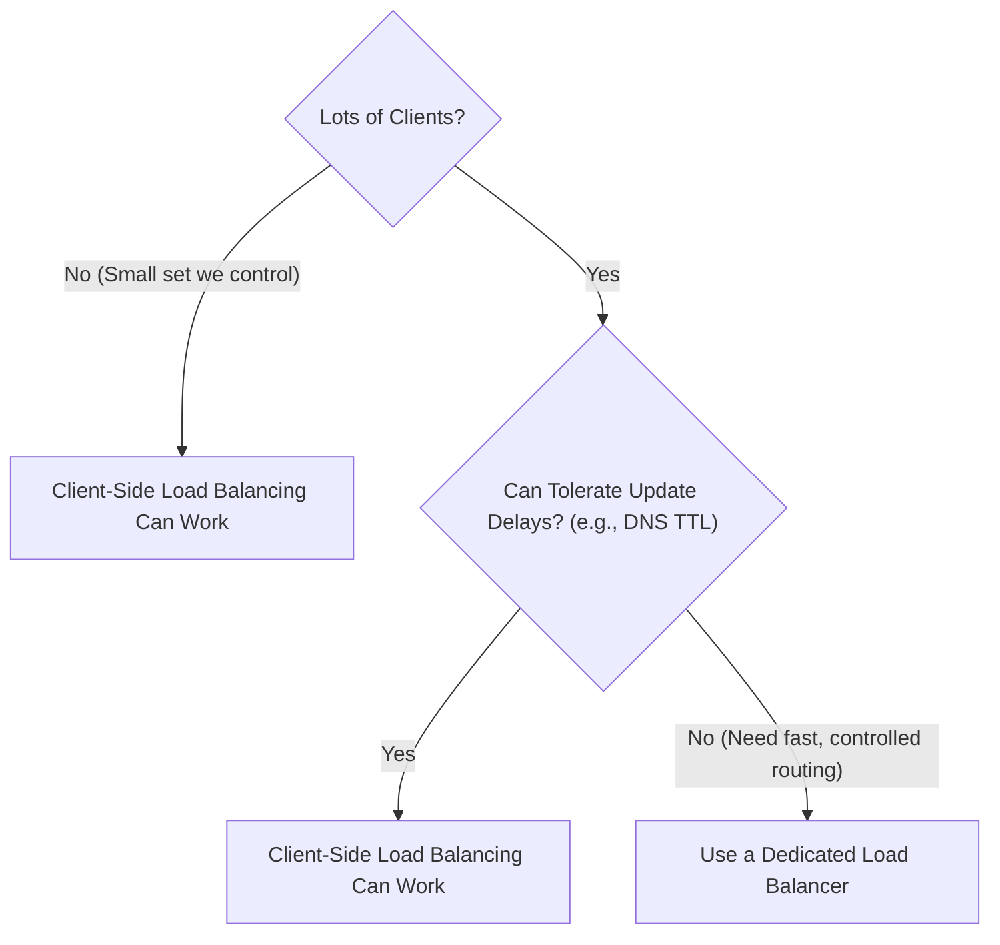
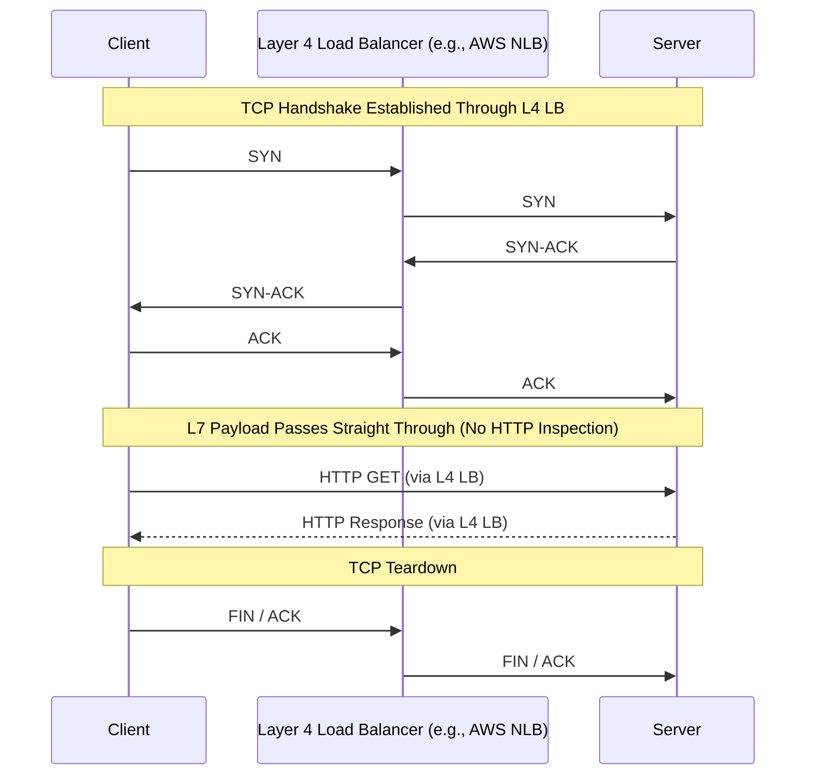
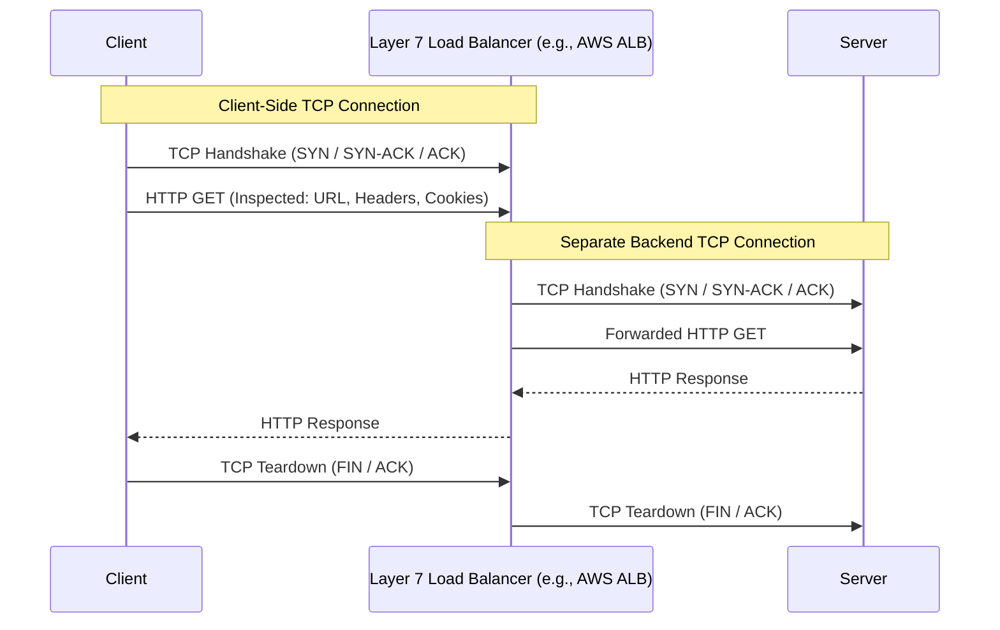
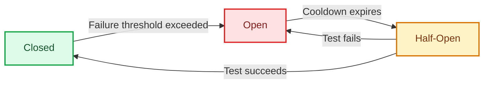

[back to HLD index](./HLD.md)
---

# Networking Essentials

> *The core networking fundamentals you need for system design interviews—covering protocol layers, transport and application protocols, real-time communication, load balancing, latency, and fault tolerance.*

## Table of Contents
1. [Networking Layers (OSI Model)](#1-networking-layers-osi-model)
2. [Example: A Simple Web Request](#2-example-a-simple-web-request)
3. [Network Layer Protocols (IP)](#3-network-layer-protocols-ip)
4. [Transport Layer Protocols (TCP, UDP & QUIC)](#4-transport-layer-protocols-tcp-udp--quic)
5. [Application Layer Protocols (HTTP / HTTPS)](#5-application-layer-protocols-http--https)
6. [REST: Simple and Flexible](#6-rest-simple-and-flexible)
7. [GraphQL: Flexible Data Fetching](#7-graphql-flexible-data-fetching)
8. [gRPC: Efficient Service Communication](#8-grpc-efficient-service-communication)
9. [Server-Sent Events (SSE): Real-Time Server Push](#9-server-sent-events-sse-real-time-server-push)
10. [WebSocket: Real-Time Bidirectional Communication](#10-websocket-real-time-bidirectional-communication)
11. [WebRTC: Peer-to-Peer Communication](#11-webrtc-peer-to-peer-communication)
12. [Load Balancing](#12-load-balancing)
13. [Common Deep Dives: Regionalization, CDNs & Partitioning](#13-common-deep-dives-regionalization-cdns--partitioning)
14. [Handling Failures and Fault Modes](#14-handling-failures-and-fault-modes)

---

## 1. Networking Layers (OSI Model)

At its core, networking connects devices so they can communicate. Networks are built on a layered architecture commonly described by the **OSI Model**. Out of the 7 layers, **three layers** matter most in system design interviews: **Layer 7 (Application)**, **Layer 4 (Transport)**, and **Layer 3 (Network)**.



> **★ Key Interview Layers:** Focus on **Layer 7 (Application)**, **Layer 4 (Transport)**, and **Layer 3 (Network)**—the highlighted layers above.

---

## 2. Example: A Simple Web Request

When you type a URL into your browser, multiple networking layers work together to retrieve a web page over **HTTP** on **TCP** over **IP**:



---

## 3. Network Layer Protocols (IP)

The **Network Layer (Layer 3)** is dominated by the **IP (Internet Protocol)** and handles **addressing and routing**.

* **Private IPs (DHCP):** Nodes inside a private network are typically assigned IPs by a **DHCP** server at boot. These addresses are arbitrary and only meaningful within that private network.
* **Public IPs (RIR):** For internet traffic to reach your servers, you need publicly routable IP addresses allocated by a **Regional Internet Registry (RIR)**. Internet routing infrastructure is optimized to route packets between public IPs—for example, any IP starting with `17.` (such as `17.0.0.0/8`) belongs to Apple.

---

## 4. Transport Layer Protocols (TCP, UDP & QUIC)

The **Transport Layer (Layer 4)** establishes end-to-end communication between applications and adds delivery guarantees on top of raw IP packets. The three primary protocols are **TCP**, **UDP**, and **QUIC**.

> **Interview Focus:** In most system design interviews, the real choice is between **TCP** and **UDP**. Think of **QUIC** as a modernized, faster evolution of TCP (built on UDP, powering HTTP/3) that is growing in adoption but not yet ubiquitous everywhere.

### UDP: Fast but Unreliable
**User Datagram Protocol (UDP)** adds minimal overhead on top of IP—think *"spray and pray."* It is connectionless with no guarantees of delivery, ordering, or duplicate protection.

* **Connectionless:** No handshake or connection setup.
* **No delivery guarantee:** Packets may be dropped without notification.
* **No ordering:** Packets may arrive out of order.
* **Lower latency:** Minimal header overhead (8 bytes) enables faster transmission.
* **Best fit:** Live video streaming, online gaming, VoIP, and DNS lookups—where speed matters more than occasional packet loss.

> **Browser Caveat:** Browsers do not have broad native support for raw UDP outside of **WebRTC**. If your design uses UDP for mobile/native clients, plan a fallback for browser users (e.g., batched HTTP/SSE streams spread out in the UI).

### TCP: Reliable with Overhead
**Transmission Control Protocol (TCP)** is the workhorse of the internet, providing reliable, ordered, error-checked byte streams via a **3-way handshake** (`SYN` → `SYN-ACK` → `ACK`).

* **Connection-oriented:** Establishes a stateful stream before transferring data.
* **Reliable & ordered delivery:** Recipients acknowledge packets; unacknowledged packets are retransmitted, and messages arrive in order.
* **Flow control:** Prevents fast senders from overwhelming slow receivers.
* **Congestion control:** Adapts send rate to avoid network collapse.
* **Best fit:** Everything where data integrity is critical.

> **Hybrid Usage:** Modern apps often combine both—for example, a video conferencing app uses **TCP/HTTP** for signaling and authentication, and **UDP/WebRTC** for real-time audio/video streams.

### TCP vs. UDP Comparison

| Feature | UDP | TCP |
| :--- | :--- | :--- |
| **Connection** | Connectionless | Connection-oriented (3-way handshake) |
| **Reliability** | Best-effort delivery | Guaranteed delivery (retransmissions) |
| **Ordering** | No ordering guarantees | Strict in-order delivery |
| **Flow Control** | No | Yes |
| **Congestion Control** | No | Yes |
| **Header Size** | 8 bytes | 20–60 bytes |
| **Speed / Latency** | Faster (minimal overhead) | Slower (handshake + ACKs + overhead) |
| **Common Use Cases** | Live streaming, gaming, VoIP, DNS | Web, APIs, databases, file transfer, everything else |

---

## 5. Application Layer Protocols (HTTP / HTTPS)

The **Application Layer (Layer 7)** typically runs in **user space**, whereas lower layers run in the **OS kernel**. This makes Layer 7 far easier to evolve and customize, while lower layers optimize for raw efficiency.

### HTTP: The Web's Foundation
HTTP is a **stateless** protocol—each request is independent and servers do not need to retain state between requests. Minimizing stateful surface area is a core principle of scalable system design.

#### Common HTTP Request Methods
| Method | Purpose | Idempotent? |
| :--- | :--- | :--- |
| **`GET`** | Retrieve data (no request body) | Yes |
| **`POST`** | Send data / create a new resource | No |
| **`PUT`** | Replace/update an entire resource | Yes |
| **`PATCH`** | Partially update a resource | Depends on implementation |
| **`DELETE`** | Delete a resource | Yes |

#### Common HTTP Status Codes
| Class | Code | Meaning |
| :--- | :--- | :--- |
| **Success (`2xx`)** | `200 OK` | Request succeeded |
| | `201 Created` | Request succeeded and a new resource was created |
| **Redirects (`3xx`)** | `301 Moved Permanently` | Resource permanently moved to a new URL |
| | `302 Found` | Resource temporarily moved |
| **Client Errors (`4xx`)** | `401 Unauthorized` | Authentication is required |
| | `403 Forbidden` | Authenticated, but not authorized for this resource |
| | `404 Not Found` | Requested resource does not exist |
| | `429 Too Many Requests` | Rate limit exceeded |
| **Server Errors (`5xx`)** | `500 Internal Server Error` | Unexpected server-side failure |
| | `502 Bad Gateway` | Invalid response received from an upstream server |

#### HTTP Headers & Content Negotiation
HTTP headers are flexible key-value metadata pairs that enable backward-compatible evolution. For example, **content negotiation** via `Accept-Encoding` lets a client advertise compression formats (`gzip`, `br` / Brotli), and the server responds with the most efficient supported format in `Content-Encoding`.

#### HTTPS (HTTP + TLS)
HTTPS wraps HTTP in **TLS** (the modern successor to deprecated Netscape-era SSL) to encrypt traffic in transit and prevent eavesdropping and man-in-the-middle (MITM) attacks.

> **Security Warning:** Encryption in transit does **not** mean the request body is trustworthy. Never trust client-supplied identifiers (such as `user_id` in a request body) without verifying identity via authenticated session/token claims—otherwise an attacker can tamper with the body and read arbitrary users' data.

---

## 6. REST: Simple and Flexible

The three dominant API paradigms on top of HTTP are **REST**, **GraphQL**, and **gRPC**.

In **REST**, you model **resources** (nouns) and manipulate them with standard HTTP verbs, typically exchanging JSON payloads:

```http
# Fetch a user
GET /users/{id} -> User

# Update an existing user
PUT /users/{id}
Body: { "username": "john.doe", "email": "john.doe@example.com" }

# Create a new user (server assigns the ID)
POST /users
Body: { "username": "stefan.mai", "email": "stefan@hellointerview.com" }

# Nested relationship: fetch a user's posts
GET /users/{id}/posts -> [Post]

# Action modeled as a resource state change (e.g., startGame)
PATCH /games/{id}
Body: { "status": "started" }
```

> **Interview Default:** JSON serialization is not the fastest format for extreme throughput, but most applications are not bottlenecked by JSON parsing. Just like TCP at Layer 4, **default to REST** in interviews unless requirements dictate otherwise. *(See [API Design](./API-Design.md) for a full deep dive.)*

---

## 7. GraphQL: Flexible Data Fetching

**GraphQL** lets clients specify the exact shape of the data they need in a single request, solving two classic REST pain points:

* **Under-fetching:** Needing multiple sequential round trips to assemble data for one screen.
* **Over-fetching:** Returning bloated payloads filled with unused fields to accommodate future use cases.

**Trade-offs & Interview Guidance:**
* **Strengths:** Ideal for mobile apps (minimizing bandwidth), complex clients, and fast-iterating frontend teams querying overlapping data without waiting on new backend endpoints.
* **Drawbacks:** Adds backend query-execution latency, caching complexity, and the N+1 query problem.
* **When to mention in interviews:** Bring up GraphQL only when the prompt emphasizes **flexible, rapidly changing client data needs** or diverse clients (web vs. mobile). Otherwise, GraphQL often gets in the way of discussing backend query optimizations.

---

## 8. gRPC: Efficient Service Communication

**gRPC** is a high-performance RPC framework from Google built on **HTTP/2** and **Protocol Buffers (protobuf)**—a strongly typed binary serialization format that is significantly smaller and faster than JSON (often up to **10x** higher throughput):

```protobuf
// Protocol Buffer definition for a User resource
message User {
  string id = 1;
  string name = 2;
}
```

```text
Protobuf binary encoding (15 bytes):
0A 03 31 32 33 12 08 6A 6F 68 6E 20 64 6F 65

Equivalent JSON encoding (40 bytes):
{"id": "123", "name": "John Doe"}
```

Protobuf schemas compile into strongly typed client and server stubs across languages, catching contract mismatches at compile time and supporting streaming, deadlines, and client-side load balancing out of the box.

### Typical Architecture: REST Externally, gRPC Internally
Public-facing clients (especially browsers) use **HTTP / REST**, while backend microservices communicate over **gRPC**:



> **Avoid Premature Optimization:** Interviewers evaluate your judgment, not whether you pick the fastest protocol everywhere. Don't hyper-optimize RPC serialization before solving the system's real bottlenecks.

---

## 9. Server-Sent Events (SSE): Real-Time Server Push

**Server-Sent Events (SSE)** is a lightweight extension over standard HTTP that allows a server to **stream multiple events to a client over a single long-lived HTTP response**.

Instead of waiting for one complete JSON payload:

```json
{
  "events": [
    {"id": 1, "timestamp": "2025-01-01T00:00:00Z", "description": "Event 1"},
    {"id": 2, "timestamp": "2025-01-01T00:00:01Z", "description": "Event 2"}
  ]
}
```

SSE pushes each event as a separate chunk that the client processes immediately as it arrives:

```text
data: {"id": 1, "timestamp": "2025-01-01T00:00:00Z", "description": "Event 1"}

data: {"id": 2, "timestamp": "2025-01-01T00:00:01Z", "description": "Event 2"}
```

**Production Caveats to Know:**
* **Connection drops & reconnection:** Proxies, load balancers, or servers will eventually close long-lived connections. The browser's `EventSource` API automatically reconnects and sends the last received event ID so the server can replay missed events.
* **Proxy buffering:** Misbehaving network proxies may buffer and batch SSE chunks into a single response, defeating real-time delivery.
* **Best fit in interviews:** Unidirectional server-to-client updates such as live auction prices, stock tickers, news feeds, or progress notifications.

---

## 10. WebSocket: Real-Time Bidirectional Communication

When both client and server need **high-frequency, real-time bidirectional communication** (with full browser support), use **WebSockets**.

1. The client initiates a WebSocket handshake over HTTP on an existing TCP connection (reusing HTTP headers/cookies for auth).
2. The server responds with `101 Switching Protocols`, upgrading the connection from HTTP to WebSocket.
3. Both client and server exchange binary or text (commonly JSON) frames freely over the persistent TCP connection.
4. The connection remains open until either side explicitly closes it.



> **Infrastructure & Interview Warning:** Every proxy, firewall, and load balancer along the path must support WebSockets, and maintaining millions of stateful connections adds significant scaling complexity. **Never jump to WebSockets without clearly justifying why unidirectional SSE or polling isn't enough.**

---

## 11. WebRTC: Peer-to-Peer Communication

**WebRTC** enables direct **peer-to-peer (P2P)** communication between browsers over **UDP** without routing media through a central server—making it ideal for **audio/video calling and conferencing** (and occasionally P2P collaborative editing with CRDTs).

Because most clients sit behind firewalls and **NAT (Network Address Translation)** devices that block inbound connections, WebRTC relies on three helper servers:

| Component | Role | In Plain English |
| :--- | :--- | :--- |
| **Signaling Server** | Central coordination server where peers discover each other and exchange connection metadata (SDP/ICE candidates) | *"The matchmaker"* — introduces two peers and swaps their connection info so they know how to reach each other. |
| **STUN Server** | *Session Traversal Utilities for NAT* — discovers a peer's publicly routable IP and port (NAT hole punching) | *"The mirror"* — tells your device what its public IP address and port look like from the outside internet. |
| **TURN Server** | *Traversal Using Relays around NAT* — fallback relay server that bounces traffic when direct P2P fails | *"The middleman"* — relays traffic between peers when strict firewalls or NAT block a direct connection. |



**Connection Flow:**
1. Clients connect to the **Signaling Server** to discover peers.
2. Clients query a **STUN Server** to discover their public IP address and port.
3. Clients exchange their connection information via the **Signaling Server**.
4. Clients establish a **direct P2P connection** (periodically refreshing info), falling back to a **TURN Server** if NAT/firewalls block direct traversal.

> **Interview Tip:** WebRTC is notoriously hard to operate reliably and still experiences connection drops. Stick to recommending it specifically for **video/audio calling and conferencing**.

---

## 12. Load Balancing

When systems scale **horizontally** (adding more servers rather than vertical scaling), a **load balancer** distributes requests across backend instances. Load balancing happens either on the **client side** or via a **dedicated server-side load balancer**.

### Client-Side Load Balancing
The client fetches a list of healthy backend servers from a service registry/directory and picks a server directly—eliminating an extra network hop per request.

* **Example — Redis Cluster:** Nodes share cluster topology via a gossip protocol. Clients fetch the shard-to-node map once, hash keys locally to pick the right node, and follow `MOVED` redirects if topology changes.
* **Example — DNS Rotation:** DNS resolvers return a rotated list of IP addresses for a domain so clients naturally spread across servers (and across multiple load balancers in different regions to avoid a single point of failure).



### Dedicated Load Balancers (Layer 4 vs. Layer 7)
A dedicated load balancer sits between clients and backend servers. It adds one network hop per request in exchange for fast server-pool updates, health checks, and centralized routing control.

#### Layer 4 Load Balancers (Transport Layer — e.g., AWS NLB)
Operates on TCP/UDP packets without inspecting HTTP payloads. It forwards traffic over a persistent TCP session directly to a chosen backend server—fast, low CPU overhead, and ideal for **WebSockets** and high-throughput raw TCP/UDP workloads.



#### Layer 7 Load Balancers (Application Layer — e.g., AWS ALB)
Terminates the client's TCP/TLS connection, inspects the **HTTP request** (URL path, headers, cookies), and opens/reuses a separate backend TCP connection to route intelligently (e.g., `/api/*` → API servers, `/static/*` → web servers, or sticky sessions by cookie).



| Feature | Layer 4 (Transport) | Layer 7 (Application) |
| :--- | :--- | :--- |
| **Inspects** | IP addresses & TCP/UDP ports | HTTP URLs, headers, cookies, bodies |
| **Connection Model** | Persists single client-to-server TCP stream | Terminates client connection; creates new backend connection |
| **Performance / CPU** | Faster, lower CPU overhead | Higher CPU due to TLS termination & packet inspection |
| **Best Use Cases** | **WebSockets**, raw TCP/UDP, ultra-high throughput | **HTTP/REST/gRPC**, path/header routing, sticky sessions |

### Health Checks & Load-Balancing Strategies
Load balancers continuously probe backends via **TCP health checks** (port accepting connections) or **L7 HTTP health checks** (e.g., `GET /health` returning `200 OK`) and automatically stop routing traffic to crashed or unhealthy instances.

| Strategy | How It Routes | Best For |
| :--- | :--- | :--- |
| **Round Robin** | Distributes requests sequentially across servers | General stateless HTTP services |
| **Random** | Picks a backend server at random | Simple stateless distribution |
| **Least Connections** | Routes to the server with the fewest active connections | Persistent connections (**WebSockets**, **SSE**) or variable request durations |
| **Least Response Time** | Routes to the server responding fastest | Heterogeneous servers or latency-sensitive workloads |
| **IP Hash** | Hashes client IP to consistently hit the same server | Basic session persistence |

### Hardware vs. Software vs. Cloud Load Balancers
| Type | Examples | Notes |
| :--- | :--- | :--- |
| **Hardware Load Balancers** | Dedicated appliances (e.g., F5 BIG-IP) | Can scale to hundreds of millions of RPS; useful callout if LB throughput ever becomes a bottleneck |
| **Software Load Balancers** | NGINX, Envoy, HAProxy | Flexible, programmable, widely deployed on standard Linux hosts |
| **Cloud Load Balancers** | AWS ELB / ALB / NLB, Google Cloud Load Balancing, Azure Load Balancer | Managed, auto-scaling L4/L7 load balancers |

---

## 13. Common Deep Dives: Regionalization, CDNs & Partitioning

### Regionalization & the Speed of Light
Light travels through fiber optic cables at ~200,000 km/s (roughly two-thirds the speed of light in a vacuum). A round trip between New York and London (~5,600 km) has a **physical minimum latency of ~56 ms** before any application processing occurs. Low-latency global systems therefore rely on **data locality**—keeping data as close as possible to both compute and users.

### Content Delivery Networks (CDNs)
A **CDN** is a globally distributed network of **edge locations** that cache responses close to users.
* **Best for:** Static assets (images, videos, JS/CSS) and cacheable read-heavy data (e.g., popular search results).
* **Dual benefit:** Drastically lowers user-perceived latency *and* shields origin backend servers from traffic spikes.

### Regional Partitioning
When user interactions are naturally localized, partition data and compute by geography.
* **Example (Uber):** A rider in Miami never needs a driver in New York. Grouping nearby cities into regional clusters (e.g., *Northeast US*, *Southwest US*) with co-located services and databases ensures both API requests and DB queries stay local and fast.

---

## 14. Handling Failures and Fault Modes

> **Fallacy #1 of Distributed Computing:** *"The network is reliable."* Always design assuming network calls will fail, time out, or return unexpected errors.

### Timeouts, Retries & Exponential Backoff with Jitter
1. **Timeouts:** Never wait forever—set bounded timeouts on every network call.
2. **Retries + Idempotency:** Pair retries with **idempotent APIs** (using **idempotency keys** for writes like payments/bookings) so retried requests never duplicate side effects.
3. **Exponential Backoff:** Wait progressively longer between retries (e.g., 100ms → 200ms → 400ms) so struggling services have time to recover.
4. **Jitter (Randomness):** Add random variance to backoff delays so thousands of failing clients don't synchronize and hammer the backend in lockstep (*"retry storms"*).

> **Interview Phrase to Know:** *"Retry with exponential backoff and jitter."*

### Circuit Breakers
When a downstream dependency crashes, a flood of retries can cause a **thundering herd** and **cascading failures** that prevent the dependency from ever booting back up. A **Circuit Breaker** wraps network calls and short-circuits failing dependencies:



* **Closed:** Requests flow normally while failures are monitored.
* **Open:** Requests **fail fast** immediately without calling the struggling downstream service.
* **Half-Open:** After a cooldown period, a limited test request probes recovery—closing the circuit on success or re-opening on failure.

**Where to apply Circuit Breakers:**
* Third-party / external API calls
* Database connections and slow queries
* Service-to-service microservice calls
* Any resource-intensive network call that can hang or time out

---

## Final Thought

In interviews, always justify networking choices against your system's concrete requirements. The best answer is rarely the fastest or most exotic protocol—it is the simplest design that fits the problem's constraints and demonstrates sound engineering judgment.

---

**Previous:** [← HLD Interview Framework](./HLD-Interview-framework.md) | **Next:** [API Design →](./API-Design.md)
