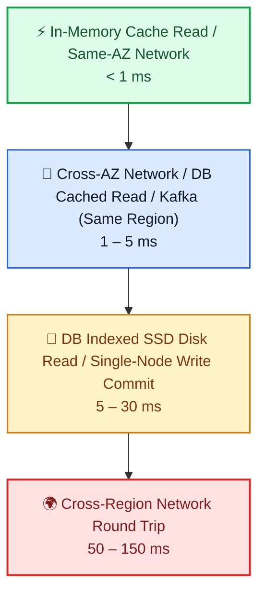
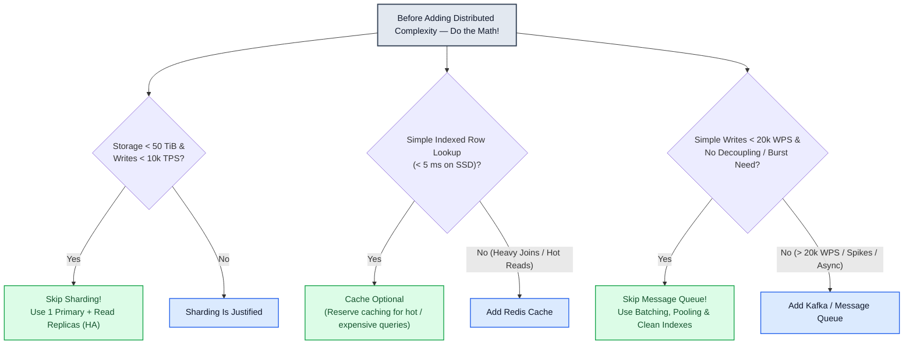

[back to HLD index](./HLD.md)
---

# Numbers to Know (2026)

> *Modern single-node hardware is vastly more capable than legacy rules of thumb suggest—knowing realistic 2026 numbers helps you avoid premature sharding, unnecessary caches, and over-engineered message queues in system design interviews.*

## Table of Contents
1. [Modern Hardware & Network Limits](#1-modern-hardware--network-limits)
2. [Caching](#2-caching)
3. [Databases](#3-databases)
4. [Application Servers](#4-application-servers)
5. [Message Queues](#5-message-queues)
6. [2026 Master Cheat Sheet](#6-2026-master-cheat-sheet)
7. [Common Interview Mistakes](#7-common-interview-mistakes)

---

## 1. Modern Hardware & Network Limits

Modern cloud servers pack enormous compute, memory, storage, and networking capacity—meaning many workloads that once demanded complex distributed architectures can now run comfortably on a single well-provisioned machine.

### Compute & Memory (AWS Reference Instances)

| Instance Type | Category | Memory (RAM) | Compute | Takeaway |
| :--- | :--- | :--- | :--- | :--- |
| **`M6i.32xlarge`** | General Purpose | `512 GiB` | `128 vCPUs` | Handles heavy general workloads on a single box |
| **`X1e.32xlarge`** | Memory-Optimized | `4 TB` | High vCPU | Fits massive working sets completely in RAM |
| **`U-24tb1.metal`** | Ultra High-Memory | `24 TB` | Bare metal | Even multi-terabyte in-memory databases fit on 1 node |

### Storage Capacity

| Storage Option | Capacity | Characteristics |
| :--- | :--- | :--- |
| **Local SSD** *(e.g., AWS `i3en.24xlarge`)* | `60 TB` | Ultra-fast random I/O on a single instance |
| **Local HDD** *(e.g., AWS `D3en.12xlarge`)* | `336 TB` | High-density sequential storage for data-heavy workloads |
| **Object Storage** *(e.g., Amazon S3)* | **Effectively Unlimited** | Petabyte-scale deployments are routine |

### Network Bandwidth & Latency

| Scope | Typical Bandwidth | Typical Latency |
| :--- | :--- | :--- |
| **Within Same Availability Zone (AZ)** | `25 Gbps` *(standard)* / `50–100+ Gbps` *(high-perf)* | `< 1 ms` |
| **Cross-AZ (Same Region)** | Limited only by instance NIC capacity | `1 – 2 ms` |
| **Cross-Region (Global)** | Regional backbone | `50 – 150 ms` |

### 2026 Latency Hierarchy at a Glance

---

## 2. Caching

Gone are the days of tiny `32–64 GB` Redis nodes requiring delicate partial caching. Modern in-memory caches routinely hold **terabyte-scale datasets** at sub-millisecond to single-digit millisecond latency.

| Metric | 2026 Benchmark (Single Instance) | When to Scale Out |
| :--- | :--- | :--- |
| **Memory** | Up to `1 TB` on memory-optimized nodes *(more for specialized setups)* | Dataset approaching `1 TB` *(or > 80% memory usage)* |
| **Read Latency** | `< 1 ms` within the same region | Strict need for `< 0.5 ms` consistently *(or latency > 1 ms)* |
| **Write Latency** | `< 1 ms` same-AZ; `1 – 2 ms` cross-AZ (same region) | Cross-region replication / write latency spikes |
| **Throughput** | `100k – 200k+ ops/sec` *(e.g., Graviton ElastiCache Redis; reads ≈ writes for simple ops)* | Sustained traffic exceeding `100k+ ops/sec` |

> **Design Shift:** Caching an entire database in memory (even hundreds of GBs) often costs less than the engineering complexity of selective partial caching. Today, cache scaling is usually triggered by **operations per second or network bandwidth**—not memory size.

---

## 3. Databases

Single **PostgreSQL** or **MySQL** instances now handle dozens of terabytes and tens of thousands of transactions per second. Operational limits (like backup windows or geo-distribution) often trigger scaling before raw hardware limits do.

| Metric | 2026 Benchmark (Single Primary) | When to Consider Sharding |
| :--- | :--- | :--- |
| **Storage** | Up to `64 TiB` *(standard RDS)*; up to `256 TiB` *(Aurora)* | Dataset approaching or exceeding `50 TiB` |
| **Read Latency** | `1 – 5 ms` *(cached)*; `5 – 30 ms` *(indexed SSD disk)* | Strict `< 5 ms` target for uncached reads |
| **Write Latency** | `5 – 15 ms` commit latency *(single-node high-perf)* | High contention or cross-region commit latency |
| **Read Throughput** | Up to `50k TPS` *(Aurora / RDS single node)* | Exceeds primary + read replica capacity |
| **Write Throughput** | `10k – 20k TPS` *(Aurora / RDS single node)* | Sustained writes consistently exceeding `10k TPS` |
| **Connections** | `5k – 20k` concurrent connections | Exceeds pool limits *(use connection pooling first)* |
| **Operations / Geo** | Regional primary + read replicas | Multi-hour backup/recovery windows or multi-region write locality |

> **Single Instance ≠ Single Point of Failure:** Running an unsharded database does **not** mean zero redundancy. In production, you still pair a primary with **read replicas and multi-AZ failover** (e.g., Aurora multi-AZ) for High Availability—**replication for HA is separate from sharding for horizontal scale**.

---

## 4. Application Servers

Modern application servers easily maintain `100k+` concurrent connections with modest overhead. **CPU processing power**—not memory or raw connection limits—typically becomes the bottleneck first.

| Metric | 2026 Benchmark (Per Instance) | When to Horizontally Scale |
| :--- | :--- | :--- |
| **Concurrent Connections** | `100k+` *(optimized configurations)* | Approaching `100k` connections/instance |
| **CPU** | `8 – 64 cores` (`2 – 4 GHz`) | Sustained utilization above `70 – 80%` |
| **Memory** | `64 – 512 GB` standard; up to `2 TB+` | Memory usage trending above `70 – 80%` |
| **Network** | `25 Gbps` standard; `50 – 100 Gbps` high-perf | Approaching NIC bandwidth limits |
| **Startup Time** | Tens of seconds to minutes *(containerized apps)* | Response latency exceeding SLA thresholds |

Because cloud auto-scaling spins up fresh container instances in tens of seconds to minutes, pairing powerful instances with **auto-scaling** beats heavy over-provisioning.

---

## 5. Message Queues

Modern event streaming platforms like **Apache Kafka** act as high-throughput, durable data highways capable of single-digit millisecond end-to-end delivery while retaining weeks or months of data.

| Metric | 2026 Benchmark (Per Broker / Cluster) | When to Scale |
| :--- | :--- | :--- |
| **Throughput** | Up to `1M msgs/sec` per broker | Approaching `800k msgs/sec` per broker |
| **End-to-End Latency** | `1 – 5 ms` *(within same region)* | Growing consumer lag hurting real-time SLAs |
| **Message Size** | `1 KB – 10 MB` handled efficiently | Very large payloads *(store blobs in S3, send pointer)* |
| **Storage & Retention** | Up to `50 TB` per broker; weeks to months | Approaching `200k` partitions per cluster or cross-region DR needs |

> **Architectural Implication:** With consistent **sub-5ms latency** *(provided there is no backlog)*, queues are fast enough to participate even in **synchronous request flows**, as well as powering event sourcing, real-time analytics, and data integration pipelines.

---

## 6. 2026 Master Cheat Sheet

Use these baselines as starting points for capacity estimation—not rigid hard limits:

| Component | Key Metrics (Single Instance / Broker) | Scale Triggers |
| :--- | :--- | :--- |
| **Caching** | • `~1 ms` latency • `100k+ ops/sec` • Memory-bound *(up to `1 TB`)* | • Hit rate `< 80%` • Latency `> 1 ms` • Memory usage `> 80%` • Cache churn / thrashing |
| **Databases** | • Up to `50k TPS` *(reads)* / `10k–20k TPS` *(writes)* • `< 5 ms` cached read latency • `64 TiB+` storage *(up to `256 TiB` Aurora)* | • Write throughput `> 10k TPS` • Uncached read latency `> 5 ms` • Dataset `≥ 50 TiB` • Geographic distribution / long backups |
| **App Servers** | • `100k+` concurrent connections • `8 – 64 cores` @ `2 – 4 GHz` • `64 – 512 GB` RAM standard *(up to `2 TB`)* | • CPU `> 70%` utilization • Response latency `> SLA` • Connections near `100k`/instance • Memory `> 80%` |
| **Message Queues** | • Up to `1M msgs/sec` per broker • `< 5 ms` end-to-end latency • Up to `50 TB` storage per broker | • Throughput near `800k msgs/sec` • Partition count `~200k` per cluster • Consistently growing consumer lag |

---

## 7. Common Interview Mistakes

Before introducing sharding, caching, or message queues, run a quick **math sanity check** against realistic hardware limits:

### 1. Premature Sharding
The **#1 mistake** in interviews is immediately sharding a database or cache without doing the math:

| Interview Example | Back-of-the-Envelope Math | Reality |
| :--- | :--- | :--- |
| **Design Yelp** | `10M businesses × 1 KB = 10 GB` *(×10 for reviews = `100 GB`)* | Fits effortlessly on a **single database** (`64 TiB` limit)—no sharding needed! |
| **LeetCode Leaderboard** | `100k contests × 100k users × (36 B ID + 4 B float) = 400 GB` | Fits completely in a **single large Redis cache** (`1 TB` limit)—no sharding needed! |

### 2. Overestimating SSD Latency
Candidates frequently assume reading from disk is painfully slow and slap a cache in front of every table. In reality, an **indexed primary-key lookup on modern SSDs** takes only **sub-millisecond to a few milliseconds**.
* Don't add caching infrastructure just for simple indexed row lookups that are already fast enough.
* **Do** cache genuinely **expensive queries** (complex joins, aggregations, feed generation) or massive read fan-out.

### 3. Over-Engineering Write Throughput with Message Queues
Seeing `5,000 writes/sec`, many candidates immediately insert Kafka to "buffer high write load"—even though a well-tuned **PostgreSQL** instance sustains **`20k+` simple writes/sec**.

* **What actually bottlenecks DB writes:** Complex multi-table transactions, write amplification from excessive indexes, expensive cascading updates, and heavy concurrent read contention.
* **Try simpler optimizations first:** Batch writes, lean schema/indexes, connection pooling, and async commits for non-critical writes.
* **When a message queue IS justified:** Guaranteed delivery across downstream outages, event sourcing, smoothing burst spikes exceeding DB capacity (`> 20k+ WPS`), or decoupling producers from consumers.

---

### Final Takeaway
* **Single databases** handle terabytes of data and tens of thousands of TPS.
* **In-memory caches** can hold entire datasets up to `1 TB`.
* **Message queues** run fast enough (`< 5 ms`) for synchronous paths (as long as there is no backlog).
* **Application servers** pack enough RAM for meaningful local optimizations.

> **Seniority Signal:** The takeaway isn't that vertical scaling solves everything—it's knowing **where the real limits actually sit** so you build the simplest architecture that meets requirements and scales cleanly when truly needed.

---

**Previous:** [← HLD Interview Framework](./HLD-Interview-framework.md) | **Next:** [Networking Essentials →](./Networking-Essentials.md)
