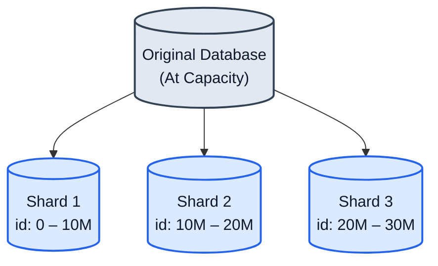
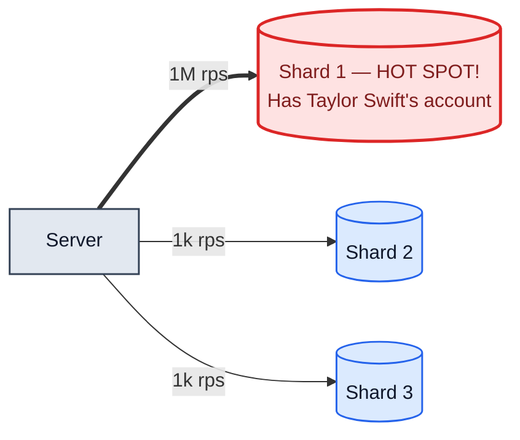
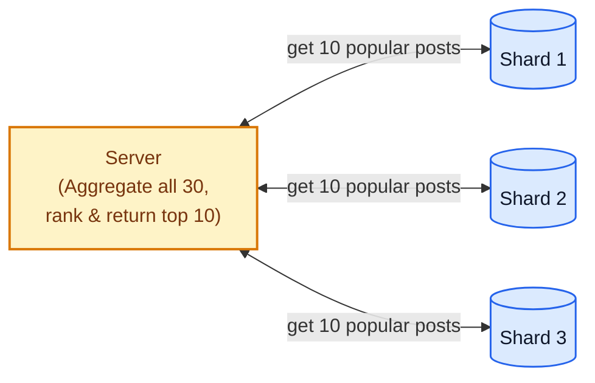

[back to HLD index](./HLD.md)
---

# Sharding

> *When a single database can no longer keep up with storage or throughput, sharding splits data horizontally across multiple independent machines—unlocking scale at the cost of routing complexity, hot spots, and distributed consistency.*

## Table of Contents
1. [Partitioning vs. Sharding](#1-partitioning-vs-sharding)
2. [Choosing Your Shard Key](#2-choosing-your-shard-key)
3. [Sharding Strategies](#3-sharding-strategies)
4. [Challenges of Sharding](#4-challenges-of-sharding)
5. [Sharding in Modern Databases](#5-sharding-in-modern-databases)
6. [Sharding in System Design Interviews](#6-sharding-in-system-design-interviews)

---

## 1. Partitioning vs. Sharding

Engineers often use **"partitioning"** and **"sharding"** interchangeably. Don't get hung up on terminology in an interview—just be crystal clear about whether your data lives on **one machine** or **many machines**.

### What Is Partitioning?
**Partitioning** splits a large table into smaller pieces **inside a single database instance**. It does not add machines; it organizes storage so the database can scan and manage data more efficiently.

| Partitioning Type | How It Splits Data | Example |
| :--- | :--- | :--- |
| **Horizontal Partitioning** | Splits **rows** across partitions *(same columns, fewer rows per partition)* | One partition per year of orders (`orders_2024`, `orders_2025`) |
| **Vertical Partitioning** | Splits **columns** across partitions *(same rows, fewer columns per partition)* | Keep hot columns (`id`, `username`) in one partition and large/rarely read blobs in another |

### What Is Sharding?
**Sharding** is **horizontal partitioning across multiple independent machines**. Each shard is a standalone database with its own CPU, memory, storage, and connection pool—allowing both storage capacity and read/write throughput to scale horizontally as you add shards.



> **The Trade-Off:** Sharding solves single-node bottlenecks, but introduces new distributed-systems problems: picking a **shard key**, **routing queries**, preventing **hot spots**, and **rebalancing data** as shards grow.

---

## 2. Choosing Your Shard Key

Whenever you shard, you make two coupled decisions:
1. **What to shard by (Shard Key):** The column used to group records together.
2. **How to distribute it (Strategy):** The rule assigning those groups to physical shards.

A poor shard key leads to skewed storage, overloaded hot shards, and expensive scatter-gather queries. A **good shard key** satisfies three properties:

* **High cardinality:** Must have many unique values. Sharding on a boolean (`true`/`false`) caps you at 2 shards, defeating the purpose; sharding on `user_id` across millions of users scales cleanly.
* **Even distribution:** Data and traffic should spread evenly. Sharding by `country` when 90% of users live in the US creates a massive bottleneck on the US shard.
* **Aligns with queries:** Your dominant queries should hit **a single shard** (e.g., *"get user profile"* or *"get user's orders"* when sharded by `user_id`).

### Good vs. Bad Shard Keys

| Candidate Key | Fit | Why |
| :--- | :--- | :--- |
| **`user_id`** *(User-centric app)* | **Good** | High cardinality (millions of users), even distribution, and most queries are naturally scoped to one user |
| **`order_id`** *(E-commerce orders)* | **Good** | High cardinality, evenly distributed over time, and order lookups/updates target a single `order_id` |
| **`is_premium`** *(Boolean)* | **Bad** | Only 2 possible values → max 2 shards; the free-user shard gets massively overloaded |
| **`created_at`** *(Timestamp)* | **Bad** | Every new write lands on the latest shard, creating a severe write hot spot while older shards sit idle |

---

## 3. Sharding Strategies

Once you have a shard key, choose how to map key values onto shards:

### 1. Range-Based Sharding
Groups records by continuous ranges of the shard key (e.g., `user_id` or `created_at`):

```text
Shard 1 → User IDs 1 – 1M
Shard 2 → User IDs 1M – 2M
Shard 3 → User IDs 2M – 3M
```

* **Strengths:** Simple to reason about and supports efficient **range scans**.
* **Best fit:** **Multi-tenant SaaS systems** where each company owns a contiguous range of IDs and queries only within its own range, keeping traffic naturally isolated and balanced across shards.

### 2. Hash-Based Sharding *(Default)*
Hashes the shard key and maps the result to a shard to guarantee even distribution:

```text
shard = hash(user_id) % 4

User  42 → hash(42)  % 4 = Shard 2
User  99 → hash(99)  % 4 = Shard 3
User 123 → hash(123) % 4 = Shard 1
```

* **Strengths:** Produces uniform, even data distribution across shards.
* **Resharding pitfall:** With naive modulo (`% 4` → `% 5`), adding or removing a single shard remaps **almost every key**, forcing massive data migration.
* **Solution:** Pair hash-based sharding with **Consistent Hashing**, which minimizes data movement when shards are added or removed.

> **Interview Default:** Hash-based sharding (with consistent hashing) is the **default strategy**—and what interviewers will assume you mean unless you explicitly propose another approach.

### 3. Directory-Based Sharding
Maintains a dedicated lookup table or routing service mapping keys explicitly to shards:

```text
user_to_shard
-------------
User  15 → Shard 1
User  87 → Shard 4
User 204 → Shard 2
```

* **Strengths:** Maximum flexibility—you can isolate a heavy user onto a dedicated shard or rebalance arbitrarily just by updating the lookup table.
* **Drawbacks:** Adds an extra network lookup (latency) to every request and creates a **single point of failure (SPOF)**—if the directory service goes down, the entire database tier becomes unreachable even when all shards are healthy.

> **Interview Warning:** Directory-based sharding is rarely the right primary answer in interviews because the extra latency and SPOF tend to derail the conversation into directory availability follow-ups. Start with hash- or range-based sharding unless dynamic placement is explicitly required.

### Sharding Strategies Comparison

| Strategy | Routing Rule | Strengths | Weaknesses | Interview Guidance |
| :--- | :--- | :--- | :--- | :--- |
| **Range-Based** | Key falls in `[min, max)` | Simple; fast range scans | Prone to write/skew hot spots | Best for multi-tenant ranges |
| **Hash-Based** | `hash(key) % N` / Consistent Hashing | Even distribution | Destroys range locality; naive `% N` painful to resize | **Default choice** (pair with consistent hashing) |
| **Directory-Based** | Explicit lookup table | Ultimate placement & rebalancing flexibility | Extra hop per query; SPOF dependency | Use only for special cases (e.g., isolating celebrities) |

---

## 4. Challenges of Sharding

Distributing data across independent machines inevitably introduces three core challenges. Knowing how to mitigate them is what separates strong system design answers from superficial ones.

### 1. Hot Spots and Load Imbalance
Even with hash-based sharding, one shard can end up handling orders of magnitude more traffic than the rest—turning that single shard into the bottleneck for the whole system.



* **Common causes:**
  * **The Celebrity Problem:** Hashing cannot fix keys that are inherently far hotter than others (e.g., Taylor Swift on Twitter).
  * **Time-based sharding:** All new writes hammer the newest shard while historical shards sit mostly idle.
* **Detection:** Monitor per-shard CPU usage, query latency, and request volume to spot skew early.
* **Mitigations:**
  * **Isolate hot keys to dedicated shards:** Move celebrity accounts onto dedicated shards (one case where selective directory routing helps).
  * **Use compound shard keys:** Combine `user_id` with another dimension such as `hash(user_id + date)` to spread a single high-volume user's writes across multiple shards over time.
  * **Dynamic shard splitting:** Use engines that automatically split and migrate hot/oversized chunks (e.g., MongoDB's background balancer).

---

### 2. Cross-Shard Operations (Scatter-Gather)
Any query needing data across multiple shards must fan out to every shard, wait for all responses, and merge/rank the results in the application tier.



**How to minimize cross-shard queries:**
* **Cache the aggregated results:** If *"top 10 most popular posts"* hits 64 shards, cache the result for 5 minutes (or precompute it in a background job). Ideal for leaderboards, trending feeds, and aggregate stats where **eventual consistency** is acceptable.
* **Denormalize to co-locate related data:** Duplicate needed fields (e.g., post metadata alongside user data on the user's shard) so hot reads stay single-shard—trading write complexity for fast reads.
* **Accept the hit for rare queries:** Infrequent queries (like an internal admin dashboard loaded a few times a day for *"total users"*) can afford a scatter-gather scan.

> **Interview Red Flag:** If you find yourself saying *"we'll query all shards and merge the results"* for a **primary, high-traffic endpoint**, pause and ask: *"Can I denormalize, cache, or precompute this instead?"*

---

### 3. Maintaining Consistency Across Shards
On a single database, wrapping *"deduct inventory + create order"* in an ACID transaction is trivial. Once related records live on **different shards**, single-DB transactions no longer work.

* **Two-Phase Commit (2PC) *(Avoid in practice)*:** A coordinator asks all shards to *prepare*, waits for confirmation, then sends *commit*. Guarantees atomicity, but is **slow and fragile**—a failure mid-protocol can leave shards locked and blocked. Most production systems avoid 2PC.
* **Practical alternatives:**
  1. **Design to avoid cross-shard transactions *(Best)*:** Keep all of a user's tightly coupled data (account balance, transaction history, profile) on the **same shard** (via `user_id`) so transactions remain fast, single-shard ACID operations.
  2. **Use the Saga Pattern:** Break multi-shard operations into independent local steps, each paired with a **compensating action** to undo prior work if a later step fails:
     ```mermaid
     sequenceDiagram
         participant App as Orchestrator / App
         participant S1 as Shard 1 (User A)
         participant S2 as Shard 2 (User B)

         App->>S1: 1. Deduct $50 from User A
         S1-->>App: Success
         App->>S2: 2. Credit $50 to User B
         S2-->>App: Failure! (Timeout / Error)
         App->>S1: 3. Compensating Action: Refund $50 to User A
         S1-->>App: Refunded (Consistent State Restored)
     ```
  3. **Accept eventual consistency:** When strict atomicity isn't required (e.g., denormalized follower counts across shards), letting counts converge within a few seconds is vastly simpler than distributed coordination.

> **Design Rule of Thumb:** If your architecture constantly needs distributed cross-shard transactions, you likely picked the wrong **shard key** or wrong **shard boundaries**.

---

## 5. Sharding in Modern Databases

Good news: you rarely build sharding mechanics from scratch—modern distributed databases and SQL sharding layers handle routing and rebalancing for you, though their internal mechanics differ:

| Technology | Category | How It Shards Under the Hood |
| :--- | :--- | :--- |
| **Cassandra** | Wide-Column NoSQL | Uses a partitioner (e.g., `Murmur3Partitioner`) with **virtual nodes** (consistent hashing over token ranges) |
| **DynamoDB** | Key-Value / NoSQL | Hashes the partition key to route to internal partitions and automatically **splits/merges** partitions as they grow *(not user-exposed ring consistent hashing)* |
| **MongoDB** | Document NoSQL | Splits data into **range-based chunks** on the shard key (or over the hash space for hashed keys) with a background balancer auto-splitting and migrating chunks |
| **Vitess / Citus** | SQL Sharding Layers | Open-source middleware sitting in front of **MySQL** (Vitess) or **PostgreSQL** (Citus) handling query routing, cross-shard ops, and online resharding |
| **AWS Aurora / Google Cloud Spanner** | Cloud Distributed SQL | Managed relational engines with built-in distributed storage and sharding |

> **What to Say in Interviews:** You don't need to implement sharding internals unless explicitly probed. Saying *"We'll use DynamoDB with `user_id` as the partition key"* or *"We'll shard MySQL using Vitess on `user_id` with operator-driven online resharding"* is clean, realistic, and sufficient.

---

## 6. Sharding in System Design Interviews

### When to Mention Sharding
**The #1 sharding mistake in interviews is sharding prematurely** before proving a single database won't suffice. Follow a simple 3-step formula: **Identify the bottleneck → Do the rough math showing a single DB won't scale → Propose sharding.**

| Limit Hit | Example Justification |
| :--- | :--- |
| **Storage Capacity** | *"500M users × 5 KB = 2.5 TB. A single Postgres instance handles that today, but 10× growth (25 TB) requires sharding."* |
| **Write Throughput** | *"50K peak writes/sec exceeds what a single primary database can sustain, so we must shard writes across multiple primaries."* |
| **Read Throughput** | *"Even with read replicas, 100M DAU firing multiple queries each requires distributing read load across shards."* |

### 4-Step Walkthrough (Example: Social Media App)
1. **Propose a shard key from access patterns:** *"Most queries are user-centric—loading a user's posts, followers, and likes—so I'll shard by `user_id`."*
2. **Choose the distribution strategy:** *"I'll use **hash-based sharding with consistent hashing** on `user_id` to distribute users evenly across shards."*
3. **Call out the trade-offs proactively:** *"The trade-off is that global queries like 'trending posts across all users' become expensive scatter-gather queries. We'll solve that by precomputing trending lists via a background job and caching them in Redis."*
4. **Plan for growth:** *"We can start with 64 shards for headroom. Because we use consistent hashing, adding more shards later only migrates a small fraction of keys rather than resharding the entire dataset."*

---

**Previous:** [← Caching](./Caching.md) | **Index:** [HLD Index](./HLD.md)
