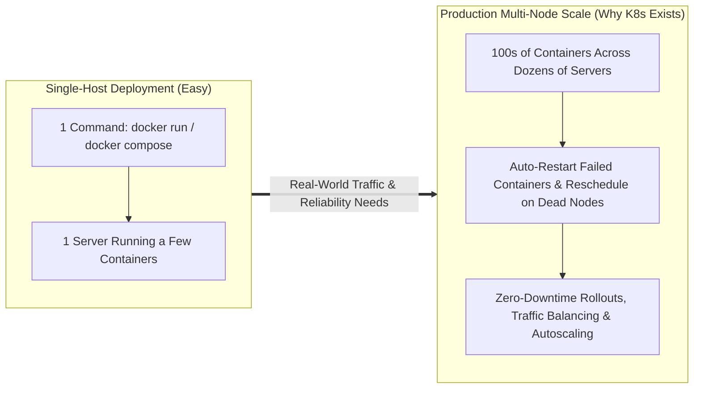
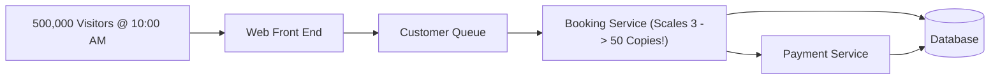
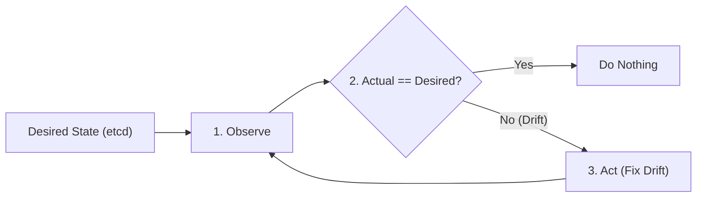
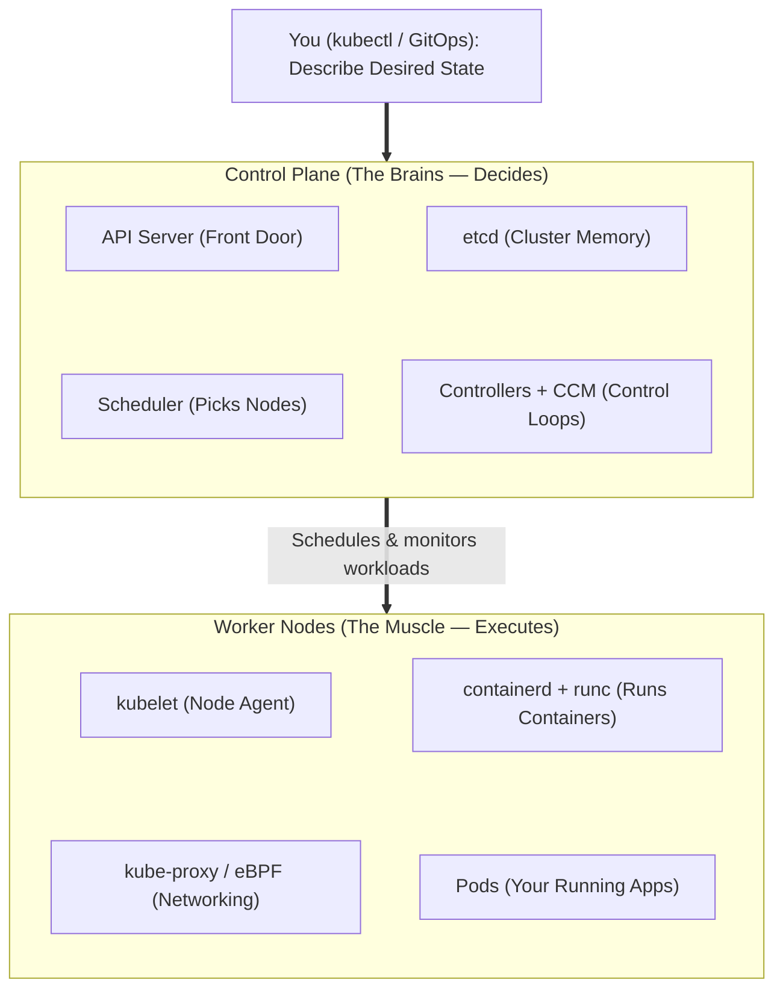
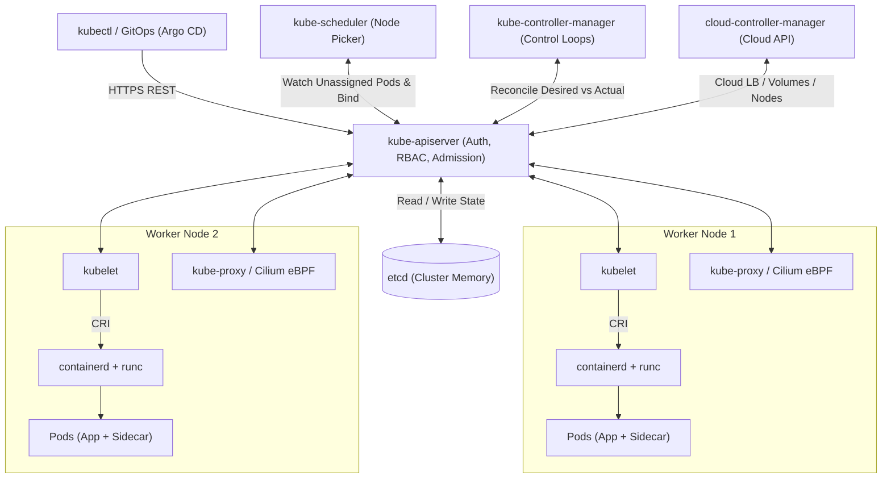

[back to Kubernetes index](./kubernetes-content.md)
---

# Part 1: Foundations, Desired State & Cluster Architecture

## Table of Contents
1. [Apps Run in Containers & The Scale Problem](#1-apps-run-in-containers--the-scale-problem)
2. [The Busiest Morning (The Ticket Website Story)](#2-the-busiest-morning-the-ticket-website-story)
3. [A New Language, One Simple Idea: Desired State & Control Loop](#3-a-new-language-one-simple-idea-desired-state--control-loop)
4. [Kubernetes Cluster Architecture (Control Plane & Worker Nodes)](#4-kubernetes-cluster-architecture-control-plane--worker-nodes)
5. [End-to-End Architectural Visualization](#5-end-to-end-architectural-visualization)

---

## 1. Apps Run in Containers & The Scale Problem

* **What is a Container?** A container is an application packaged together with all the files, libraries, and runtime dependencies it needs to run—isolated by Linux **Namespaces** and constrained by **cgroups** (see [Docker Container Internals](../Docker/section-1/container.md)).
* **The Developer's Laptop Analogy:** Because the container holds its entire runtime environment ("a ready-to-run box"), it behaves identically on a remote production server as it did on a developer's local machine.
* **Where Single-Host Docker Stops & Orchestration Begins:**
  * *Single-container deployment:* Trivial—usually one command (`docker run` or `podman run`), or a single-machine `docker compose up`.
  * *Real-world production scale:* A modern application consists of dozens or hundreds of container copies spread across **multiple physical or virtual servers** across multiple Availability Zones.
  * *The hard part:* Keeping those containers alive 24/7, routing traffic as container IPs constantly change, rolling out new versions with zero downtime, scaling rapidly with traffic spikes, and automatically recovering from sudden hardware/server failures.

---

## 2. The Busiest Morning (The Ticket Website Story)

Imagine a high-demand concert ticket website going on sale at **10:00 AM**:

* **9:59 AM:** A few thousand visitors browsing.
* **10:01 AM:** **500,000 (half a million) visitors** hit the site simultaneously.

### Anatomy of the Application
| Component | Responsibility |
| :--- | :--- |
| **Web Front End** | Serves the user interface |
| **Booking Service** | Processes ticket selection and temporary seat holds |
| **Payment Service** | Communicates with third-party payment processors |
| **Customer Queue** | Manages waiting rooms and absorbs burst demand |
| **Database** | Persists tickets, transactions, and user records |

### The Scalability & Reliability Challenge
1. **Normal load:** A few copies (replicas) of each service are plenty.
2. **10:00 AM Surge:** The *Booking Service* suddenly needs **50 copies** distributed across multiple host servers.
3. **10:03 AM Hardware Crash:** One of the host servers suddenly dies. Every Booking container running on that server must be immediately recreated on surviving, healthy servers.
4. **12:00 PM Cooldown:** Once the rush ends, those extra containers should automatically scale back down so you stop paying for idle cloud infrastructure.
5. **Why manual scripts fail:** Humans and ad-hoc bash scripts cannot detect crashes, reschedule across nodes, reconfigure load balancers, and verify health in seconds. By the time an engineer notices an alert, thousands of users have seen `502 Bad Gateway` errors and revenue is lost.

**Why Kubernetes Exists:** Kubernetes was built specifically to automate this lifecycle—running containers across a pool of servers, deciding where each belongs, restarting failed containers, routing traffic cleanly, and adding or removing capacity automatically.

---

## 3. A New Language, One Simple Idea: Desired State & Control Loop

Learning Kubernetes often feels like learning a new language: *Pod, Deployment, ReplicaSet, Service, Node, Control Plane, Kubelet, Helm, Operator*.

**The Core Mental Model:** Every single term in Kubernetes exists to support one central idea: **The Desired State**.

### Declarative vs. Imperative
* **Imperative (Step-by-step commands):** *"Start container A on server 1, start container B on server 2, open port 80, restart container A if it dies."* (Brittle—breaks whenever reality drifts from your script.)
* **Declarative (Desired State):** You declare **what should be true**, e.g.:
  > *"I want exactly **5 copies** of `booking-service` running immutable image `booking:2.4.0@sha256:...`, spread across Availability Zones, reachable internally on port `80`."*

### The Reconciliation Control Loop
Kubernetes continuously runs autonomous **control loops** (just like a thermostat maintaining room temperature) comparing **Desired State** vs. **Actual State**:

This loop **never ends**. Self-healing, rolling updates, and autoscaling are all just specialized instances of this exact reconciliation loop.

---

## 4. Kubernetes Cluster Architecture (Control Plane & Worker Nodes)

A **Kubernetes Cluster** is a group of physical or virtual machines (Nodes) coordinated together as a single unified compute fabric. It is divided into two distinct layers:

### A. The Control Plane (The Brains)
Makes global decisions about the cluster and detects/responds to cluster events.

| Component | Role & Production Notes |
| :--- | :--- |
| **`kube-apiserver` (API Server)** | **The front door of the cluster.** Every `kubectl` command, controller action, and node status update passes through here (REST/JSON API). Handles **Authentication** (who are you?), **Authorization / RBAC** (are you allowed?), **Admission Control** (mutating/validating webhooks & policies), schema validation, and is the **only component** that reads/writes directly to `etcd`. |
| **`etcd`** | **The cluster's memory (single source of truth).** A highly available, distributed key-value store (built on the Raft consensus algorithm) storing all cluster configuration and current resource state. **Critical:** *If you lose `etcd`, the cluster forgets everything it is supposed to be doing.* Run an odd number of replicas (3 or 5) for quorum, enable encryption at rest, and take automated periodic snapshots. |
| **`kube-scheduler` (Scheduler)** | Watches for newly created Pods with **no assigned Node**. Evaluates resource `requests` (CPU/RAM), Affinity/Anti-Affinity rules, Taints/Tolerations, and Topology Spread Constraints, then binds each Pod to the best-fitting Worker Node. |
| **`kube-controller-manager` (Controllers)** | Runs the core **control loops** (Deployment Controller, ReplicaSet Controller, Node Controller, Job Controller, EndpointSlice Controller, etc.). Continuously observes actual state via API Server and reconciles it toward desired state. |
| **`cloud-controller-manager` (CCM)** | *(In cloud-hosted clusters like EKS/GKE/AKS)* Bridges Kubernetes to the underlying cloud provider's APIs—automatically provisioning cloud Load Balancers, attaching cloud block storage volumes (EBS/PD), and checking if an unresponsive Node was terminated by the cloud provider. |

### B. Worker Nodes (The Muscle)
The machines where application containers actually run. Every Worker Node runs three core components:

| Component | Role & Production Notes |
| :--- | :--- |
| **`kubelet`** | **The Node agent.** Runs on every Worker Node, watches the API Server for Pods assigned to *its* node, instructs the container runtime to start/stop containers, executes Liveness/Readiness/Startup probes, mounts volumes, and continuously reports Pod and Node health back to the API Server. |
| **Container Runtime (`containerd` / `CRI-O`)** | **The container engine.** Communicates with `kubelet` over the **CRI (Container Runtime Interface)**, pulls OCI-compliant images (including images built with `docker build`!), and delegates to low-level **`runc`** to create Linux Namespaces and cgroups. *(See [OCI & CRI Bridge](../Docker/section-6/production-docker-and-internals.md#6-container-runtime-internals-oci-containerd-runc--the-bridge-to-kubernetes).)* |
| **`kube-proxy` (or eBPF dataplane like Cilium)** | **The Node network proxy.** Maintains network routing rules (`iptables`, `IPVS`, or modern kernel **eBPF** via Cilium) on each Node so that traffic sent to a Kubernetes **Service** virtual IP (`ClusterIP`) is transparently load-balanced to healthy backend Pods across the cluster. |

> **One-Sentence Architecture Summary:**
> **"You describe it. The Control Plane decides. The Worker Nodes do it."**

---

## 5. End-to-End Architectural Visualization

---

**Next:** [Part 2: Manifests, Workloads & Pod Lifecycle →](./02-workloads-and-lifecycle.md)
