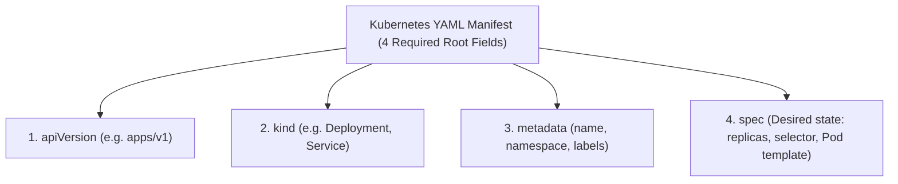
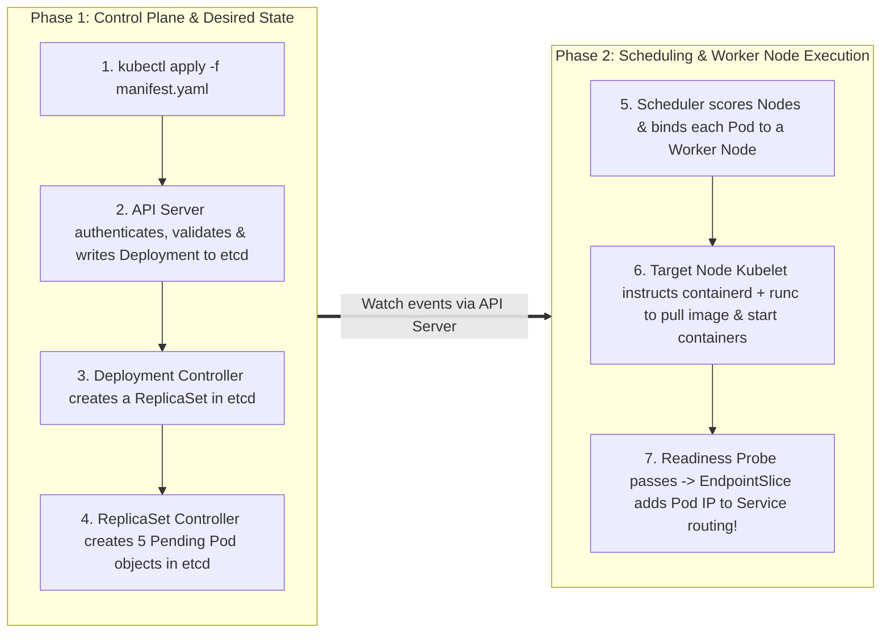
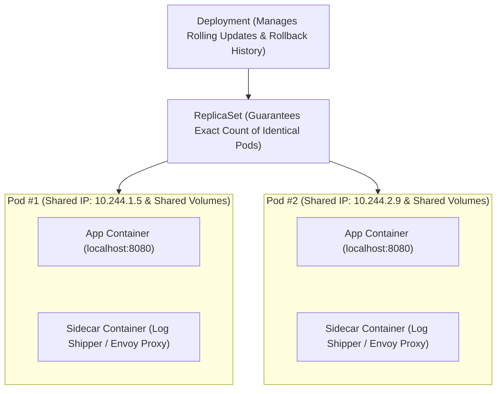
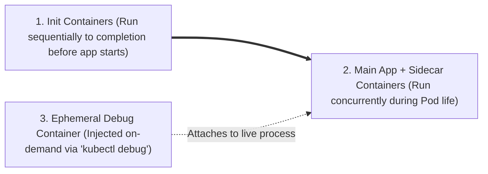
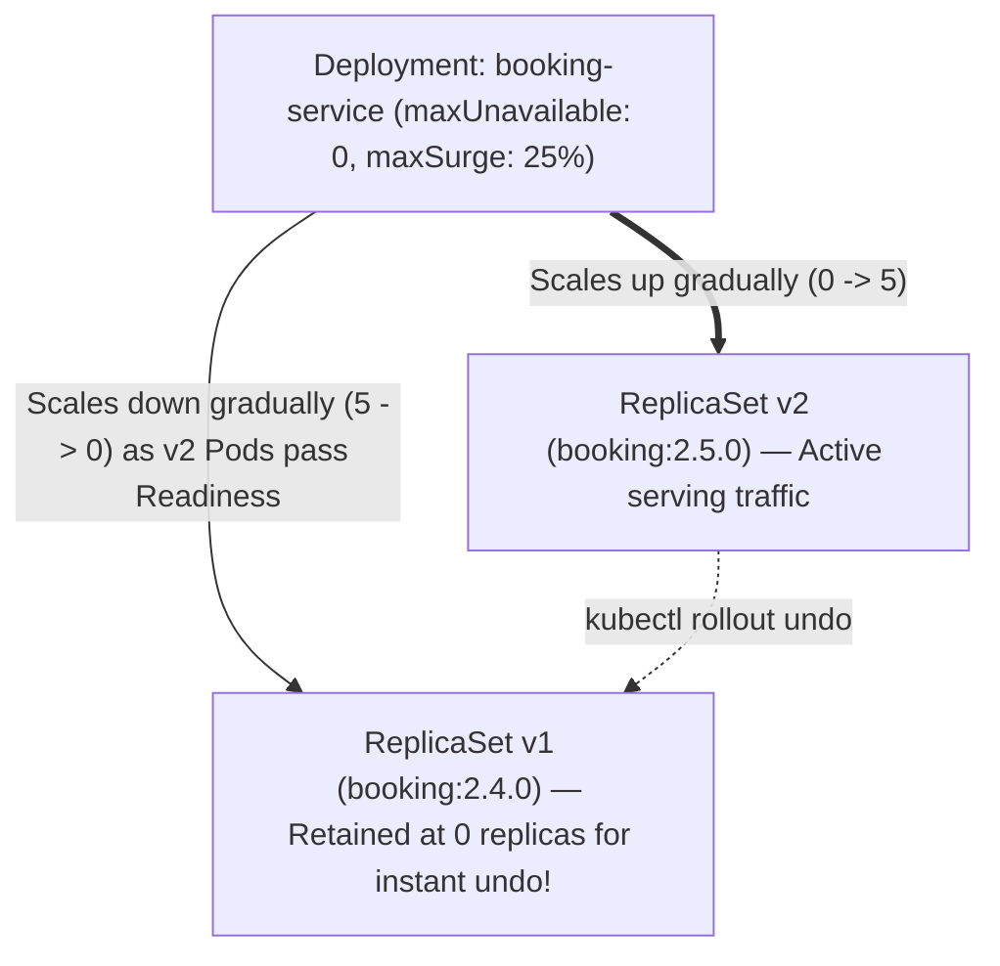
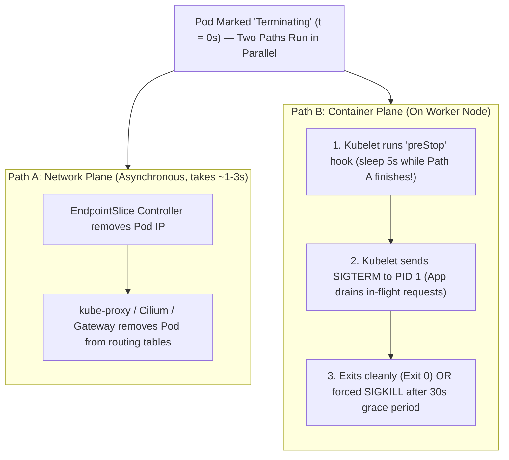
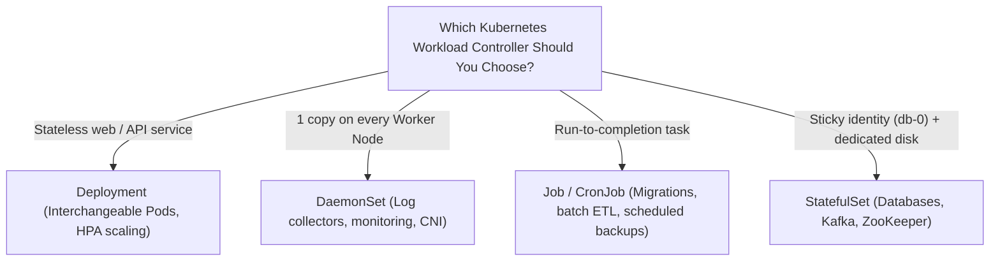

[back to Kubernetes index](./kubernetes-content.md)
---

# Part 2: Declarative Manifests, Workloads & Pod Lifecycle

## Table of Contents
1. [Declarative Manifests & The `kubectl apply` Workflow](#1-declarative-manifests--the-kubectl-apply-workflow)
2. [How a YAML Manifest Becomes Running Containers](#2-how-a-yaml-manifest-becomes-running-containers)
3. [Pods: Sidecars, Init Containers & Ephemeral Containers](#3-pods-sidecars-init-containers--ephemeral-containers)
4. [Deployments, ReplicaSets, Rolling Updates & Rollbacks](#4-deployments-replicasets-rolling-updates--rollbacks)
5. [Graceful Shutdown (`SIGTERM`, `preStop` Hook & Zero-Downtime Draining)](#5-graceful-shutdown-sigterm-prestop-hook--zero-downtime-draining)
6. [Other Workload Controllers (`DaemonSet`, `Job`, `CronJob`, `StatefulSet`)](#6-other-workload-controllers-daemonset-job-cronjob-statefulset)

---

## 1. Declarative Manifests & The `kubectl apply` Workflow

* **Manifests:** Text files—typically written in **YAML**—that declare the desired state of Kubernetes resources.
* Teams store YAML manifests in **Git** for peer review, versioning, and audit trails, then submit them to the API Server via `kubectl` (colloquially pronounced *"cube-cuddle"* or *"cube-control"*):

```bash
kubectl apply -f booking-deployment.yaml
```



### Annotated Production Deployment Manifest

```yaml
apiVersion: apps/v1
kind: Deployment                      # Resource type
metadata:
  name: booking-service
  namespace: ticketing
  labels:
    app: booking
spec:
  replicas: 5                         # Desired state: 5 identical Pod replicas
  revisionHistoryLimit: 5             # Keep last 5 ReplicaSets for instant rollbacks
  strategy:
    type: RollingUpdate
    rollingUpdate:
      maxUnavailable: 0               # Never drop below 5 ready Pods during update
      maxSurge: 25%                   # Allow up to 25% extra Pods temporarily during rollout
  selector:
    matchLabels:
      app: booking                    # Ties this Deployment to Pods with matching labels
  template:                           # Blueprint for every Pod created by this Deployment
    metadata:
      labels:
        app: booking                  # MUST match spec.selector.matchLabels above
    spec:
      terminationGracePeriodSeconds: 30
      containers:
      - name: booking-app
        # Version tag + exact cryptographic digest prevents running mutated/wrong tags!
        image: registry.example.com/booking:2.4.0@sha256:7b5c19d4a1e8f...
        ports:
        - containerPort: 8080
        lifecycle:
          preStop:
            exec:
              command: ["/bin/sh", "-c", "sleep 5"]
```

---

## 2. How a YAML Manifest Becomes Running Containers

Every time you run `kubectl apply -f booking-deployment.yaml`, the following choreography occurs asynchronously through the **API Server** and **etcd**:



---

## 3. Pods: Sidecars, Init Containers & Ephemeral Containers



* **What is a Pod?** The **smallest deployable unit** in Kubernetes—a wrapper around one (or a few tightly coupled) container(s).
* **Shared Context:** All containers inside the same Pod share:
  * The same **Network Namespace & IP address** (they communicate with each other over `localhost`, and cannot bind to the same port).
  * The same **Storage Volumes** (e.g., an `emptyDir` volume where the app writes logs and a sidecar reads them).
* **When to put multiple containers in one Pod:** *Only* when they must be co-located and scaled 1:1 together (e.g., an app container + a Service Mesh proxy like Envoy, or a log/metrics collector). Never put your frontend and database in the same Pod!

### Special Container Types Inside a Pod



| Container Type | Behavior & Use Case |
| :--- | :--- |
| **App (Main) Container** | Your primary long-running workload. |
| **Sidecar Container** | Helper container running alongside the main app (service mesh proxy, log forwarder, secret injector). *(Native K8s 1.29+ sidecars use `initContainers` with `restartPolicy: Always` so they start before the app and shut down after it.)* |
| **Init Container** | Runs **sequentially to completion** *before* any main app container starts. Ideal for waiting on a dependency (`wait-for-db`), pulling dynamic config, or running permission setup. If an Init Container fails, the Pod restarts until it succeeds. |
| **Ephemeral Debug Container** | Temporarily injected into a running Pod via `kubectl debug`—indispensable for troubleshooting minimal **`distroless`** images that intentionally omit `sh`, `curl`, and `nslookup`! |

### Pod Ephemerality (Crucial Rule)
* If a *container* inside a Pod crashes, `kubelet` restarts that container inside the same Pod.
* However, **Pods themselves are ephemeral (mortal)**. If a Pod is deleted or its Worker Node dies, **that Pod is gone forever**. Kubernetes will **never** resurrect a bare, standalone Pod.
* Therefore, you **almost never deploy bare Pods directly**—always wrap them in a controller like a **Deployment**, **StatefulSet**, **DaemonSet**, or **Job**.

---

## 4. Deployments, ReplicaSets, Rolling Updates & Rollbacks

A **Deployment** manages **ReplicaSets**, and each **ReplicaSet** guarantees the exact number of Pods for a given Pod template version.

* **Self-Healing:** If a Pod is deleted or a Node dies, the ReplicaSet's control loop detects the gap and schedules a replacement Pod on a healthy Node.
* **Zero-Downtime Rolling Updates:** When you update the container image (e.g., `2.4.0` → `2.5.0`), the Deployment creates a **new ReplicaSet** and gradually scales it up while scaling the **old ReplicaSet** down:
  * `maxUnavailable: 0` guarantees existing capacity **never drops** during an update.
  * `maxSurge: 25%` allows spinning up 25% extra Pods temporarily to absorb traffic while new Pods pass their **Readiness Probes**.
* **Instant Rollbacks:** Because the old ReplicaSet is retained (with `replicas: 0`), rolling back a bad release is instantaneous:



```bash
kubectl rollout status deployment/booking-service -n ticketing
kubectl rollout history deployment/booking-service -n ticketing
kubectl rollout undo deployment/booking-service -n ticketing          # Instant rollback to previous version
kubectl rollout undo deployment/booking-service --to-revision=2       # Rollback to specific revision
```

---

## 5. Graceful Shutdown (`SIGTERM`, `preStop` Hook & Zero-Downtime Draining)

When a Pod is terminated (during a rolling update, scale-down, or node drain), **two things happen in parallel**—and misunderstanding this race condition causes dropped `502` requests during deployments!



### The Zero-Downtime Shutdown Checklist
1. **Add a `preStop` sleep (`sleep 5`)**: Because Path A (removing the Pod IP from load balancers/iptables) is asynchronous, a `5–10s` `preStop` hook ensures your app keeps serving in-flight requests until all traffic stops arriving, *before* `SIGTERM` triggers shutdown.
2. **Use Exec Form in your `Dockerfile` (`CMD ["node", "server.js"]`)**: As covered in [Docker PID 1 & SIGTERM](../Docker/section-6/production-docker-and-internals.md#4-the-pid-1--sigterm-gotcha-cmd-vs-entrypoint), using shell form (`CMD node server.js`) runs `/bin/sh` as PID 1, which **swallows `SIGTERM`** and causes Kubernetes to brutally kill your app with `SIGKILL` after 30 seconds!
3. **Handle `SIGTERM` in application code**: Stop accepting new connections, finish in-flight HTTP requests / DB transactions, close connection pools cleanly, and exit with status `0`.

---

## 6. Other Workload Controllers (`DaemonSet`, `Job`, `CronJob`, `StatefulSet`)



| Workload Kind | Guarantee & Characteristics | Real-World Examples |
| :--- | :--- | :--- |
| **Deployment** | Stateless apps; interchangeable Pods with random names; easy horizontal scaling & rolling updates. | Web frontends, REST/gRPC APIs (`booking-service`, `payment-service`). |
| **DaemonSet** | Ensures **exactly one copy** of a Pod runs on **every Worker Node** (automatically adds one when a new Node joins). | Log collectors (Fluent Bit, Promtail), monitoring agents (Node Exporter, Datadog), CNI network plugins (Calico, Cilium). |
| **Job** | Runs one or more short-lived Pods **to completion** (`Exit 0`), retrying on failure (`backoffLimit`), then stops. | Database schema migrations, batch ETL processing, one-off data backfills. |
| **CronJob** | Creates **Jobs** on a recurring cron schedule (e.g., `0 2 * * *`). | Nightly database backups, report generation, periodic cleanup tasks. |
| **StatefulSet** | Manages **stateful applications**: gives every Pod a **stable, predictable network identity** (`db-0`, `db-1`, `db-2`), ordered startup/teardown, and its **own dedicated PersistentVolumeClaim (PVC)** via `volumeClaimTemplates`. | Kafka, ZooKeeper, Cassandra, Elasticsearch, PostgreSQL clusters. |

> **Production Reality Check on StatefulSets:** A `StatefulSet` gives a database stable hostnames and dedicated disks, **but by itself it does NOT make a database highly available, handle replication, or orchestrate primary failover!** For stateful databases on Kubernetes, you either use a dedicated **Kubernetes Operator** (e.g., CloudNativePG, Strimzi for Kafka) or—as most engineering teams wisely choose—rely on **cloud-managed database services** (AWS RDS/Aurora, Cloud SQL, DynamoDB) for critical production data.

---

**Next:** [Part 3: Networking, Configuration & Persistent Storage →](./03-networking-config-and-storage.md)
