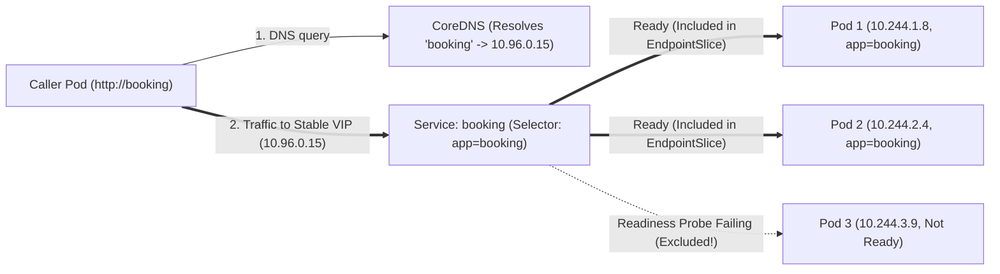
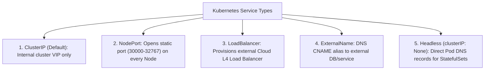
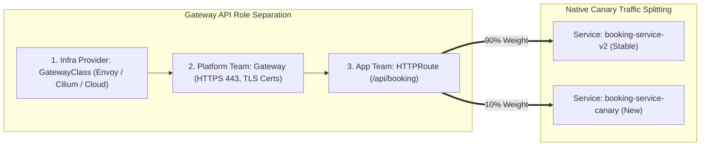
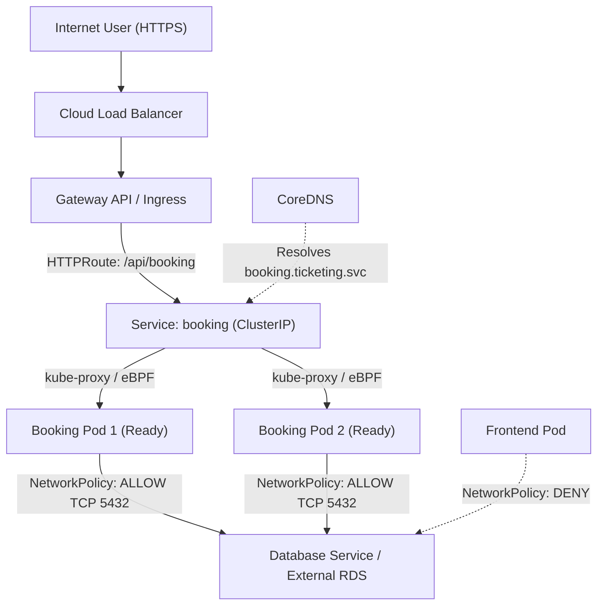
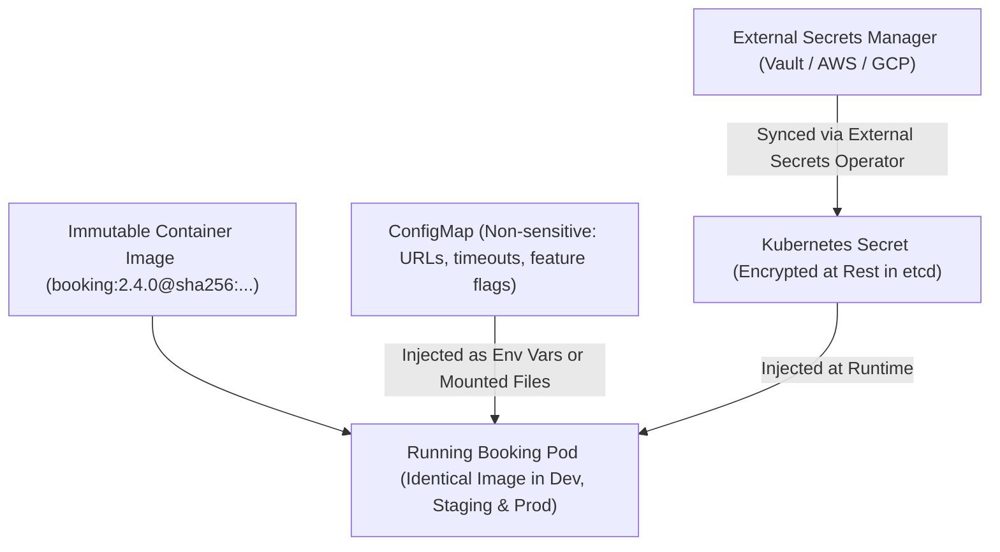
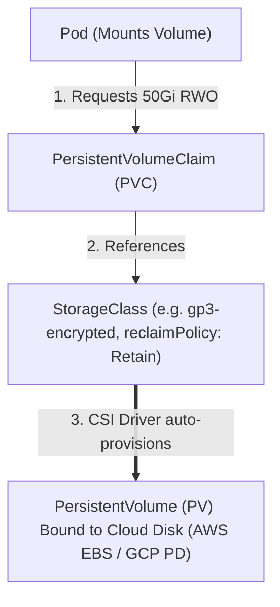

[back to Kubernetes index](./kubernetes-content.md)
---

# Part 3: Networking, Configuration & Persistent Storage

## Table of Contents
1. [Pod Networking, Services & CoreDNS](#1-pod-networking-services--coredns)
2. [Kubernetes Service Types (ClusterIP, NodePort, LoadBalancer, ExternalName & Headless)](#2-kubernetes-service-types-clusterip-nodeport-loadbalancer-externalname--headless)
3. [Letting the Internet In: Ingress vs. Gateway API](#3-letting-the-internet-in-ingress-vs-gateway-api)
4. [Network Policies & CNI Security Isolation](#4-network-policies--cni-security-isolation)
5. [Networking Visualized (End-to-End Traffic Flow)](#5-networking-visualized-end-to-end-traffic-flow)
6. [Configuration: ConfigMaps & Secrets](#6-configuration-configmaps--secrets)
7. [Persistent Storage: `emptyDir`, PV, PVC, StorageClass & CSI](#7-persistent-storage-emptydir-pv-pvc-storageclass--csi)

---

## 1. Pod Networking, Services & CoreDNS

* **The Kubernetes Flat Network Model:** Every Pod gets its own unique cluster-wide IP address (managed by a **CNI plugin** such as Calico, Cilium, Flannel, or AWS VPC CNI). Any Pod can reach any other Pod across Nodes without NAT (unless restricted by a NetworkPolicy).
* **The Dynamic IP Problem:** Because Pods are ephemeral and constantly recreated, their IP addresses change every time a Pod restarts or moves to a new Node. You can **never** hardcode Pod IPs!
* **Kubernetes Services:** Provide a **stable, enduring virtual IP (VIP)** and **DNS name** that front a dynamic pool of healthy Pods.
  * **Label Selector Connection:** A Service identifies which Pods belong to its routing pool via `selector` labels (e.g., `app: booking`). Only Pods whose **Readiness Probe is passing** are included in the Service's **EndpointSlices**.
    > *Debugging Tip:* If a Service returns connection refused or empty responses, run `kubectl get endpoints <service>`—an empty list almost always means a **label mismatch** or failing Readiness Probes!
  * **Internal DNS (CoreDNS):** Every Service automatically gets a DNS record inside the cluster:
    * Same namespace: `http://booking`
    * Cross-namespace FQDN: `http://booking.<namespace>.svc.cluster.local`
  * **How Routing Actually Works (`kube-proxy` vs eBPF):** `kube-proxy` watches Services and EndpointSlices and programs Linux kernel rules (`iptables` or `IPVS`) on every Worker Node to load-balance traffic from the Service VIP to backend Pod IPs. Modern CNIs like **Cilium** replace `kube-proxy` entirely using **eBPF** in the Linux kernel for dramatically higher throughput and lower latency at large cluster scales.



---

## 2. Kubernetes Service Types (ClusterIP, NodePort, LoadBalancer, ExternalName & Headless)



| Service Type | Scope | How It Works | Typical Use Case |
| :--- | :--- | :--- | :--- |
| **`ClusterIP`** *(Default)* | Internal cluster only | Assigns an internal virtual IP reachable only from inside the cluster. | Internal microservices (`booking-service`, `payment-service`, Redis). |
| **`NodePort`** | External (via Node IP) | Opens a static port (`30000–32767`) on **every Worker Node** and forwards `<NodeIP>:<NodePort>` to the Service. | Local dev (`Minikube`/`Kind`), bare-metal testing, or underlay for cloud LoadBalancers. |
| **`LoadBalancer`** | External (Cloud) | Triggers the Cloud Controller Manager to provision an external cloud L4 Load Balancer (e.g., AWS NLB/ELB, GCP LB) routing to the cluster. | Exposing a single TCP/UDP service or the cluster's Gateway/Ingress controller. *(Expensive if created per microservice!)* |
| **`ExternalName`** | DNS CNAME alias | Maps a K8s Service name to an external DNS hostname (e.g., `prod-db.rds.amazonaws.com`) via DNS `CNAME` without proxying traffic. | Accessing external cloud-managed databases cleanly via Kubernetes service names. |
| **Headless Service** (`clusterIP: None`) | Internal direct-to-Pod DNS | Allocates **no** virtual IP; instead, CoreDNS returns the individual **A/AAAA records of every backend Pod IP** directly. | **StatefulSets** (Kafka, Cassandra, Postgres clusters) where clients must connect to a specific replica like `db-0.db-headless.default.svc.cluster.local`. |

---

## 3. Letting the Internet In: Ingress vs. Gateway API

Provisioning a separate cloud `LoadBalancer` for every single HTTP microservice is expensive and operationally messy. Instead, Kubernetes uses an **L7 HTTP/HTTPS routing layer** sitting behind a *single* shared Load Balancer:

### Ingress (Traditional)
* Maps external HTTP/HTTPS hostnames and URL paths (e.g., `api.tickets.com/book` → `booking-service:80`) to internal Services, and handles TLS termination.
* **Limitations:** Historically relied heavily on non-portable vendor-specific YAML annotations (`nginx.ingress.kubernetes.io/...`), lacked native support for traffic splitting / header matching / gRPC / TCP, and mixed platform-team and app-team concerns in one resource.
* **Important 2026 Industry Update (Ingress NGINX Retirement):** The long-running community `ingress-nginx` controller reached legacy/retirement status in **2026**. New and migrating production clusters should adopt the **Gateway API** (or supported next-gen controllers like Envoy Gateway, Cilium Gateway, Traefik, or cloud-native Gateways).

### Gateway API (The Modern Standard)
Designed with **role-oriented separation of concerns**:
1. **Infrastructure Provider** defines a `GatewayClass` (e.g., Envoy Gateway, Cilium, AWS ALB, GKE Gateway).
2. **Cluster / Platform Team** owns the `Gateway` (ports, TLS certificates, cloud load balancer, cross-namespace security policies).
3. **Application Teams** independently own their `HTTPRoute` / `GRPCRoute` / `TCPRoute` manifests—supporting native canary traffic splitting (`weight: 90` / `weight: 10`), header-based routing, and request mirroring without vendor-specific annotations!



```yaml
apiVersion: gateway.networking.k8s.io/v1
kind: HTTPRoute
metadata:
  name: booking-route
  namespace: ticketing
spec:
  parentRefs:
  - name: public-gateway
  hostnames: ["tickets.example.com"]
  rules:
  - matches:
    - path:
        type: PathPrefix
        value: /api/booking
    backendRefs:
    - name: booking-service-v2
      port: 80
      weight: 90
    - name: booking-service-canary
      port: 80
      weight: 10
```

---

## 4. Network Policies & CNI Security Isolation

* **Dangerous Default:** By default in Kubernetes, **every Pod can talk to every other Pod across every Namespace** (flat open network). A compromised marketing blog Pod could directly reach your payment database!
* **Zero-Trust Best Practice:**
  1. Apply a **"Default Deny All"** `NetworkPolicy` (both `Ingress` and `Egress`) to every Namespace.
  2. Explicitly whitelist **only** required flows (e.g., allow `app: booking` Pods to reach `app: database` on TCP port `5432`, and allow DNS UDP/TCP `53` to CoreDNS; block everything else).
* **Critical CNI Caveat:** Applying a `NetworkPolicy` YAML object **does nothing** unless your cluster's **CNI plugin actively supports and enforces NetworkPolicies** (e.g., **Calico**, **Cilium**, Antrea). Some basic CNIs (like default Flannel) silently ignore NetworkPolicy objects—always test that blocked traffic actually drops!

---

## 5. Networking Visualized (End-to-End Traffic Flow)



---

## 6. Configuration: ConfigMaps & Secrets

**Golden Rule:** **Keep configuration out of container images.** The exact same immutable image (`booking:2.4.0@sha256:...`) must run in `dev`, `staging`, and `prod`—only the injected configuration changes.



### ConfigMap
* Stores **non-sensitive** key-value pairs or config files (`application.yml`, `nginx.conf`, feature flags, timeouts, service URLs).
* Consumed by Pods either as **environment variables** (`envFrom`) or **mounted files** in a volume (mounted ConfigMaps automatically update inside running Pods without restarting them, whereas `env` variables require a Pod restart).

### Secrets (And The Crucial Security Caveat!)
* Intended for sensitive data (API keys, database passwords, TLS private keys, `imagePullSecrets`).
* **CRITICAL CAVEAT:** **Kubernetes Secrets are NOT encrypted by default!** They are merely **Base64-encoded** in manifests and stored in plaintext inside `etcd` unless explicitly configured otherwise. Anyone with `get secret` RBAC access (or `etcd` backup access) can immediately run `base64 -d` and read them!
* **Production Secret Hardening Checklist:**
  1. Enable **Encryption at Rest** (`EncryptionConfiguration` with KMS provider) on the API Server for `etcd`.
  2. Never commit raw `Secret` YAML files into Git (use **Sealed Secrets**, **SOPS**, or external sync).
  3. Lock down **RBAC** strictly so only authorized ServiceAccounts can read specific Secrets.
  4. **Best Practice:** Integrate an external enterprise secrets manager (**HashiCorp Vault**, **AWS Secrets Manager**, **GCP Secret Manager**, **Azure Key Vault**) via the **External Secrets Operator (ESO)** or **Secrets Store CSI Driver**.

---

## 7. Persistent Storage: `emptyDir`, PV, PVC, StorageClass & CSI

Remember: Container filesystems are ephemeral—when a container restarts or a Pod dies, its local disk vanishes.

### Ephemeral vs. Persistent Volume Types
* **`emptyDir`:** Created when a Pod is assigned to a Node and deleted permanently when the Pod dies. Great for scratch space, caching, or **sharing files between a Main Container and a Sidecar Container** inside the same Pod.
* **PersistentVolume (PV) & PersistentVolumeClaim (PVC):** Decouple *how storage is provisioned* (cluster/infra concern) from *how apps request storage* (developer concern):
  * **PVC (Claim):** The application's request (e.g., *"Give me `50Gi` of `ReadWriteOnce` SSD storage"*).
  * **PV (Volume):** The actual backing storage resource provisioned from cloud/SAN storage (AWS EBS, GCP Persistent Disk, NFS, Ceph) via a **CSI (Container Storage Interface)** driver.
  * **StorageClass:** Enables **Dynamic Provisioning**—instead of admins manually creating PVs beforehand, a PVC references a `StorageClass` (e.g., `gp3-encrypted`), and the CSI driver automatically provisions a brand-new cloud disk on demand!



### Access Modes (Critical Interview & Production Concept)
| Access Mode | Abbreviation | Meaning | Typical Backing Storage |
| :--- | :--- | :--- | :--- |
| **`ReadWriteOnce`** | `RWO` | Mounted read-write by a **single Node** at a time. | Cloud block storage (AWS EBS, GCP PD, Azure Disk). |
| **`ReadOnlyMany`** | `ROX` | Mounted read-only by **many Nodes** simultaneously. | Shared static assets, ML model weights. |
| **`ReadWriteMany`** | `RWX` | Mounted read-write by **many Nodes** simultaneously. | Network filesystems (AWS EFS, Azure Files, NFS, CephFS). |
| **`ReadWriteOncePod`** | `RWOP` | Mounted read-write by a **single Pod** across the entire cluster (strictest isolation). | CSI block volumes (K8s 1.29+ GA). |

### Reclaim Policy (Dangerous Default Warning!)
Check your `StorageClass` **`reclaimPolicy`**:
* **`Delete`** *(Often the default for dynamically provisioned cloud disks!)*: Deleting a PVC **immediately deletes the underlying PV and destroys the cloud disk forever**.
* **`Retain`** *(Recommended for production stateful data)*: Deleting a PVC leaves the PV and its data intact until an operator manually archives/deletes it.
* **Backup Reality Check:** Persistent Volumes protect against Pod restarts, **not** accidental `DROP TABLE`, disk corruption, or AZ disasters. True durability always requires scheduled **off-cluster backups/snapshots** (e.g., Velero + database-native logical/WAL backups).

---

**Next:** [Part 4: Production Readiness, Scheduling, Autoscaling & Security →](./04-production-reliability-scaling-and-security.md)
