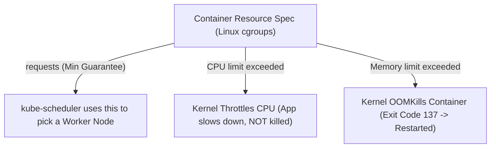
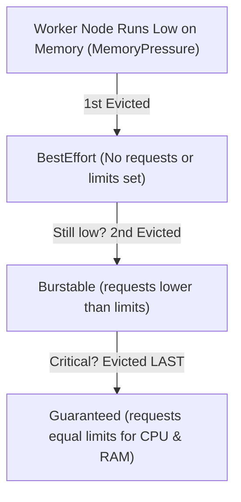
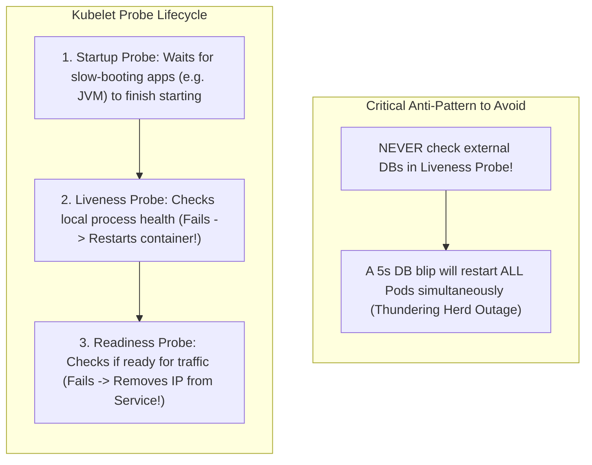
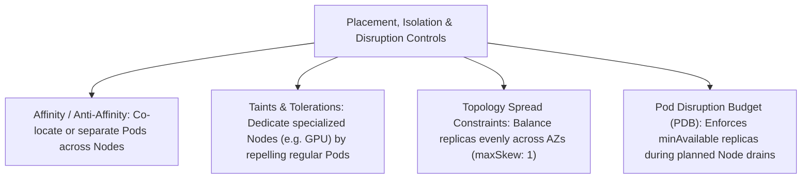
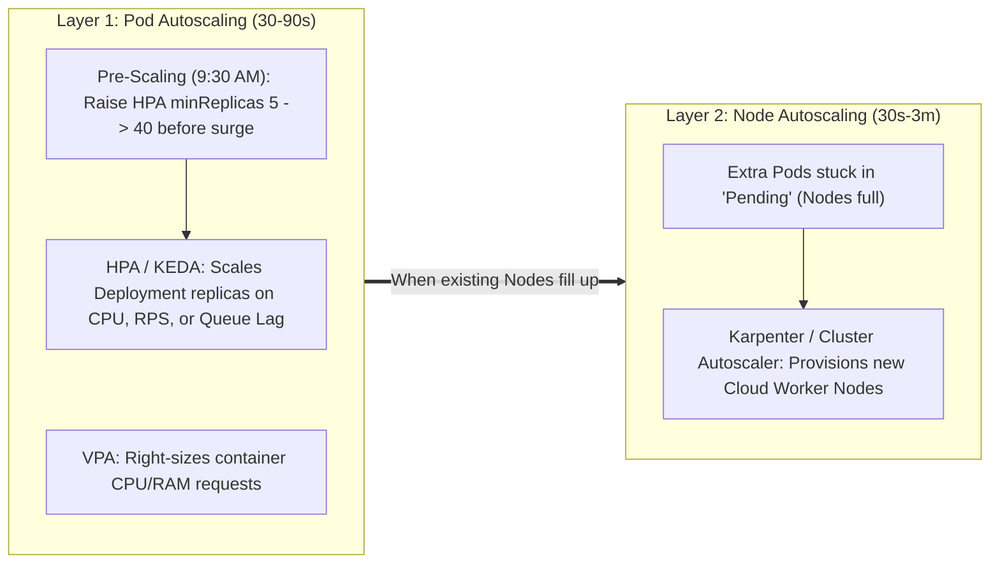
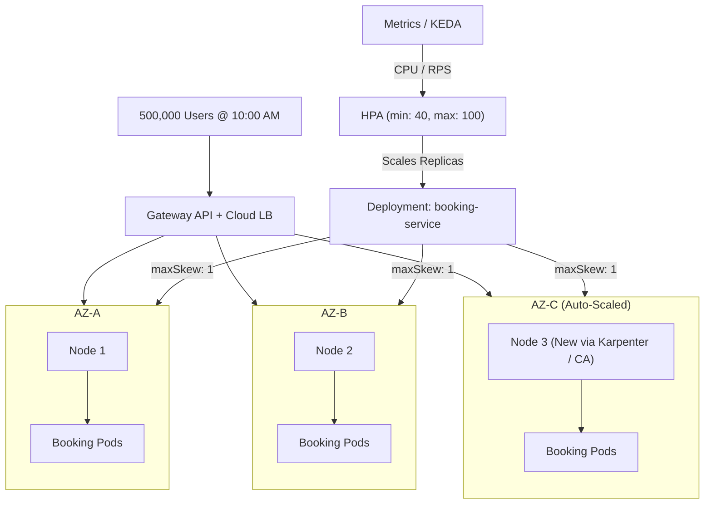
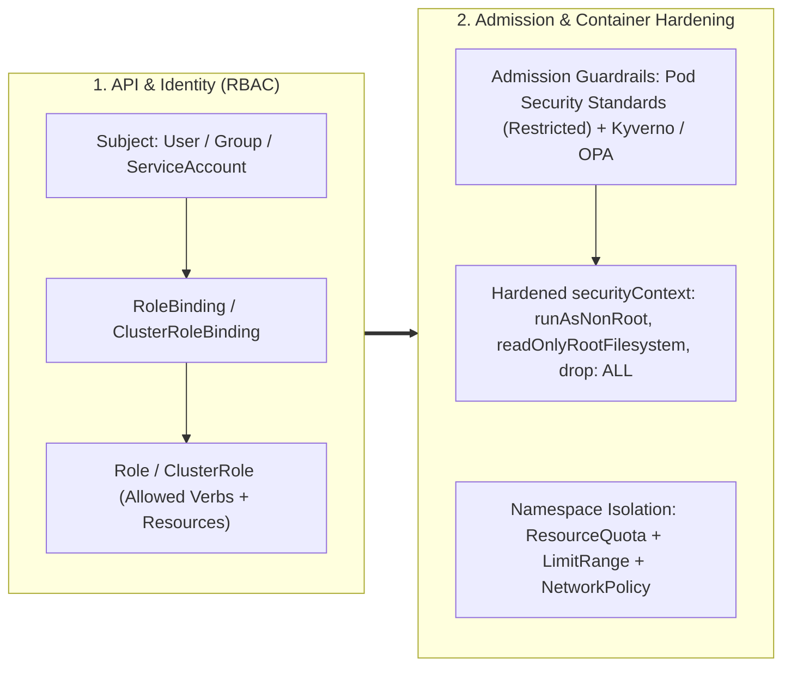

[back to Kubernetes index](./kubernetes-content.md)
---

# Part 4: Production Readiness, Scheduling, Autoscaling & Security

## Table of Contents
1. [Preparing for a Surge: Load Testing, Resource Requests/Limits & QoS Classes](#1-preparing-for-a-surge-load-testing-resource-requestslimits--qos-classes)
2. [Health Checks: Startup, Liveness & Readiness Probes](#2-health-checks-startup-liveness--readiness-probes)
3. [Advanced Scheduling, Topology Spread & Pod Disruption Budgets (PDB)](#3-advanced-scheduling-topology-spread--pod-disruption-budgets-pdb)
4. [Autoscaling Under Pressure (Pre-Scaling, HPA, KEDA, VPA, Cluster Autoscaler & Karpenter)](#4-autoscaling-under-pressure-pre-scaling-hpa-keda-vpa-cluster-autoscaler--karpenter)
5. [High Availability & Autoscaling Visualized](#5-high-availability--autoscaling-visualized)
6. [Cluster & Container Security Best Practices](#6-cluster--container-security-best-practices)

---

## 1. Preparing for a Surge: Load Testing, Resource Requests/Limits & QoS Classes

### Load Testing First (Never Guess!)
Before launching a high-traffic event (like a 10:00 AM concert ticket sale), simulate real traffic (using k6, Locust, or Gatling) to measure:
* Exact **requests per second (RPS)** one Pod handles before p99 latency spikes.
* Exact **database connection pool** usage per Pod (so 50 Pods × 20 connections doesn't exhaust Postgres `max_connections`!).
* Whether your bottleneck is CPU, Memory, GC pauses, DB locks, or downstream third-party APIs.

### Resource `requests` vs. `limits` (Powered by Linux `cgroups`)
Under the hood, Kubernetes translates these fields directly into Linux **cgroups** limits on the container:

| Field | What It Does | What Happens When Exceeded? |
| :--- | :--- | :--- |
| **`requests` (Guaranteed Minimum)** | Used by **`kube-scheduler`** to find a Node with enough unallocated CPU/RAM to fit the Pod. Guarantees at least this CPU share during contention. | Container can burst above its `request` if the Node has spare idle capacity (up to its `limit`). |
| **`limits` (Hard Ceiling)** | Maximum CPU and Memory the container is allowed to consume. | **CPU Limit exceeded:** Linux kernel **throttles** the container (app slows down / tail latency spikes—container is NOT killed).<br>**Memory Limit exceeded:** Linux kernel **OOM-kills** the container (**`OOMKilled`, Exit Code 137**), and `kubelet` restarts it! |

> **Senior Production Tip on CPU Limits:** Always set **Memory `requests` == Memory `limits`** (or tightly bounded) so OOM kills are predictable. Be careful with overly tight **CPU `limits`** on latency-sensitive apps (like Java/Go services)—unnecessary CPU throttling often causes mysterious p99 latency spikes even when the host node has plenty of idle CPU!



### Quality of Service (QoS) Classes & Eviction Order
When a Worker Node runs dangerously low on memory, `kubelet` evicts Pods in strict QoS order:

| QoS Class | How It Is Assigned | Eviction Priority |
| :--- | :--- | :--- |
| **1. `BestEffort`** | **No** `requests` or `limits` set on any container. | **Evicted FIRST** (zero guarantees—never use in production!). |
| **2. `Burstable`** | At least one container has a `request` or `limit`, and `requests < limits`. | **Evicted SECOND** (if exceeding requests). |
| **3. `Guaranteed`** | **Every** container has both CPU & Memory `requests == limits`. | **Evicted LAST** (highest protection for critical services like `booking-service` or `payment-service`). |



---

## 2. Health Checks: Startup, Liveness & Readiness Probes

`kubelet` continuously probes containers using HTTP (`httpGet`), TCP (`tcpSocket`), gRPC (`grpc`), or shell commands (`exec`):



| Probe Type | Question It Answers | Action on Failure | Best Practice |
| :--- | :--- | :--- | :--- |
| **Startup Probe** | *"Has this slow-booting app finished initializing yet?"* | Disables Liveness & Readiness checks until it succeeds (or kills container if `failureThreshold × periodSeconds` expires). | **Essential for JVM/Spring Boot or legacy apps** that take 30–60s to warm up—prevents Liveness Probe from killing them in an infinite boot loop! |
| **Liveness Probe** | *"Is this app alive, or deadlocked/wedged?"* | `kubelet` **kills and restarts** the container. | Check **only local process health** (e.g., `/health/live` returning `200 OK`). |
| **Readiness Probe** | *"Is this Pod ready to serve live traffic right now?"* | Removes the Pod's IP from the **Service's EndpointSlices** (stops sending traffic; does **NOT** restart the container!). | Verify app warm-up, cache loading, or critical local readiness (e.g., `/health/ready`). |

> **CRITICAL ANTI-PATTERN: Checking External Dependencies in a Liveness Probe!**
> Never have your **Liveness Probe** query an external database or third-party API! If the database has a brief 5-second hiccup, **every single Pod's Liveness Probe will fail simultaneously**, causing Kubernetes to kill and restart your entire fleet at once—turning a tiny blip into a **catastrophic thundering-herd outage**!

---

## 3. Advanced Scheduling, Topology Spread & Pod Disruption Budgets (PDB)

Controlling *where* Pods land prevents single-point-of-failure outages:

### Placement & Scheduling Controls
* **`nodeSelector`:** Simple key-value Node matching (e.g., `disktype: ssd`).
* **Node Affinity / Anti-Affinity:** Expressive rules (`requiredDuringScheduling...` = hard rule; `preferredDuringScheduling...` = soft preference) to place Pods on specific instance families or regions.
* **Pod Affinity / Anti-Affinity:** Co-locate Pods together (e.g., app + cache in same AZ) or keep replicas apart (never put two replicas of the same DB on the same Node).
* **Taints & Tolerations:** Repel Pods from specialized Nodes unless the Pod explicitly *tolerates* the taint (e.g., tainting GPU nodes with `gpu=true:NoSchedule` so regular web apps don't steal expensive GPU capacity).
* **Topology Spread Constraints:** Evenly distributes Pod replicas across **Nodes** (`kubernetes.io/hostname`) and **Availability Zones** (`topology.kubernetes.io/zone`, with `maxSkew: 1`). Guarantees that losing an entire data-center rack or AZ never takes down all replicas of your service!
* **PriorityClasses & Preemption:** Assigns high priority to critical workloads (`booking-service`, `ingress`) so if the cluster runs out of space, Kubernetes can preempt low-priority batch jobs to schedule critical Pods.

### Pod Disruption Budgets (PDB)
Declares the minimum capacity that must remain available during **voluntary (planned) disruptions** (such as draining a Node for OS patching or Kubernetes version upgrades):

```yaml
apiVersion: policy/v1
kind: PodDisruptionBudget
metadata:
  name: booking-pdb
spec:
  minAvailable: 80%          # Or use `maxUnavailable: 1`
  selector:
    matchLabels:
      app: booking
```

> **PDB Caveat:** A PDB protects against **voluntary** disruptions (node drains, cluster upgrades). It **cannot** protect your service from **involuntary** failures like sudden hardware/AZ crashes or application crash-on-startup bugs!



---

## 4. Autoscaling Under Pressure (Pre-Scaling, HPA, KEDA, VPA, Cluster Autoscaler & Karpenter)

### The Golden Rule: Autoscaling Is NOT Instant!
* Spinning up new Pods (image pull + app warm-up + Readiness Probe) takes **30–90 seconds**.
* Provisioning brand-new Worker Nodes from a cloud provider takes **1–4 minutes**.
* **You cannot scale purely reactively when 500,000 users arrive at 10:00:00 AM!**



### The 5 Pillars of Kubernetes Scaling
1. **Pre-Scaling (Scheduled Warm-Up):** For known spikes (e.g., 10:00 AM ticket drop), raise the HPA's `minReplicas` (e.g., from `5` to `40`) at **9:30 AM**. This forces Nodes and Pods to warm up *before* the surge hits.
2. **Horizontal Pod Autoscaler (HPA):** Automatically scales Pod replica count (`Deployment`/`StatefulSet`) based on metrics:
   * Built-in metrics: CPU and Memory utilization via **Metrics Server**.
   * Custom / External metrics: Requests per second (RPS), Kafka consumer lag, or SQS Queue Length—powered by Prometheus Adapter or **KEDA (Kubernetes Event-Driven Autoscaling)** (which can even scale workloads down to `0`!).
3. **Vertical Pod Autoscaler (VPA):** Automatically right-sizes a Pod's CPU and Memory `requests`/`limits` based on historical usage *(note: avoid targeting the same CPU/Memory metric with both HPA and VPA simultaneously; modern K8s also supports In-Place Pod Vertical Resizing without restarting the Pod).*
4. **Cluster Autoscaler (Node-Level Scaling):** Watches for Pods stuck in `Pending` due to insufficient cluster CPU/RAM and requests additional Worker Nodes from cloud Auto Scaling Groups / Managed Node Groups (and scales idle Nodes back down after cooldown).
5. **Karpenter (Modern Node Provisioner):** Open-source alternative (widely adopted on AWS EKS) that bypasses rigid Node Groups to launch right-sized EC2/Spot instances directly in **~30–45 seconds**—far faster and more cost-efficient than traditional Cluster Autoscaler.

> **Downstream Bottleneck Warning:** Scaling stateless `booking-service` Pods from 5 → 500 **will not save your site** if your monolithic database, Redis single-shard, or third-party payment gateway hits its limit! Always pair Pod autoscaling with connection pooling, queueing, caching, and rate limiting.

---

## 5. High Availability & Autoscaling Visualized



### How This Architecture Works Together During a Surge

1. **Multi-AZ Traffic Distribution (`Gateway API + Cloud LB`):** All 500,000 incoming requests enter through a single Cloud Load Balancer and **Gateway API**, which load-balances requests across healthy (`Ready`) Booking Pods in **AZ-A**, **AZ-B**, and **AZ-C**.
2. **Metric-Driven Pod Scaling (`Metrics / KEDA` → `HPA` → `Deployment`):** Metrics Server / KEDA continuously feeds live CPU, RPS, and queue-depth metrics to the **HPA**. Because the team pre-scaled `min: 40` before 10:00 AM, the cluster absorbs the initial wave while HPA dynamically scales the `booking-service` Deployment up toward `max: 100` replicas.
3. **Fault-Tolerant Placement (`maxSkew: 1`):** **Topology Spread Constraints** force the Scheduler to distribute Pods evenly across all three Availability Zones (at most a 1-Pod difference between zones). If an entire Availability Zone goes dark, the remaining two AZs keep serving traffic seamlessly.
4. **Elastic Node Provisioning (`AZ-C: Node 3`):** When existing Worker Nodes (`Node 1` and `Node 2`) run out of CPU/RAM and extra Booking Pods stay `Pending`, **Karpenter / Cluster Autoscaler** detects the unschedulable Pods and automatically provisions `Node 3` in `AZ-C` so the new Pods can start serving traffic.

---

## 6. Cluster & Container Security Best Practices

Security in Kubernetes is **defense in depth** across 4 layers (Cloud → Cluster → Namespace → Container):



### 1. Authentication & Role-Based Access Control (RBAC)
Controls **who can do what** on the Kubernetes API (Principle of Least Privilege):
* **`Role`** (namespace-scoped) / **`ClusterRole`** (cluster-wide): Defines allowed API verbs (`get`, `list`, `watch`, `create`, `delete`) on specific resources (`pods`, `deployments`, `secrets`).
* **`RoleBinding`** / **`ClusterRoleBinding`**: Binds a `Role`/`ClusterRole` to a **User**, **Group**, or **ServiceAccount**.
* **ServiceAccounts:** Every workload should run with its own dedicated `ServiceAccount` granting the absolute bare minimum API permissions (and set `automountServiceAccountToken: false` if the app never talks to the Kubernetes API!).

### 2. Multi-Tenancy Isolation (`Namespaces`, `ResourceQuota`, `LimitRange`)
* **Namespaces:** Logically partition a cluster by team or environment (`dev`, `staging`, `ticketing-prod`).
* **`ResourceQuota`:** Caps the *total* CPU, Memory, PVC storage, and object counts an entire Namespace can consume—preventing one noisy neighbor from starving the cluster.
* **`LimitRange`:** Sets default `requests`/`limits` and min/max bounds for individual Pods/Containers inside a Namespace so engineers can't accidentally deploy unbounded `BestEffort` Pods.

### 3. Container & Pod Hardening (`securityContext` & Pod Security Standards)
Never run containers as `root`! Enforce a hardened `securityContext` on every production Pod:

```yaml
securityContext:
  runAsNonRoot: true
  runAsUser: 10001
  readOnlyRootFilesystem: true        # Blocks attackers from writing malware to disk!
  allowPrivilegeEscalation: false     # Prevents setuid privilege escalation
  seccompProfile:
    type: RuntimeDefault              # Restricts dangerous Linux syscalls
  capabilities:
    drop: ["ALL"]                     # Strips all Linux root capabilities
```

* **Pod Security Standards (Admission):** Built-in cluster/namespace security enforcement with three profiles: **`Privileged`**, **`Baseline`**, and **`Restricted`**. Roll out safely by starting in **`audit`** / **`warn`** mode to catch breaking workloads before flipping to **`enforce`**.

### 4. Policy Engines & Software Supply Chain Security
* **Admission Policy Engines (`Kyverno` / `OPA Gatekeeper`):** Intercept every API request via Validating/Mutating Webhooks to enforce organization-wide guardrails (e.g., *"Reject any image not pulled from our private registry"*, *"Reject `:latest` tags"*, *"Require `team` labels on all Deployments"*).
* **Supply Chain Hygiene:** Scan images in CI (Trivy/Grype), pin images by **immutable `@sha256:` digests**, generate SBOMs, and verify cryptographic signatures (**Cosign / Sigstore**) at admission time.

---

**Next:** [Part 5: Ecosystem, Troubleshooting Playbook & Production Ops →](./05-ecosystem-troubleshooting-and-production.md)
