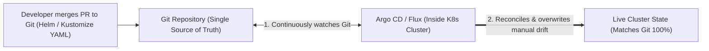
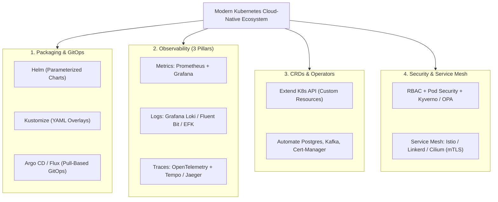
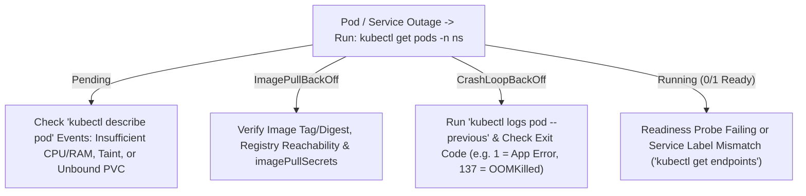
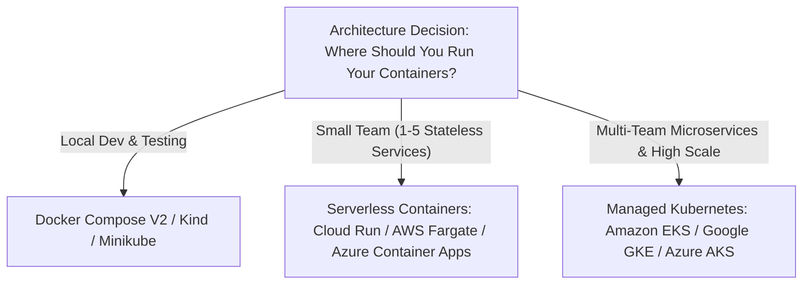
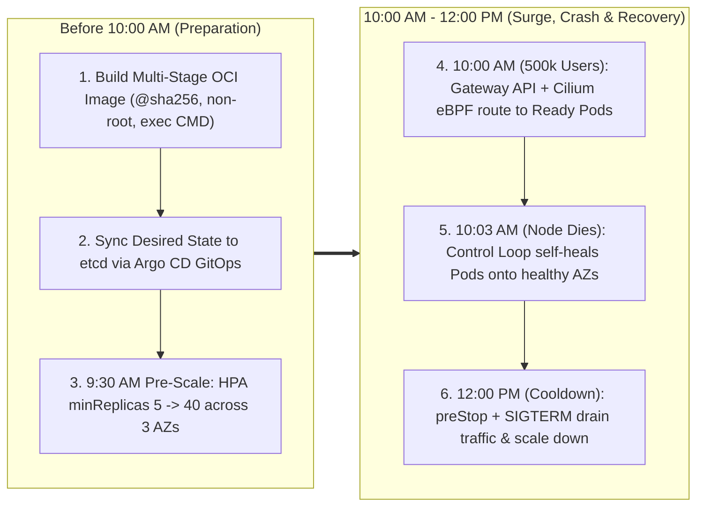

[back to Kubernetes index](./kubernetes-content.md)
---

# Part 5: Cloud-Native Ecosystem, Troubleshooting & Production Operations

## Table of Contents
1. [The Modern Kubernetes Ecosystem](#1-the-modern-kubernetes-ecosystem)
2. [Ecosystem At a Glance](#2-ecosystem-at-a-glance)
3. [Production Troubleshooting & Forensics Playbook](#3-production-troubleshooting--forensics-playbook)
4. [Essential `kubectl` Debugging Cheatsheet](#4-essential-kubectl-debugging-cheatsheet)
5. [Running Clusters in Production & When NOT to Use Kubernetes](#5-running-clusters-in-production--when-not-to-use-kubernetes)
6. [Full Circle Recap: The Ticket Website Incident in Action](#6-full-circle-recap-the-ticket-website-incident-in-action)

---

## 1. The Modern Kubernetes Ecosystem

Core Kubernetes gives you scheduling, self-healing, and primitives—not a complete platform. The CNCF (Cloud Native Computing Foundation) ecosystem fills the remaining operational pillars:

### 1. Packaging & Configuration Management: **Helm** vs. **Kustomize**
* **Helm (Package Manager / Templating):** Bundles YAML manifests into reusable parameterized templates called **Charts** (`values-dev.yaml`, `values-prod.yaml`). Industry standard for distributing and installing third-party software (Prometheus, Cert-Manager, Redis, Envoy Gateway).
* **Kustomize (Template-Free Overlays):** Built natively into `kubectl` (`kubectl apply -k overlays/prod`). Keeps plain, valid YAML in a `base/` directory and applies environment-specific patches in `overlays/` without Jinja/Go-template syntax complexity. *(Many teams combine both: Helm for third-party charts, Kustomize for internal microservices!)*

### 2. Continuous Delivery: **GitOps (Argo CD & Flux)**
* Instead of CI pipelines pushing imperatively via `kubectl apply` from Jenkins/GitHub Actions, a **GitOps controller inside the cluster** continuously watches your Git repository.
* If someone manually edits a live cluster object (`kubectl edit`), Argo CD / Flux detects **configuration drift** and automatically reconciles (rolls back) the cluster to match Git—giving you full auditability, PR-reviewed deployments, and `git revert` rollbacks!



### 3. Automating Complex Stateful Software: **CRDs & Operators**
* **CRD (Custom Resource Definition):** Extends the Kubernetes API itself with new custom object kinds (e.g., `kind: PostgresCluster`, `kind: KafkaTopic`, `kind: Certificate`).
* **Operator:** A custom controller running the reconciliation loop for a CRD—encoding human SRE runbooks (automated backups, shard rebalancing, primary failover, rolling version upgrades) directly into software (e.g., **CloudNativePG**, **Strimzi Kafka**, **cert-manager**).

### 4. The Three Pillars of Observability
Because Pods are ephemeral and disappear along with their local disk/logs, external telemetry is **mandatory**:
1. **Metrics (`Prometheus` + `Grafana`):** Prometheus scrapes time-series metrics (CPU, RAM, HTTP latency, error rates, queue depth); Grafana renders live dashboards and alerting.
2. **Centralized Logging (`Grafana Loki` / `EFK` / `Fluent Bit`):** DaemonSets ship stdout/stderr container logs off every Node to durable searchable storage so you can debug Pods that died hours ago.
3. **Distributed Tracing (`OpenTelemetry` + `Jaeger` / `Tempo`):** Traces a single user request (`trace_id`) across every microservice hop (`Frontend → Booking → Payment → DB`) to pinpoint exact latency bottlenecks. **OpenTelemetry (OTel)** is the modern unified standard for instrumenting Metrics, Logs, and Traces together.

### 5. Service Mesh (`Istio` / `Linkerd` / `Cilium Service Mesh`)
* Injects transparent networking capabilities (historically via Envoy sidecars, or sidecar-less via Istio Ambient / Cilium eBPF) for east-west (Pod-to-Pod) traffic:
  * Automatic **mTLS** encryption & workload identity between every service.
  * Fine-grained traffic shifting (canary/blue-green), circuit breaking, rate limiting, and automatic distributed tracing.
* **Best Practice Warning (Retry Storms!):** Always set **strict, tight caps on automatic retries** and pair them with **circuit breakers / retry budgets**. Unlimited retries across a chain of microservices during a partial outage amplify traffic exponentially—turning a minor slowdown into a **self-inflicted Denial-of-Service (DoS) attack**!

---

## 2. Ecosystem At a Glance



---

## 3. Production Troubleshooting & Forensics Playbook



### Common Pod Failure States & Exact Next Steps

| Pod State | Typical Root Cause | Diagnostic Next Steps |
| :--- | :--- | :--- |
| **`Pending`** | No Worker Node satisfies CPU/RAM `requests`, Affinity/Taint rules, or unbound PVC. | Run `kubectl describe pod <name>` → check the **`Events`** section at the bottom for `FailedScheduling` reasons. |
| **`ImagePullBackOff` / `ErrImagePull`** | Typo in image name/tag, private registry missing `imagePullSecrets`, or registry rate-limit/network block. | Run `kubectl describe pod <name>` → verify image URI, digest, and `imagePullSecrets` credentials. |
| **`CrashLoopBackOff`** | Container starts, exits with a non-zero error, and Kubelet backs off (`10s, 20s, 40s... 5m`) while restarting it. | Run `kubectl logs <name> --previous` to inspect the **crashed** instance's stdout/stderr + check `Last State` / **Exit Code** in `describe`. |
| **`OOMKilled`** | Container exceeded its Memory `limit` (or Node ran out of RAM) and Linux kernel killed it. | Check `kubectl describe pod <name>` for `Reason: OOMKilled` (`Exit Code: 137`). Profile heap/memory leaks or increase memory `limits`. |
| **`CreateContainerConfigError`** | Referenced `ConfigMap` or `Secret` key does not exist in that Namespace. | Run `kubectl describe pod <name>` → verify `ConfigMap`/`Secret` names and keys match exactly. |
| **`Running` but `0/1 Ready`** | Container process is alive, but the **Readiness Probe** is failing (so Service sends it zero traffic). | Run `kubectl describe pod <name>` for probe failure HTTP code/timeout; verify `containerPort` matches app listening port. |
| **`Terminating` (Stuck)** | Finalizer stuck on resource, unresponsive Node, or app ignoring `SIGTERM` during a huge `terminationGracePeriodSeconds`. | Inspect `kubectl describe pod <name>` and check `metadata.finalizers` or Node health (`kubectl get nodes`). |

### Container Exit Codes Cheat Sheet

| Exit Code | Signal | Meaning |
| :--- | :--- | :--- |
| **`0`** | None | Clean, normal process exit (expected for completed `Job` containers). |
| **`1`** | Application Error | Unhandled exception, bad config, syntax error, or missing dependency. |
| **`126` / `127`** | Shell/Exec Error | Command not executable (`126`) or binary/file not found in image (`127`). |
| **`137`** | `SIGKILL` (`128 + 9`) | **Hard kill!** Almost always **`OOMKilled`** (exceeded memory limit) OR app ignored `SIGTERM` past `terminationGracePeriodSeconds`! |
| **`139`** | `SIGSEGV` (`128 + 11`) | Segmentation fault (invalid memory access in C/C++/native library). |
| **`143`** | `SIGTERM` (`128 + 15`) | Graceful termination signal received (normal during Pod shutdown/scale-down). |

### The 5-Step Outage Triage Checklist

When a deployment breaks or traffic drops, follow this exact sequence:

1. **Observe cluster & Pod status:**
   ```bash
   kubectl get pods -n <namespace> -o wide
   kubectl get events -n <namespace> --sort-by='.lastTimestamp'
   ```
2. **Describe the failing Pod (inspect Scheduling, Probes, Volume mounts, Exit Codes):**
   ```bash
   kubectl describe pod <pod-name> -n <namespace>
   ```
3. **Inspect current AND previous crashed logs:**
   ```bash
   kubectl logs <pod-name> -n <namespace>
   kubectl logs <pod-name> --previous -n <namespace>      # Critical for CrashLoopBackOff!
   kubectl logs <pod-name> -c <container-name> -f         # Specific container in multi-container Pod
   ```
4. **Confirm Rollout & Service Routing (catch label mismatches & empty EndpointSlices):**
   ```bash
   kubectl rollout status deployment/<deployment-name> -n <namespace>
   kubectl get endpoints <service-name> -n <namespace>
   ```
5. **Interactive Diagnosis (or instant rollback if production is burning!):**
   ```bash
   # Roll back immediately to restore SLA before deep-diving:
   kubectl rollout undo deployment/<deployment-name> -n <namespace>

   # Inspect live container (or attach ephemeral debug container for distroless images):
   kubectl exec -it <pod-name> -n <namespace> -- sh
   kubectl debug -it <pod-name> -n <namespace> --image=nicolaka/netshoot --target=<container-name>
   ```

---

## 4. Essential `kubectl` Debugging Cheatsheet

| Task | Command |
| :--- | :--- |
| Check CPU & Memory live usage | `kubectl top nodes` / `kubectl top pods -n <ns>` |
| Forward local port to a Pod/Service | `kubectl port-forward svc/booking 8080:80 -n ticketing` |
| Preview changes before applying | `kubectl diff -f manifest.yaml` |
| Check RBAC permissions | `kubectl auth can-i delete pods --as=system:serviceaccount:ticketing:booking-sa` |
| Safely drain a Node for maintenance | `kubectl drain <node-name> --ignore-daemonsets --delete-emptydir-data` |
| View YAML of live resource | `kubectl get deploy booking-service -n ticketing -o yaml` |
| Switch cluster context / namespace | `kubectl config use-context <ctx>` / `kubectl config set-context --current --namespace=<ns>` |

---

## 5. Running Clusters in Production & When NOT to Use Kubernetes

### Managed Cloud Kubernetes vs. Local Development
* **Production (Managed Control Plane):** Most organizations run **Amazon EKS**, **Google GKE**, or **Azure AKS**, where the cloud provider operates and maintains the HA Control Plane (`API Server`, `etcd` backups, `Scheduler`).
  > **"Managed" ≠ "Hands-Off"!** You are still responsible for Worker Node sizing/patching (unless using Autopilot/Fargate), VPC networking, CNI & NetworkPolicies, RBAC, Secrets management, Observability, and Kubernetes version upgrades.
* **Local Learning & Testing:** Run lightweight single-host clusters using **Kind** (*Kubernetes in Docker*—fast, multi-node simulation, ideal for CI), **Minikube**, or **k3d / k3s**.

### Kubernetes Upgrade Lifecycle
* Kubernetes releases roughly **3 minor versions per year**, supporting each version for **~12–14 months**.
* **Upgrade Order Rule:** Always upgrade the **Control Plane first**, then perform rolling upgrades of the **Worker Nodes** (respecting your **Pod Disruption Budgets**), and audit deprecated APIs beforehand (using tools like `pluto` or `kubent`).

### When NOT to Use Kubernetes (Avoid Resume-Driven Development!)
Kubernetes is extraordinary at scale, **but it carries real operational overhead**. If you are a small team running 1–5 straightforward stateless services or a startup chasing product-market fit, consider simpler alternatives first:
* **Serverless Containers:** **Google Cloud Run**, **AWS ECS / Fargate**, **Azure Container Apps** (give you container packaging + autoscaling + HTTPS without managing clusters, upgrades, or CNIs!).
* **PaaS / Single-Host:** Railway, Fly.io, Render, or a hardened VM with Docker Compose + managed RDS.



---

## 6. Full Circle Recap: The Ticket Website Incident in Action

Revisiting our 10:00 AM concert ticket surge through the complete Docker + Kubernetes mental model:



1. **Immutable Artifact (Docker):** CI builds a hardened, multi-stage, non-root OCI image pinned by `@sha256:` digest, using exec-form `CMD` so `SIGTERM` drains live ticket checkouts cleanly.
2. **Desired State (`etcd` + GitOps):** Argo CD syncs YAML manifests from Git into the API Server; `etcd` persists the desired state.
3. **Pre-Scaling & Placement (9:30 AM):** HPA `minReplicas` is pre-scaled from `5` → `40`; **Karpenter / Cluster Autoscaler** provisions extra Nodes; **Topology Spread Constraints** spread Booking Pods evenly across 3 Availability Zones with **Guaranteed QoS** (`requests == limits`).
4. **Traffic Routing & Zero-Trust (10:00 AM — 500k Users):** **Gateway API** terminates HTTPS and routes `/api/booking` to the stable `booking` **ClusterIP Service**; **CoreDNS** and **Cilium eBPF** load-balance only to Pods passing their **Readiness Probes**; **NetworkPolicies** block unauthorized Pods from touching the database.
5. **Self-Healing Hardware Crash (10:03 AM):** A Worker Node dies suddenly. The Node Controller marks it lost, **EndpointSlices** remove dead Pod IPs from routing within seconds, and the **ReplicaSet Control Loop** immediately schedules replacement Pods onto surviving Nodes in healthy AZs.
6. **Observability & Scale-Down (12:00 PM):** **Prometheus/Grafana/Loki/OpenTelemetry** confirm zero `5xx` errors and healthy p99 latency. As traffic drops, HPA and Karpenter scale Pods and Nodes cleanly back down (using `preStop` hooks + `SIGTERM`), stopping cloud spend automatically.

**All of this happened without a single engineer waking up to run a manual script—because the team engineered the Desired State before the morning ever began.**

---

[← Back to Kubernetes Index](./kubernetes-content.md) | [← Back to Main Notes README](../README.md)
