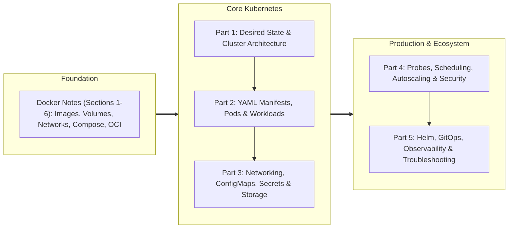
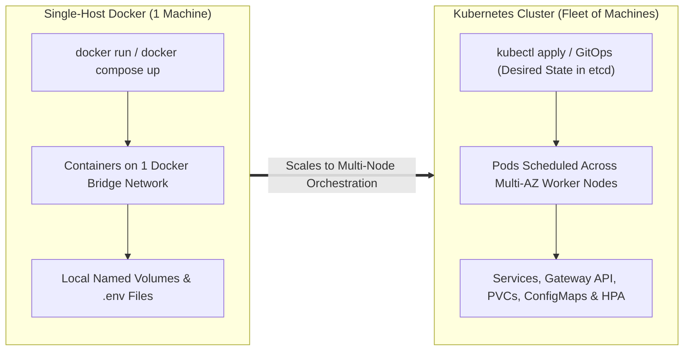

[back to previous page](../README.md)
---

# The Complete Kubernetes Ecosystem Explained (Comprehensive Study Notes)

> A complete, end-to-end guide to **Kubernetes & Cloud-Native Container Orchestration**—bridging directly from single-host [Docker & Container Internals](../Docker/dockercontent.md) to production-grade multi-node clusters, networking, autoscaling, security, observability, and troubleshooting.

---

## Navigation & Study Roadmap

| Part | File | Topics Covered |
| :--- | :--- | :--- |
| **Prerequisite** | [Docker Notes (Sections 1–6)](../Docker/dockercontent.md) | Linux Namespaces & cgroups, Docker CLI, Dockerfiles, Multi-stage Builds, Volumes, Docker Networking, Compose V2, OCI/`containerd`/CRI bridge |
| **Part 1** | [01: Foundations, Desired State & Cluster Architecture](./01-foundations-and-architecture.md) | Single-container vs multi-node scale, The Ticket Website Surge Story, Declarative Desired State & Reconciliation Control Loop, Control Plane (`API Server`, `etcd`, `Scheduler`, `Controller Manager`, `Cloud Controller Manager`) & Worker Nodes (`Kubelet`, `kube-proxy`/eBPF, `containerd`/CRI) |
| **Part 2** | [02: Manifests, Workloads & Pod Lifecycle](./02-workloads-and-lifecycle.md) | Declarative YAML Manifests (`kubectl apply`, `@sha256` digests), Manifest-to-Pod execution flow, Pods (Sidecars, Init Containers, Ephemeral Debug Containers), `Deployment → ReplicaSet → Pod`, Rolling Updates (`maxSurge`/`maxUnavailable`) & Rollbacks, Graceful Shutdown (`SIGTERM`, `preStop` hook, PID 1 gotcha, `SIGKILL`), `DaemonSet`, `Job`, `CronJob`, `StatefulSet` |
| **Part 3** | [03: Networking, Configuration & Persistent Storage](./03-networking-config-and-storage.md) | Dynamic Pod IPs, Service Types (`ClusterIP`, `NodePort`, `LoadBalancer`, `ExternalName`, Headless), CoreDNS, `kube-proxy` vs eBPF (Cilium), Ingress vs Gateway API (2026 Ingress NGINX retirement), Network Policies & CNI enforcement, `ConfigMap`, `Secret` (Base64 caveat, Encryption at Rest, External Secrets), Storage (`emptyDir`, `PV`, `PVC`, `StorageClass`, Access Modes, Reclaim Policies, CSI) |
| **Part 4** | [04: Production Readiness, Scheduling, Autoscaling & Security](./04-production-reliability-scaling-and-security.md) | Load Testing, Resource `requests` vs `limits` (CPU throttling vs OOMKill Exit 137), QoS Classes (`Guaranteed`, `Burstable`, `BestEffort`), Probes (`Startup`, `Liveness`, `Readiness` + anti-patterns), Advanced Scheduling (Affinity/Anti-Affinity, Taints/Tolerations, Topology Spread Constraints, PriorityClasses), Pod Disruption Budgets (PDB), Autoscaling (Pre-scaling, HPA, KEDA, VPA, Cluster Autoscaler & Karpenter), Cluster Security (RBAC, Namespaces, `ResourceQuota`/`LimitRange`, ServiceAccounts, Pod Security Standards, `securityContext`, Kyverno/OPA Gatekeeper, Supply Chain Security) |
| **Part 5** | [05: Cloud-Native Ecosystem, Troubleshooting & Production Ops](./05-ecosystem-troubleshooting-and-production.md) | Helm vs Kustomize, GitOps (Argo CD & Flux), CRDs & Operators, Observability Three Pillars (Prometheus, Grafana, Loki/EFK, OpenTelemetry Tracing), Service Mesh (Istio/Linkerd & retry storms), Pod States & Exit Codes Forensics Table, Step-by-step `kubectl` Troubleshooting Playbook & Cheatsheet, Managed K8s (EKS/AKS/GKE) vs Local (`Minikube`/`Kind`/`k3d`), Upgrade Lifecycle, When NOT to Use Kubernetes, End-to-End Ticket Website Recap |

---

## The Docker-to-Kubernetes Mental Model (Rosetta Stone)

If you already know [Docker](../Docker/dockercontent.md), use this mapping to immediately anchor every Kubernetes concept to what you already understand:

| Single-Host Docker Concept | Kubernetes Cluster Equivalent | Why the Shift Matters at Scale |
| :--- | :--- | :--- |
| `docker run` (imperative) | `kubectl apply -f manifest.yaml` (declarative) | You declare the **desired state** in Git; controllers reconcile drift continuously. |
| Single Container | **Pod** (1+ tightly coupled containers sharing IP, netns & volumes) | Enables sidecar patterns (logging, proxies) and atomic co-scheduling. |
| `docker-compose.yml` `services:` | **Deployment** + **Service** manifests | Scales replicas across *multiple machines* and self-heals on node death. |
| `docker run -p 8080:80` | **Service** (`ClusterIP`/`NodePort`/`LoadBalancer`) + **Gateway API / Ingress** | Decouples dynamic, ephemeral Pod IPs from stable DNS names and external HTTP routing. |
| User-defined Docker Bridge DNS | **CoreDNS** + **CNI Plugin** (Calico/Cilium) + **NetworkPolicy** | Flat routable Pod networking across all nodes with zero-trust L3/L4 firewalling. |
| Docker Named Volume (`-v`) | **PersistentVolumeClaim (PVC)** + **PersistentVolume (PV)** + **StorageClass** | Dynamically provisions durable cloud/network block or file storage across nodes. |
| Docker `tmpfs` / scratch layer | **`emptyDir`** volume | Ephemeral storage shared among containers inside the same Pod; dies with the Pod. |
| `.env` files / `-e VAR=val` | **ConfigMap** (non-sensitive) & **Secret** / External Secrets Manager | Keeps container images 100% immutable across `dev`, `staging`, and `prod`. |
| `docker stop` (10s `SIGTERM` → `SIGKILL`) | `terminationGracePeriodSeconds` (default 30s) + **`preStop` hook** | Zero-downtime draining while load balancers remove the Pod's endpoint. |
| `docker build` (OCI Image) | `containerd` / `CRI-O` pulling OCI image (pinned with `@sha256:...`) | Same OCI image format; K8s talks directly to `containerd` via CRI (no `dockerd` needed). |
| `docker exec -it <id> sh` | `kubectl exec -it <pod> -- sh` (or `kubectl debug` for distroless) | Interactive debugging inside running workloads on any node in the cluster. |
| `docker logs -f <id>` | `kubectl logs -f <pod>` (`--previous` for crashed containers) + Loki/EFK | Centralized log shipping is mandatory because Pod logs vanish when Pods are deleted. |
